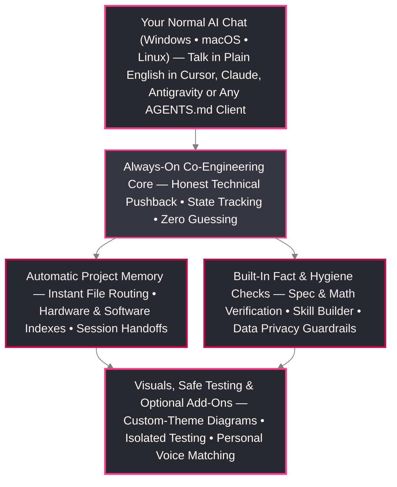

# 🧬 Homunculus (`v1.0.0`)

**The Drop-In Upgrade for AI Coding & Engineering Assistants — Automatic Project Memory, Fact-Checking, Skill Hygiene & Session Continuity**

[**🚀 Quick-Start Guide**](docs/Quick_Start_and_Setup_Guide.md) • [**🧠 Capabilities Overview**](docs/Capabilities_and_Architecture_Guide.md) • [**🗂️ Project Memory Guide**](docs/Memory_Setup_README.md) • [**📟 Prompts & Command Deck**](docs/Commands_and_Prompts_Reference.md) • [**🛡️ Data Safety**](docs/Developer_Data_Safety_Guidelines.md) • [**❓ Buyer & User FAQ**](docs/FAQ.md)

---

> [!TIP]
> **Works Automatically Behind the Scenes — Just Chat Normally**
> You do **not** need to memorize terminal commands or change how you talk to your AI. Drop the `Homunculus` folder into your workspace, point your AI assistant to `HOMUNCULUS_START_HERE.md`, and work in plain English. Homunculus runs automatically in the background across **Windows, macOS, and Linux**—keeping your project memory organized, checking facts and math against your actual files, and saving your stopping point between sessions.

---

## 🧪 Why Stock AI Setups Struggle on Real Projects

Out of the box, modern AI chat and coding tools are tuned to be **polite and agreeable**, not rigorous. That works fine for a quick one-off script, but when you build a real software, firmware, or hardware project over days and weeks, stock AI setups hit five frustrating walls:

1. **Blind Agreement at Step 1**: Instead of warning you when an idea or plan has a hidden flaw, stock AI says *"Great idea!"* and builds a mountain of code on top of a broken foundation—forcing hours of rework later.
2. **Making Up Missing Details**: When a measurement, part number, voltage, or config setting isn't written down yet, stock AI quietly guesses a "typical" number or writes vague instructions that hide the missing detail until your build fails.
3. **Forgetting Everything Between Sessions**: Take a week off from a project and your AI forgets what was already solved, what is still waiting on parts or decisions, and whether any files changed while you were away.
4. **Slow, Repetitive Searching**: Every new chat session starts with the AI blindly searching through folders over and over, burning time and context limits before doing real work.
5. **Mixing Up Rough Notes & Client Projects**: Without clear boundaries, stock AI can treat a rough brainstorm note as a finished specification, mix up details between two different projects, or accidentally read private `.env` keys into a chat log.

**Homunculus** fixes these problems automatically, guided by a simple 4-part priority order on every task:

$$\mathbf{1.\ Accuracy\ \&\ Truth \succ 2.\ Efficiency \succ 3.\ Data\ Safety \succ 4.\ Speed}$$

---

## ⚡ Stock AI Config vs. Homunculus (`At a Glance`)

| Everyday Scenario | Stock Chat / API / IDE Setup | With Homunculus (`v1.0.0`) |
| :--- | :--- | :--- |
| **Flawed Premise or Hidden Design Conflict** | Agrees politely and writes code that breaks existing features. | Flags the conflict upfront, protects what is already working, and proposes a clean path forward. |
| **Missing or Conflicting Specs** | Invents plausible-sounding numbers or glosses over missing details. | Marks missing or conflicting items clearly as **`[TBD]`** or **`[CONFLICT]`** so nothing slips through unnoticed. |
| **Checking Numbers, Units & File References** | Relies on the AI "proofreading itself." | Automatically cross-checks numbers, unit math, and file references against your real project files. |
| **Returning After Days or Weeks Away** | Loses context or forces you to scroll through a massive chat log. | Saves a clean **Session Handoff** summary of where you stopped and checks if any project files changed while you were gone. |
| **Starting a New Chat Session** | Wastes turns searching folders to figure out where files live. | Knows your project map immediately on Turn 1 so work starts right away. |
| **Rough Brainstorm Notes vs. Final Specs** | Confuses early scratch notes with verified production specs. | Keeps rough ideas in a dedicated **Quarantine** area until you confirm they are ready for production. |
| **Creating Custom AI Workflows** | Custom rules pile up into slow, overlapping instructions. | Built-in **Skill Architect** checks for overlap before creating new skills and cleans up bloat only with your permission. |
| **OS & Work Laptop Compatibility** | Often requires admin rights, package managers, or specific OS tools. | **Zero-Install Drop-In** across **Windows, macOS, and Linux**—no admin rights, no external packages, and no lock-in. |

---

### 🔍 Real-World Examples: How It Feels in Practice

#### Example 1: Pausing a Project on Thursday and Picking Up Two Weeks Later
- **Without Homunculus**: You come back after two weeks and spend 30 minutes reminding the AI what works, what is still broken, and what you wanted to tackle next—without realizing a teammate edited two config files over the weekend.
- **With Homunculus**: Before you log off, you simply say: *"Save our stopping point for next time."* Homunculus records a rich summary of where development stopped and your next discussion points. When you return two weeks later and say *"Pick up where we left off,"* Homunculus immediately spots the weekend file edits, briefs you on the exact changes, and puts your next steps right back on screen.

#### Example 2: Writing Documentation or Assembly Guides Without Made-Up Numbers
- **Without Homunculus**: You ask the AI to write a setup guide or bill of materials. It fills in missing screw lengths or server port counts from guesswork, and pulls a number from an old scratchpad note you never verified.
- **With Homunculus**: Rough scratchpad notes are automatically kept out of final documentation. Every measurement, count, and formula is checked against your real project files, and any spec you haven't finalized yet is clearly tagged as `[TBD]` so you can fill it in with confidence.

---

## 🏗️ How Homunculus Works (And What's Included)

> [!NOTE]
> **About Our Color Scheme (`Customizable to Your Brand`)**
> This GitHub manual uses the **Alchemical-3D** brand colors (`#FF3985` Neon Pink, `#C90448` Crimson & `#1E1E24` Dark Slate) simply because Homunculus is an Alchemical-3D product. Homunculus itself is completely portable—it ships with neutral dark/light themes and lets you prompt your own custom color palettes anytime (see the [Community Extension SDK](templates/community_sdk/README.md)).

### Included Capabilities at a Glance

1. **Co-Engineering Partner Rules**: Replaces "yes-man" AI replies with genuine co-engineering—checking foundations before writing code and keeping a live checklist of solved vs. open items so fixing a new bug never breaks an old one.
2. **Dual-Mode Project Memory & Session Continuity**: Works out of the box with standard Markdown folders (or optionally with **Obsidian** if you use it). Automatically maps your software and hardware files, isolates unverified brainstorm notes in a **Quarantine** zone, and saves rich **Session Handoffs** so you never lose context between sessions.
3. **Automatic Fact, Math & Reference Checking**: Verifies that numbers, unit calculations, part counts, and file citations in your docs and specs actually match your project files—flagging gaps instead of inventing details.
4. **Skill Architect & Hygiene Manager**: Helps you build new custom AI skills without creating duplicates, and audits existing skills to trim wasted context only when you approve.
5. **Parallel Subagent & Safe Sandbox Support**: Coordinates multi-file research efficiently (with simple `[lite]`, `[fast]`, and `[deep]` prompt tags) and tests changes in an isolated sandbox before applying them to your live project.
6. **Data Privacy & Multi-Project Firewalls**: Protects `.env` secrets and credentials from being read into chat logs and keeps separate client or public/private projects strictly isolated.
7. **Diagram Studio, Doc Polisher & Optional Side-Loaded Add-Ons**: Generates clean `.svg` and `300 DPI .png` technical diagrams in your choice of color palette, checks repository links and formatting, and includes optional side-loaded add-ons (`addons/author-voice-cadence/` for personal writing voice matching and `addons/gmail-workspace-assistant/` for multi-account Gmail MCP triage and draft staging).
8. **On-the-Fly Engineering & Technical Learning (`teach-me` / `Brief+`)**: Generates source-verified first-principles `Brief+` lessons inside the non-consumed `study_briefs/` folder via a throw-away subagent and returns a compact Datasheet Card to chat without cluttering your active context window.

---

## 📚 Complete User Manual & Documentation Index

This GitHub repository is the complete online manual for Homunculus. Browse the pages below in order or jump straight to the topic you need:

| Manual Page | What You Will Find |
| :--- | :--- |
| **[1. Quick-Start & Setup Guide](docs/Quick_Start_and_Setup_Guide.md)** | **Start Here**: 60-second Zero-Install Drop-In setup across **Windows, macOS, and Linux**, supported AI clients (`Cursor`, `Claude Code`, `Claude Cowork`, `Antigravity`, `AGENTS.md`), and your first 15 minutes with Homunculus. |
| **[2. Capabilities Overview](docs/Capabilities_and_Architecture_Guide.md)** | A clear, approachable tour of the tools included in Homunculus—how they work automatically behind the scenes and what problems they solve. |
| **[3. Prompts, Commands & Arguments Deck](docs/Commands_and_Prompts_Reference.md)** | Copy-pasteable **Plain-English Chat Prompts** for everyday use, plus the complete reference table of terminal commands and arguments for power users. |
| **[4. Project Memory & Session Handoff Guide](docs/Memory_Setup_README.md)** | How to organize single or multi-project workspaces, switch between standard Markdown and Obsidian, use Quarantine notes, and pick up projects after long breaks. |
| **[5. Data Safety & Privacy Guide](docs/Developer_Data_Safety_Guidelines.md)** | How Homunculus keeps credentials out of AI chat logs and prevents accidental cross-project or personal path leaks before you commit code. |
| **[6. Buyer & User FAQ](docs/FAQ.md)** | Straight answers to common questions before and after buying: ease of use, OS & work-laptop support, custom colors, commercial licensing, and Discord support. |
| **[7. Community Extension SDK (`MIT`)](templates/community_sdk/README.md)** | Starter templates for creating your own custom Drop-In Add-Ons and brand color palettes. |
| **[8. Discord Store & Support Guide](docs/Discord_Store_Release_Guide.md)** | How purchasing on the Discord Store unlocks your download and private Discord support channels, plus how to use the GitHub Issue Tracker. |

---

## 🛒 How to Get Homunculus & Unlock Discord Support

Homunculus is delivered as a **100% readable, locally customizable source package** (`Model C` Hybrid License — see [`LICENSE.md`](LICENSE.md)) with full commercial and employer usage rights and zero recurring subscriptions or cloud lock-in:

1. **Purchase & Download via the Alchemical-3D Discord Store**:
   - Join the official [**Alchemical-3D Discord**](https://discord.gg/aE49DW2xXe) and visit the **Discord Store** to get the **Homunculus Core Archive (`Homunculus-v1.0.0.zip`)**.
2. **Automatic Discord Buyer Role Unlock**:
   - Purchasing through Discord automatically unlocks your **Homunculus Buyer Role**, giving you direct access to private **Support (`#homunculus-support`)**, **Releases (`#homunculus-releases`)**, and **Development (`#homunculus-dev`)** channels.
3. **Public GitHub Manual & Issue Tracker**:
   - Use this GitHub repository anytime as your online user manual and open tickets in the [**GitHub Issue Tracker**](https://github.com/Alchemical-3D/Homunculus/issues) for bug reports, documentation questions, or feature requests.

---

## 💬 Community Feedback, Feature Requests & Issue Tracking

Homunculus is actively shaped by real-world engineering workflows, and **we want your feedback!** Whether you have a suggestion for a new workflow, feedback on how a tool behaved in your editor, a documentation improvement, or a bug report, you have two direct ways to share it:

- **💬 In the [Alchemical-3D Discord](https://discord.gg/aE49DW2xXe)**: Jump into our community channels—or use the buyer-unlocked **`#homunculus-support`** and **`#homunculus-dev`** channels—to share feedback, discuss ideas, and chat directly with us.
- **🐛 On GitHub via the [Issue Tracker](https://github.com/Alchemical-3D/Homunculus/issues)**: Open an issue anytime on this repository to submit structured bug reports, feature requests, client adapter suggestions, or manual feedback.

---

## 🤝 Workspace Deployment Consulting & Team Workshops

Need hands-on help tailoring and rolling out Homunculus for your workflow or organization? We offer dedicated **1-on-1 setup consulting, custom workspace & skill engineering, and live workshops** for teams and larger entities—including:
- **Turnkey Workspace & Multi-Project Setup**: Configuring custom project memory structures, client/compartment privacy rules, and native AI editor integrations across your team's machines.
- **Custom Domain Skill & Template Engineering**: Building tailored verification rules, recurring deliverable templates, and brand diagram palettes around your organization's standards.
- **Interactive Team & Enterprise Workshops**: Live guided sessions teaching your engineers, developers, or technical writers how to get verified, zero-rework results from AI co-engineering.

> 🤝 **Book Consulting or a Team Workshop**
>
> Reach out to us directly at **[we@alchemical3d.net](mailto:we@alchemical3d.net)** or open a conversation in the **[Alchemical-3D Discord](https://discord.gg/aE49DW2xXe)** (`https://alchemical3d.net`).

***

> ☕ **Want to Support Alchemical-3D Above & Beyond?**
>
> If you feel like supporting Alchemical-3D and the ongoing development of our tools and open ecosystem above and beyond your purchase copy, feel free to [visit our Ko-fi](https://ko-fi.com/alchemical3d)!
>
> 

***
*Documentation prepared with AI editorial assistance • Engineered & maintained by [Alchemical-3D](https://github.com/Alchemical-3D).*
