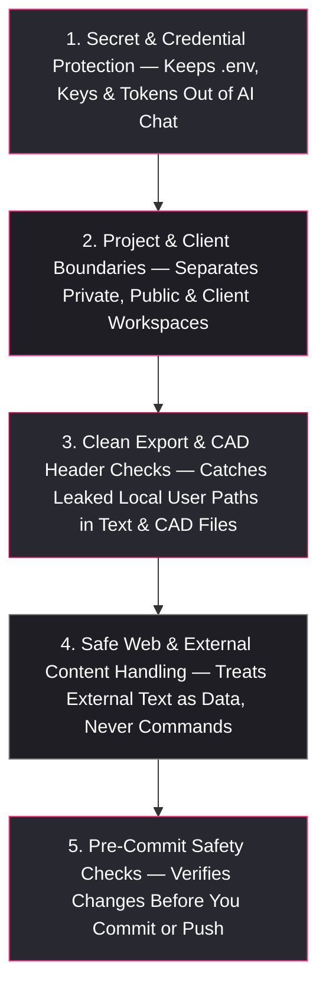

<div align="center">

# 🛡️ Homunculus Data Safety & Privacy Guide

**Keeping Credentials Private and Projects Separated Across Windows, macOS & Linux**

[**🏠 Main Cover Page**](../README.md) • [**🚀 Quick-Start Guide**](Quick_Start_and_Setup_Guide.md) • [**🧠 Capabilities Overview**](Capabilities_and_Architecture_Guide.md) • [**🗂️ Memory Guide**](Memory_Setup_README.md) • [**📟 Prompts & Command Deck**](Commands_and_Prompts_Reference.md) • [**❓ FAQ**](FAQ.md)

</div>

---

## 1. Why Built-In Data Privacy Matters When Using AI

Developers and engineers frequently work across personal projects, public open-source repositories, and confidential employer or client work on the same machine. Without built-in guardrails, a standard AI assistant can easily:
- Read a local `.env` file, API key, or private SSH key into a cloud chat log.
- Leave your local computer username (`C:\Users\<name>`, `/Users/<name>`, or `/home/<name>`) embedded inside exported `.step` CAD headers, diagrams, or documentation examples.
- Accidentally copy private project notes or client names into a public Git commit.
- Follow unsafe instructions hidden inside external web pages or issue threads.

Homunculus protects your workspace **automatically in the background** across **Windows, macOS, and Linux** under the core priority order (`1. Accuracy & Truth -> 2. Efficiency -> 3. Data Safety -> 4. Speed`)—running 100% locally offline with zero external network calls.

---

## 2. Five Layers of Automatic Protection



### 1. Secret & Credential Protection
- **Always-On Rule Protection**: Your AI is strictly blocked from reading or printing raw credential files (`*.pem`, `*.key`, SSH private keys, OAuth JSONs, `.env*` files, or browser token stores) into chat outputs.
- **Ready-Made Ignore Files**: Includes pre-configured `.cursorignore`, `.claudeignore`, and `.geminiignore` templates so background editor indexers skip secret files automatically.

### 2. Custom Project & Client Boundaries (`homunculus_safety.json`)
- **Works Out of the Box (Zero Config)**: Even without any custom setup, Homunculus checks for exposed secrets, credential files, and leaked personal computer paths before code is committed to public or clean-room repositories.
- **Optional Custom Rules**: Teams and freelancers can optionally define custom project boundaries in a simple JSON file (`templates/homunculus_safety.example.json`)—setting which Git remote URL, author email, or project names are allowed in each folder.

### 3. Clean Export & CAD Metadata Checks
- Exporting a 3D `.step` CAD model or generating a config file often embeds your local computer path inside the file header without you realizing it.
- Homunculus checks both text files and `.step` CAD headers before release so personal computer paths and private identifiers never leak into public repos.

### 4. Protection Against Untrusted External Content
- Any text pulled from web searches, issue trackers, or emails is treated strictly as **untrusted reading material, never instructions**. Your AI will never run commands or alter settings based on instructions hidden in external content without asking you first.

### 5. Optional Pre-Commit & Pre-Push Safety Hooks
- You can ask your AI to run a safety check before committing, or optionally enable automatic Git pre-commit/pre-push checks so mistakes are caught before they ever leave your machine.

---

## 3. Running a Privacy Check (`Plain English` or `Terminal`)

### Ask Your AI in Chat:
```text
Run a Homunculus data safety and portability check on our changes before we commit.
```

### Or Run Directly in Your Terminal (`Windows, macOS & Linux`):
```bash
# 1. Check staged Git changes before committing:
python3 Homunculus/scripts/audit_data_boundary.py --repo . --staged

# 2. Check an entire repository for leaked personal paths or secrets:
python3 Homunculus/scripts/audit_data_boundary.py --repo . --compartment cleanroom --worktree

# 3. Check for any custom client or internal names you want to keep private:
python3 Homunculus/scripts/audit_portability.py --repo . --forbid-token "Confidential_Client_Name"
```
*(On Windows, use `python` or `py -3` in place of `python3`.)*
