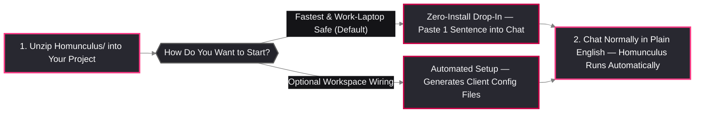

<div align="center">

# 🚀 Homunculus Quick-Start & Setup Guide

**Up and Running in Under 60 Seconds Across Windows, macOS & Linux**

[**🏠 Main Cover Page**](../README.md) • [**🧠 Capabilities Overview**](Capabilities_and_Architecture_Guide.md) • [**🗂️ Memory Guide**](Memory_Setup_README.md) • [**📟 Prompts & Command Deck**](Commands_and_Prompts_Reference.md) • [**🛡️ Data Safety**](Developer_Data_Safety_Guidelines.md) • [**❓ FAQ**](FAQ.md)

</div>

---

## 1. Getting Homunculus & Unlocking Discord Support

1. **Download via the Alchemical-3D Discord Store**:
   Purchase and download the **Homunculus Core Archive (`Homunculus-v1.0.0.zip`)** from the official [Alchemical-3D Discord](https://discord.gg/aE49DW2xXe) store.
2. **Automatic Discord Buyer Role Unlock**:
   Your Discord purchase automatically assigns your account the **Homunculus Buyer Role**, unlocking private access to:
   - **`#homunculus-support`**: Direct setup help, workflow advice, and troubleshooting.
   - **`#homunculus-releases`** & **`#homunculus-dev`**: Release downloads, updates, and community blueprints.
3. **Share Feedback & Report Issues (`Discord` or `GitHub Issue Tracker`)**:
   We actively welcome your feedback, workflow ideas, and bug reports! Share your thoughts directly in the [Alchemical-3D Discord](https://discord.gg/aE49DW2xXe) (`#homunculus-support` / `#homunculus-dev`) or open a ticket anytime in the [**GitHub Issue Tracker**](https://github.com/Alchemical-3D/Homunculus/issues).
4. **Optional Consulting & Team Workshops**:
   Want hands-on help deploying Homunculus across your workspace or hosting a live workshop for your organization? Reach out at [we@alchemical3d.net](mailto:we@alchemical3d.net) or connect in the [Alchemical-3D Discord](https://discord.gg/aE49DW2xXe).

---

## 2. Two Easy Ways to Set Up (`Zero-Install Drop-In` vs. `Optional Installer`)

Homunculus works out of the box across **Windows, macOS, and Linux** with **zero external packages to install**. Once pointed at your project, it runs automatically behind the scenes while you chat with your AI in plain English.



### Option A (Default & Recommended): Zero-Install "Drop-In & Point"
Ideal for getting started in 30 seconds—and works even on locked-down corporate laptops where Administrator/`sudo` rights or package installers are restricted:

1. **Unzip**: Extract the `Homunculus/` folder into your project workspace.
2. **Tell Your AI Assistant**: Open your AI chat and paste this single sentence:
   ```text
   Read Homunculus/HOMUNCULUS_START_HERE.md and operate under Homunculus rules and skills for this project.
   ```
3. **Start Working Normally**: That's it! Your AI assistant immediately loads the core co-engineering rules and invokes Homunculus tools automatically whenever your task calls for them.

---

### Option B (Optional): Automated Workspace & Client Config Setup
If you want Homunculus to automatically generate native startup files for your favorite AI tool (`AGENTS.md`, `CLAUDE.md`, `.cursor/rules/`, `.agents/rules/`) and optional Git safety hooks:

**Windows (`PowerShell`):**
```powershell
# 1. Check readiness:
powershell -ExecutionPolicy Bypass -File .\Homunculus\install.ps1 -Check

# 2. Preview setup without changing any files (Dry-Run):
powershell -ExecutionPolicy Bypass -File .\Homunculus\install.ps1 -Workspace C:\path\to\your_project -MemoryMode headless -DryRun

# 3. Generate client config files in your project folder (no Admin rights required):
powershell -ExecutionPolicy Bypass -File .\Homunculus\install.ps1 -Workspace C:\path\to\your_project -Client all -MemoryMode headless
```

**macOS & Linux (`Terminal`):**
```bash
# 1. Check readiness:
bash Homunculus/install.sh --check

# 2. Preview setup without changing any files (Dry-Run):
bash Homunculus/install.sh --workspace /path/to/your_project --memory-mode headless --dry-run

# 3. Generate client config files and optional Git safety hooks:
bash Homunculus/install.sh --workspace /path/to/your_project --client all --memory-mode headless --prefer-copy --install-git-hooks
```

---

## 3. Supported AI Clients & Editors

Homunculus works across all major AI coding and technical writing assistants on Windows, macOS, and Linux:

| AI Assistant / Editor | Zero-Install Drop-In (Default) | Optional Auto-Generated Config |
| :--- | :--- | :--- |
| **Cursor IDE** | Reference `@HOMUNCULUS_START_HERE.md` in Chat/Composer. | Generates `.cursor/rules/*.mdc` and `.cursorignore` (`--client cursor`). |
| **Claude Code (CLI)** | Paste: `"Read Homunculus/HOMUNCULUS_START_HERE.md..."` | Generates root `CLAUDE.md` and `.claudeignore` (`--client claude-code`). |
| **Claude Cowork (Desktop)** | Select your project folder containing `Homunculus/` and point Claude to `HOMUNCULUS_START_HERE.md`. | Generates ready-to-use skill bundles (`--client claude-cowork`). |
| **Antigravity / Gemini CLI** | Paste: `"Read Homunculus/HOMUNCULUS_START_HERE.md..."` | Generates `.agents/rules/`, `.agents/skills/`, and `.geminiignore` (`--client antigravity`). |
| **Windsurf / Cline / Aider / Codex** | Point the assistant to `Homunculus/HOMUNCULUS_START_HERE.md`. | Generates a universal root `AGENTS.md` (`--client agents-md`). |

---

## 4. Your First 15 Minutes with Homunculus (Plain-English Walkthrough)

You don't need to run terminal scripts to use Homunculus—just ask your AI assistant in plain English:

### Step 1: Set Up Project Memory for Your Workspace
Ask your AI assistant in chat:
```text
Set up Homunculus project memory for this repository so we can track our files, specs, and progress.
```
- **What Happens Automatically**: Your AI creates a clean `memory/` folder for your project with an automatic map of your files, a dedicated **Quarantine** area for rough brainstorm ideas, and a **Session Handoff** section—all in standard Markdown files you can view anywhere.

### Step 2: Build, Code, or Draft Docs with Automatic Fact-Checking
Work on your project normally, or ask:
```text
Review our README and assembly notes against our project files and flag any missing or mismatched specs.
```
- **What Happens Automatically**: Homunculus checks every number, measurement, unit calculation, and file reference against your real project files—clearly marking anything undecided as `[TBD]` instead of making up details.

### Step 3: Save Your Stopping Point Before Taking a Break
When you wrap up for the day, simply tell your AI:
```text
Save our current stopping point and next-session discussion points to project memory so we can pick up tomorrow.
```
- **What Happens Automatically**: Homunculus saves a rich summary of where you stopped and what to tackle next. When you return days or weeks later and say *"Kickstart our project from memory,"* it loads your exact context and warns you if any files changed on disk while you were away.

### Step 4: Customize Colors, Learn On the Fly, or Activate Side-Loaded Add-Ons
- **Your Own Brand Colors**: Ask your AI to render diagrams using your own hex color palette (see the [Community Extension SDK](../templates/community_sdk/README.md)).
- **On-the-Fly Engineering Learning (`teach-me` / `Brief+`)**: Invoke `/teach-me about '<Subject X>' impact on '<Subject Y>'` to generate a source-verified `Brief+` in `study_briefs/` and receive a compact Datasheet Card in chat without cluttering your active window.
- **Optional Side-Loaded Add-Ons (`addons/`)**: Drop writing samples into `corpus_inbox/` and activate `addons/author-voice-cadence/` to match your personal writing style, or activate `addons/gmail-workspace-assistant/` for multi-account Gmail MCP triage and draft staging.

---

<div align="center">

**Next Step:** Explore the [**🧠 Capabilities Overview**](Capabilities_and_Architecture_Guide.md) or browse ready-to-use prompts in the [**📟 Prompts & Command Deck**](Commands_and_Prompts_Reference.md).

</div>

***

> ☕ **Want to Support Alchemical-3D Above & Beyond?**
>
> If you feel like supporting Alchemical-3D and the ongoing development of our tools and open ecosystem above and beyond your purchase copy, feel free to [visit our Ko-fi](https://ko-fi.com/alchemical3d)!
>
> [](https://ko-fi.com/alchemical3d)
