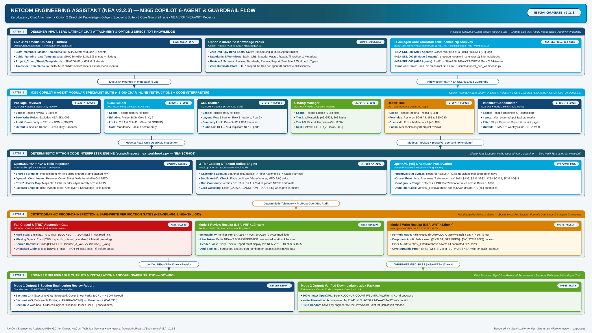

# 🏢 NetCom Engineering Assistant (`NEA v2.2.3`) — M365 Copilot & Guardrail Execution Flowchart

> [!IMPORTANT]
> **Strict Entity Separation**: **NetCom (`netcom1989.com`)** is an independent corporate entity and has **no relationship** with **Alchemical-3D**. Rendered using the Vault's `NetCom_Corporate_Color_Template` palette.

Operational multi-layer execution flowchart for [`NetCom_Engineering_Assistant`](../Projects/NetCom_Engineering_Assistant/NetCom_Engineering_Assistant.md) (`NEA v2.2.3`), illustrating how **Direct Chat `.xlsx` / `.pdf` / Image Uploads (`+ Upload from device`)**, **Option 2 Direct `.txt` Knowledge Packs**, the **`3` Packaged Core Guardrail `<skill-name>.zip` Archives (`NEA-SKL-001`..`003` with Bundled `scripts/inspect_nea_workbooks.py`)**, the **6-Agent M365 Copilot Specialist Suite & Directional Cross-Duty Informer**, the **Code Interpreter OpenXML Engine (`inspect_nea_workbooks.py`)**, and **Cryptographic `NEA-VRF` / `NEA-WRT` Receipts** operate together during live engineering review, workbook build, template repair, and multi-media timesheet consolidation sessions.

- **Connected Hubs:** [`README.md`](../README.md) • [`NetCom_Engineering_Assistant`](../Projects/NetCom_Engineering_Assistant/NetCom_Engineering_Assistant.md) • [`NetCom_Tasks`](../Tasks/NetCom_Tasks.md) • `NetCom_Corporate_Color_Template` • [`NetCom_Engineering_Assistant_Lessons_Learned`](../Projects/NetCom_Engineering_Assistant/NetCom_Engineering_Assistant_Lessons_Learned.md)



---

## 🔄 Single-Command Re-Render (Strict Layout Gate, NetCom Corporate Palette)

```bash
python3 /home/orin/.gemini/config/skills/visual-studio/scripts/render_diagram.py \
  --spec /home/orin/Projects/Engineering/memory/Diagrams/NEA_v2_Copilot_Execution_Flowchart.md \
  --palette netcom_corporate \
  --out-dir /home/orin/Projects/Engineering/memory/Diagrams \
  --basename NEA_v2_Copilot_Execution_Flowchart \
  --strict
```

---

## 📐 Declarative Diagram Specification

```json diagram_spec
{
  "archetype": "layered_architecture",
  "title": "NETCOM ENGINEERING ASSISTANT (NEA v2.2.3) — M365 COPILOT 6-AGENT & GUARDRAIL FLOW",
  "subtitle": "Zero-Latency Chat Attachment • Option 2 Direct .txt Knowledge • 6-Agent Specialist Suite • 3 Core Guardrail .zips • NEA-VRF / NEA-WRT Receipts",
  "badge": "NETCOM CORPORATE v2.2.3",
  "width": 2640,
  "band_gap": 60,
  "layers": [
    {
      "id": "layer_1",
      "badge": "LAYER 1",
      "title": "DESIGNER INPUT, ZERO-LATENCY CHAT ATTACHMENT & OPTION 2 DIRECT .TXT KNOWLEDGE",
      "right_note": "Bypasses OneDrive Graph Search Indexing Lag — Mounts Live .xlsx / .pdf / Image Bytes Directly in /mnt/data/",
      "style": "primary",
      "height": 206,
      "cards": [
        {
          "id": "c_xlsx",
          "title": "Live .xlsx / Media Upload (+ Button)",
          "subtitle": "Direct Chat Attachment -> /mnt/data/ (0 Graph Lag)",
          "badge": "LIVE MEDIA INPUT",
          "style": "primary",
          "weight": 1.05,
          "lines": [
            "• **BOM_Materials_Master_Template.xlsx**: SHA256=f47a9f3ad7 (6 sheets)",
            "• **Cable_Running_List_Template.xlsx**: SHA256=e6b4614fa2 (3 sheets + hidden)",
            "• **Project_Cover_Sheet_Template.xlsx**: SHA256=82caf65dc0 (1 sheet)",
            "• **Timesheet_Template.xlsx**: SHA256=1e61da1be0 (2 sheets + multi-media inputs)"
          ]
        },
        {
          "id": "c_know",
          "title": "Option 2 Direct .txt Knowledge Packs",
          "subtitle": "Copilot_Agents/<Agent_Slug>/Knowledge/*.txt",
          "badge": "GRAPH-INDEXABLE",
          "style": "tertiary",
          "weight": 1.0,
          "lines": [
            "• **Zero .md / .py Blind Spots**: Native .txt indexing in M365 Agent Builder",
            "• **Standards & Workflows**: BOM, CRL, Material Master, Repair, Timesheet & Metadata",
            "• **Review & Schema**: Review_Standards, Review_Report_Template & Workbook_Types",
            "• **Zero Duplicate Bloat**: 3 to 7 scoped .txt files per agent (0 duplicate skills/scripts)"
          ]
        },
        {
          "id": "c_skills",
          "title": "3 Packaged Core Guardrail <skill-name>.zip Archives",
          "subtitle": "Skills/<skill-name>/<skill-name>.zip (SKILL.md + scripts/inspect_nea_workbooks.py)",
          "badge": "NEA-SKL-001..003 CORE",
          "style": "secondary",
          "weight": 1.05,
          "lines": [
            "• **NEA-SKL-001 (All 6 Agents)**: Closed-World Lock & [TBD] / [CONFLICT] tags",
            "• **NEA-SKL-002 (5 Mode-2 Agents)**: preserve_openxml_extensions() & formula locks",
            "• **NEA-SKL-003 (All 6 Agents)**: Pre/Post SHA-256, NEA-VRF/WRT & Gate C Advisories",
            "• **Bundled Oracle**: Each .zip ships root SKILL.md + scripts/inspect_nea_workbooks.py"
          ]
        }
      ]
    },
    {
      "id": "layer_2",
      "badge": "LAYER 2",
      "title": "M365 COPILOT 6-AGENT MODULAR SPECIALIST SUITE (< 8,000-CHAR INLINE INSTRUCTIONS + CODE INTERPRETER)",
      "right_note": "Copilot_Agents/<Agent_Slug>/ UI Drop-In Folders + 3 Core Guardrail <skill-name>.zip Archives (Version 2.2.3)",
      "style": "secondary",
      "height": 212,
      "cards": [
        {
          "id": "c_agt_rev",
          "title": "Package Reviewer",
          "subtitle": "AGT-001 • Mode 1 Read-Only Review",
          "badge": "5,330 / 8,000c",
          "style": "primary",
          "weight": 1.0,
          "lines": [
            "• **Scope**: --scope review (5 .txt files)",
            "• **Zero Write Rules**: Excludes NEA-SKL-002",
            "• **Audit**: Cover parity + CRL <-> BOM + [3B] BX",
            "• **Output**: 6-Section Report + Cross-Duty Handoffs"
          ]
        },
        {
          "id": "c_agt_bom",
          "title": "BOM Builder",
          "subtitle": "AGT-002 • Mode 2 Project BOM Build",
          "badge": "3,820 / 8,000c",
          "style": "secondary",
          "weight": 1.0,
          "lines": [
            "• **Scope**: --scope bom (6 .txt files)",
            "• **Editable**: Project BOM Cols B, C, J",
            "• **Locks**: Col A & Cols D..I (3-tier XLOOKUP)",
            "• **Gate**: Mandatory --lookup before entry"
          ]
        },
        {
          "id": "c_agt_crl",
          "title": "CRL Builder",
          "subtitle": "AGT-003 • Mode 2 16-Col CRL Build",
          "badge": "3,342 / 8,000c",
          "style": "tertiary",
          "weight": 1.0,
          "lines": [
            "• **Scope**: --scope crl (6 .txt files)",
            "• **Layout**: Row 1 banner, Row 2 headers, Row 3+",
            "• **Summary Lock**: Protects B17:B38 formulas",
            "• **Audit**: Run ID 1..279 & duplicate NE/FE ports"
          ]
        },
        {
          "id": "c_agt_cat",
          "title": "Catalog Manager",
          "subtitle": "AGT-004 • Mode 2 Catalog Hygiene",
          "badge": "3,794 / 8,000c",
          "style": "pass",
          "weight": 1.0,
          "lines": [
            "• **Scope**: --scope catalog (7 .txt files)",
            "• **Tier 1**: tblMaterials (A3:G508, 505 keys)",
            "• **Tier 2/3**: Fiber & Harness (A3:H1258)",
            "• **Spill**: Lists!H1 FILTER(VSTACK, <>0)"
          ]
        },
        {
          "id": "c_agt_rep",
          "title": "Repair Tool",
          "subtitle": "AGT-005 • Mode 2 OpenXML Repair",
          "badge": "3,607 / 8,000c",
          "style": "warn",
          "weight": 1.0,
          "lines": [
            "• **Scope**: --scope repair & --repair (6 .txt)",
            "• **Formulas**: Restores BOM A8:I155 & B30:C30",
            "• **OpenXML**: Fixes tblMaterials & [4E] DVs",
            "• **Focus**: Mechanics only (0 project review)"
          ]
        },
        {
          "id": "c_agt_tsh",
          "title": "Timesheet Consolidator",
          "subtitle": "AGT-006 • Mode 2 Multi-Media Rollup",
          "badge": "6,206 / 8,000c",
          "style": "primary",
          "weight": 1.15,
          "lines": [
            "• **Scope**: --scope timesheet & --consolidate",
            "• **Inputs**: .xlsx, scanned .pdf & photo media",
            "• **Filter**: Strips Expense Report & receipt pages",
            "• **Output**: ECMA-376 weekly rollup + NEA-WRT"
          ]
        }
      ]
    },
    {
      "id": "layer_3",
      "badge": "LAYER 3",
      "title": "DETERMINISTIC PYTHON CODE INTERPRETER ENGINE (scripts/inspect_nea_workbooks.py — NEA-SCR-001)",
      "right_note": "Single-Turn Execution Inside Isolated Azure Container — Zero Multi-Turn LLM Arithmetic Drift",
      "style": "tertiary",
      "height": 206,
      "cards": [
        {
          "id": "c_eng_xml",
          "title": "OpenXML <f> + <v> & Role Inspector",
          "subtitle": "Pure-Stdlib zipfile + ElementTree Parser",
          "badge": "OPENXML KERNEL",
          "style": "primary",
          "weight": 1.0,
          "lines": [
            "• **Shared Formulas**: Inspects both <f> (including shared si) and cached <v>",
            "• **Dynamic Coordinates**: Resolves Cover Sheet fields by label in Col B/F/G",
            "• **Row 2 Header Map**: Maps all 16 CRL headers dynamically across A2:P2",
            "• **Fallback Snippet**: Inline Python kernel runs even if Knowledge .txt is absent"
          ]
        },
        {
          "id": "c_eng_cat",
          "title": "3-Tier Catalog & Takeoff Rollup Engine",
          "subtitle": "--lookup \"<term>\" & Cross-Workbook Audit",
          "badge": "3-TIER CATALOG",
          "style": "tertiary",
          "weight": 1.05,
          "lines": [
            "• **Cascading Lookup**: Searches tblMaterials -> Fiber Assemblies -> Cable Harness",
            "• **Duplicate Mfg Check**: Flags duplicate (Manufacturer, MFG P/N) pairs",
            "• **Run Continuity**: Verifies CRL Run IDs 1..279 & duplicate NE/FE endpoints",
            "• **Zero Guessing**: Emits [CATALOG ADDITION REQUIRED] when part is absent"
          ]
        },
        {
          "id": "c_eng_ext",
          "title": "OpenXML [4E] & <extLst> Preservation",
          "subtitle": "preserve_openxml_extensions(orig, saved)",
          "badge": "DROPDOWN LOCK",
          "style": "secondary",
          "weight": 1.05,
          "lines": [
            "• **openpyxl Bug Bypass**: Restores <extLst> (x14:dataValidations) stripped on save",
            "• **Cross-Sheet Lists**: Preserves 'Reference Lists'!$A$1:$A$3, $B$1:$B$2, $C$1:$C$12, $D$1:$D$11",
            "• **Contiguous Range**: Enforces 7 CRL DataValidation rules across Rows 3..1087",
            "• **AutoFilter Lock**: Verifies _FilterDatabase spans $A$2:$P$1087 (0 [4E] anomalies)"
          ]
        }
      ]
    },
    {
      "id": "layer_4",
      "badge": "LAYER 4",
      "title": "CRYPTOGRAPHIC PROOF-OF-INSPECTION & SAFE-WRITE VERIFICATION GATES (NEA-SKL-001 & NEA-SKL-003)",
      "right_note": "Mandatory Pre-Release Gates — Blocks Unbacked Literals, Formula Overwrites & Stripped Dropdowns",
      "style": "warn",
      "height": 196,
      "cards": [
        {
          "id": "c_gate_halt",
          "title": "Fail-Closed & [TBD] Abstention Gate",
          "subtitle": "NEA-SKL-001 Anti-Hallucination Enforcement",
          "badge": "FAIL-CLOSED",
          "style": "alert",
          "weight": 0.98,
          "lines": [
            "• **Hard Stop**: Emits [EXTRACTION BLOCKED — ABORTED] if .xlsx read fails",
            "• **Missing Specs**: Emits [TBD: <specific_missing_variable>] inline (0 guessing)",
            "• **Source Conflicts**: Emits [CONFLICT: <Source_A_val> vs <Source_B_val>]",
            "• **Unbacked Claims**: Tags [UNVERIFIED — NOT IN TELEMETRY] before output"
          ]
        },
        {
          "id": "c_gate_vrf",
          "title": "Mode 1 Review Receipt (NEA-VRF-<12hex>)",
          "subtitle": "Pre/Post SHA-256 Source Immutability Proof",
          "badge": "READ RECEIPT",
          "style": "pass",
          "weight": 1.02,
          "lines": [
            "• **Immutability**: Verifies Pre-SHA256 == Post-SHA256 (0 bytes modified)",
            "• **Live Token**: Emits NEA-VRF-31A37EEFB1DF over sorted workbook hashes",
            "• **Header Lock**: Every Review Report must display live NEA-VRF + 10-char SHA256",
            "• **Anti-Spoiler**: 0 hardcoded testbed part numbers or quantities in Knowledge/"
          ]
        },
        {
          "id": "c_gate_wrt",
          "title": "Mode 2 Write Receipt (NEA-WRT-<12hex>)",
          "subtitle": "--verify-write ORIG_XLSX EDITED_XLSX",
          "badge": "WRITE RECEIPT",
          "style": "warn",
          "weight": 1.05,
          "lines": [
            "• **Formula Audit**: Fails closed ([FORMULA_OVERWRITE]) if any <f> cell is lost",
            "• **Dropdown Audit**: Fails closed ([EXTLST_STRIPPED] / [DV_STRIPPED]) on loss",
            "• **Filter Audit**: Verifies _FilterDatabase covers all populated CRL rows",
            "• **Cryptographic Proof**: Emits [WRITE-VERIFIED: PASS | NEA-WRT-845DE5F8B55D]"
          ]
        }
      ]
    },
    {
      "id": "layer_5",
      "badge": "LAYER 5",
      "title": "ENGINEER DELIVERABLE OUTPUTS & INSTALLATION HANDOFF (\"PAPER TRUTH\" — GOV-005)",
      "right_note": "Final Engineer Sign-Off — Released Spreadsheets Serve as Field Installation Paper Truth",
      "style": "pass",
      "height": 186,
      "cards": [
        {
          "id": "c_out_rev",
          "title": "Mode 1 Output: 6-Section Engineering Review Report",
          "subtitle": "Standardized NEA-REF-003 Markdown Deliverable",
          "badge": "REVIEW REPORT",
          "style": "primary",
          "weight": 1.0,
          "lines": [
            "• **Sections 1–3**: Executive Gate Scorecard, Cover Sheet Parity & CRL <-> BOM Takeoff",
            "• **Sections 4–5**: Deliverable Findings (AR/RR/ADV/INF) vs. Governance (CAT/TPL)",
            "• **Section 6**: Workbook-Ordered Engineer Closeout Punch List (- [ ] checkboxes)"
          ]
        },
        {
          "id": "c_out_xlsx",
          "title": "Mode 2 Output: Verified Downloadable .xlsx Package",
          "subtitle": "Returned via Copilot Code Interpreter Download Link",
          "badge": "PAPER TRUTH",
          "style": "pass",
          "weight": 1.0,
          "lines": [
            "• **100% Intact OpenXML**: 3-tier XLOOKUP, COUNTIF/SUMIF, AutoFilter & x14 dropdowns",
            "• **Write Attestation**: Accompanied by Pre/Post SHA-256 & NEA-WRT-<12hex> receipt",
            "• **Field Handoff**: Saved by engineer to OneDrive/SharePoint for installation release"
          ]
        }
      ]
    }
  ],
  "connections": [
    {
      "from_layer": "layer_1",
      "to_layer": "layer_2",
      "x_ratio": 0.22,
      "label": "Live .xlsx Mounted in /mnt/data/ (0 Lag)",
      "style": "primary"
    },
    {
      "from_layer": "layer_1",
      "to_layer": "layer_2",
      "x_ratio": 0.78,
      "label": "Knowledge/*.txt + NEA-SKL-001..003 Guardrails",
      "style": "secondary"
    },
    {
      "from_layer": "layer_2",
      "to_layer": "layer_3",
      "x_ratio": 0.25,
      "label": "Mode 1: Read-Only OpenXML Inspection",
      "style": "primary"
    },
    {
      "from_layer": "layer_2",
      "to_layer": "layer_3",
      "x_ratio": 0.75,
      "label": "Mode 2: --lookup + preserve_openxml_extensions()",
      "style": "tertiary"
    },
    {
      "from_layer": "layer_3",
      "to_layer": "layer_4",
      "x_ratio": 0.50,
      "label": "Deterministic Telemetry + Pre/Post OpenXML Audit",
      "style": "warn"
    },
    {
      "from_layer": "layer_4",
      "to_layer": "layer_5",
      "x_ratio": 0.28,
      "label": "Verified NEA-VRF-<12hex> Receipt",
      "style": "primary"
    },
    {
      "from_layer": "layer_4",
      "to_layer": "layer_5",
      "x_ratio": 0.72,
      "label": "[WRITE-VERIFIED: PASS | NEA-WRT-<12hex>]",
      "style": "pass"
    }
  ],
  "footer_left": "NetCom Engineering Assistant (NEA v2.2.3) • Owner: NetCom Technical Services • Workspace: /home/orin/Projects/Engineering/NEA_v2.2.3",
  "footer_right": "Rendered via visual-studio (render_diagram.py • Palette: netcom_corporate)"
}
```
