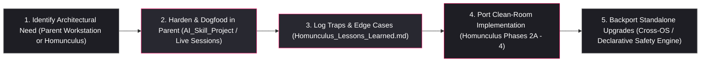

# 🧠 Homunculus — AI Co-Engineering & Architecture Lessons Learned (`Homunculus_Lessons_Learned`)

Part of the [`README.md`](../../README.md) and companion engineering ledger for [`Homunculus`](Homunculus.md) (`https://github.com/Alchemical-3D/Homunculus`).

> [!IMPORTANT]
> **Purpose & AI Operating Contract**
> This document is the persistent engineering feedback ledger between the **Parent Workstation (``<legacy_builder_workspace>``)** and the **Clean-Room Release Target (`/home/orin/Projects/Alchemical3D/Homunculus/`)**.
> - **For Antigravity (Primary Thread & Subagents):** Read this file before authoring or modifying `Homunculus` rules, skills, adapters, or CLI scripts so solved traps, false-positive edge cases, and turn-efficiency lessons from the parent system are never repeated. Append new `LL-XXX` entries whenever parent-system dogfooding or sandbox runs expose a structural weakness.
> - **Compartment Boundary Note:** Because this note lives inside the private `/home/orin/Projects/Engineering/memory` Dual-Mode Memory root (Compartment A), it may freely record parent-system benchmarks, sandbox IDs (`SBX-...`), and workstation comparisons while keeping `/home/orin/Projects/Alchemical3D/Homunculus/` 100% clean-room sanitized (`0` personal paths or parent repo references).

---

## 1. Parent-First Dogfooding & Bidirectional R&D Loop

- **Why Parent-First Validation Matters for Co-Engineering & Cleanup Rules:**
  Rules governing session behavior (`co-engineering-partner.md`), anti-bloat execution gates, and skill-hygiene auditing (`skill-architect` + `audit_skill_hygiene.py`) directly shape how the agent builds `Homunculus` itself. Testing them on the parent system first immediately reduces wasted turns during `Homunculus` development and exposes where static redundancy checks might misclassify legitimate domain context before shipping to external users.

---

## 2. Verified Lessons Learned Registry (`LL-001` – `LL-024`)
*(Audited strictly against the supreme priority hierarchy: **`1. Accuracy & Truth > 2. Portability > 3. Efficiency > 4. Data Safety > 5. Speed`**)*

### Quick-Lookup Vault Reference Matrix (One-Way `Vault -> Core` Mapping)

| ID | Architectural Principle | Canonical Operational Owner (`Self-Contained`) | Diagnostic / Enforcement Gate |
| :--- | :--- | :--- | :--- |
| **`LL-001`** | Anti-Bloat & Deferred Side-Effects (`--sync-visuals` / SVG renders) | `rules/co-engineering-partner.md` (Pillar 3) & `skills/pre-commit-gate/` | `audit_skill_hygiene.py` (`MID_TASK_VISUAL_SYNC`) |
| **`LL-002`** | Zero Per-Edit `PostToolUse` Hooks (`hooks.json` empty) | `hooks/hooks.json` & `skills/pre-commit-gate/` | `audit_skill_hygiene.py` (`ACTIVE_POST_TOOL_HOOK`) |
| **`LL-003`** | Unified Two-Mode `skill-architect` (`Create/Extend` + `Audit/Cleanup`) | `skills/skill-architect/SKILL.md` | `audit_skill_hygiene.py --check-new / --audit` |
| **`LL-004`** | Permission-First Cleanup (`Chesterton's Fence`) | `rules/co-engineering-partner.md` (Pillar 5) & `skills/skill-architect/` | Advisory classification buckets |
| **`LL-005`** | Two-Mode `.py` Oracle Rule (Cheatsheet for Routine CLI vs. Source Read for Porting/Auditing/Debugging) | `rules/co-engineering-partner.md` (Pillar 5) & `skills/subagent-orchestrator/` | `audit_skill_hygiene.py` (`BLANKET_PY_SOURCE_BAN`) |
| **`LL-006`** | Quarantining Open `[TBD]` Ledgers & YAML Frontmatter Citations (`#L1-L14`) | `skills/claim-verification/scripts/verify_claims.py` (`Phase 3`) | `verify_claims.py` (`FRONTMATTER_CITATION_BLOCKED` & `QUARANTINED_ZONE_CITATION`) |
| **`LL-007`** | Multi-Encoding (`UTF-8/16/32`), NUL-Delimited (`-z`) & Declarative Boundary Scanning | `scripts/audit_portability.py` (`Phase 1`) & `scripts/audit_data_boundary.py` (`Phase 2A` `homunculus_safety.json`) | `audit_portability.py` & `audit_data_boundary.py` |
| **`LL-008`** | Cross-OS (`Linux -> macOS -> Windows`), Corporate Drop-In & Sandbox Fallbacks | `scripts/homunculus_paths.py` (`Phase 1`), `adapters/` (`Phase 2B`), & `sandbox_runner.py` (`Phase 3`) | `test_phase1_foundation.py` & `sandbox_runner.py` |
| **`LL-009`** | Two-Touch Hygiene Cadence (Parent Calibration $\rightarrow$ Pre-Release Gate) | `Homunculus` `Phase 2A` & `Phase 3 -> 4` Gate | `audit_skill_hygiene.py --strict-structure` |
| **`LL-010`** | `AUTO-TREE` Is a Turn-1 Routing Map; Verify Live Disk When Mutating | `rules/co-engineering-partner.md` (Pillar 5) & `skills/subagent-orchestrator/` | `audit_skill_hygiene.py` (`UNSCOPED_LS_FIND_BAN`) |
| **`LL-011`** | `1–3` Line Anchored Evidence Packets vs. `30–80` Line Pre-Mutation Window Reads | `rules/co-engineering-partner.md` (Pillar 5) & `skills/subagent-orchestrator/` | Pre-mutation `read_file` window |
| **`LL-012`** | Auditor Calibration (Leading `/`, Backtick Masking, Sub-Bullet Grouping, `references/*.md` Scan) | `skills/skill-architect/scripts/audit_skill_hygiene.py` | `OS Dry-Run (+faults)` |
| **`LL-013`** | `always_on` Rule Footprint (`100%` Turn Tax) & Reverse Directionality (`Rule -> Skill` Delegation) | `skills/skill-architect/scripts/audit_skill_hygiene.py` | `[KEEP IN SKILL / CHECK ALWAYS-ON RULE FOOTPRINT]` |
| **`LL-014`** | Generative Trim Guards (Operational CLI Flags, Action-Site Domain Constraints, Pointer-Hop Token Inversion) & Fastener Omission Gate | `rules/co-engineering-partner.md` (Pillar 5), `audit_skill_hygiene.py`, & `audit_repo_docs.py` (Check `#7b`) | `[KEEP — OPERATIONAL CLI / FLAG ANCHOR]`, `[KEEP INLINE]`, & `audit_repo_docs.py` |
| **`LL-015`** | Canonical Absolute Script Paths (`./scripts/*.py` Ban) & `--repo-root` Isolated Excerpt Link/CAD Resolution | `skills/alchemical-github-content/` (`SKILL.md` & `audit_repo_docs.py`) & `audit_skill_hygiene.py` | `audit_skill_hygiene.py` (`RELATIVE_SCRIPT_PATH_HAZARD`) & `audit_repo_docs.py --repo-root` |
| **`LL-016`** | One-Way Vault Memory vs. Self-Contained Core Operational Files (Zero `LL-xxx` or Journal Reverse Dependency) | `Obsidian_Notes/` Vault $\rightarrow$ ``<legacy_builder_workspace>`` & `Homunculus/` | `audit_skill_hygiene.py` (`DEV_JOURNAL_CROSS_BLEED`) |
| **`LL-017`** | Project-Scoped `<Project>_Lessons_Learned.md` Ledgers (`--section lessons`), 3-Tier Containment & `verify_claims.py` Failed-Attempt Quarantine | `skills/maker-ecosystem-memory/` (`sync_memory.py`), `skills/claim-verification/` (`verify_claims.py`), & `Templates/Lessons_Learned_Template.md` | `verify_claims.py` (`excluded_lessons_learned_sources`) & `audit_skill_hygiene.py` |
| **`LL-018`** | `Compare-Full` System Audit: Unconditional Tier-B `verify_claims.py` Scope, Cross-Brain Scratch Boundaries, `CROSS_ARM_CONTAMINATION` & Fail-Closed Script Hardening (`0` `numpy`) | `rules/verifiable-accuracy.md` (§5), `verify_claims.py`, `audit_data_boundary.py`, `inspect_hardware_ecosystem.py`, `sync_memory.py`, `render_diagram.py`, & `sandbox_runner.py` | `SBX-20261104_090329-12245bb9` & `SBX-20261104_091445-fb9d6384` (`8/8` faults caught) |
| **`LL-019`** | Standalone Zero-Vault & Zero-History Cold-Start Doctrine + Dynamic New-Project Discovery (Eliminating Hardcoded `ENTITY_ALIASES` / `STEM_PREFIX_RE` Lists) | `rules/co-engineering-partner.md` (Pillar 5), `verify_claims.py` (`_detect_entity` + `idx_known_entities`), `inspect_hardware_ecosystem.py` (`--repo` + generic `STEM_PREFIX_RE`), & `sync_memory.py` (`--init-memory` / `--init-project`) | Dynamic `CROSS_ENTITY_CONTAMINATION` on unindexed projects |
| **`LL-020`** | Phase 2A–3B Clean-Room Construction, Parent-System Flaw Ledger (`PF-01`–`PF-23`), Dual-Mode Memory Separation (`--sync-hardware` / `--sync-software`), `SESSION-HANDOFF` (`--save-handoff` / `--kickstart`), & Cross-Script Sandbox Triangulation | `Homunculus/skills/*`, `Homunculus/addons/author-voice-cadence/`, `Homunculus/scripts/*`, & `tests/test_phase1..3b.py` | `SBX-20261104_203744-63957361`, `SBX-20261105_074245-0be89a6a`, `Compare-Light` (`0ecb6826` vs `25cde8c6`), & `SBX-20261105_084550-a1a6e36d` (`4/4` controls, `3/3` faults, `24/24` tests) |
| **`LL-021`** | Truth-Oracle Poisoning via Speculative Telemetry Heuristics (`classify_bore_diameter`, `solid_abs_g`), Multi-Domain `QUALIFIER_GROUPS` (`27` Groups), & Unspecified Source Clause Suppression | `inspect_hardware_ecosystem.py` & `verify_claims.py` (`QUALIFIER_GROUPS` + `is_unspecified_stmt` + `Ø` backtick unquoting) | `SBX-20261106_082824-c7325eea`, `SBX-20261106_083332-1b3c07be`, & `SBX-20261106_103955-5163077a` (`Controls 2/2, +faults 6/6`) |
| **`LL-022`** | Validator Crash (`rc=2`) Masquerading as `CAUGHT_FAIL_CLOSED` & Fault-Spec Setup Command Precedence in Adversarial Sandboxes | `skills/engineering-sandbox/scripts/sandbox_runner.py` (`VALIDATOR_CRASH`, `WRONG_FAULT_SIGNATURE`, & `flt.get("setup_cmd") or flt.get("cmd")`) | `SBX-20261106_074650-cf448f31` & `SBX-20261106_094659-44e3f023` |
| **`LL-023`** | Unanchored Substring Sanitization (`Pneumatic -> Project_Alphatic`), Regex Refactoring Regressions (`STEM_PREFIX_RE`), & Spaced SI Unit Exclusion (`AMBIGUOUS_LOWER_SPACED_UNITS`) | `inspect_hardware_ecosystem.py`, `verify_claims.py`, `sync_memory.py`, & `audit_portability.py` | `test_phase3b_skills.py` (`25/25` unit tests) & `audit_portability.py` |
| **`LL-024`** | Methodical Pre-Deletion Callback Sweep, CoW Dry-Run Retirement Protocol, & Strict Workstation vs. Clean-Room Add-On Separation (`Option A1/B1/C1`) | `scripts/bootstrap_workstation.sh`, `scripts/audit_data_boundary.py`, & `Homunculus_Cleanroom_Promotion_Diff.md` | `SBX-20261106_094659-44e3f023` through `SBX-20261106_095600-2e753103` (`Live Host Mutations: 0`) |
| **`LL-025`** | Antigravity Modular Rule `trigger: always_on` Frontmatter vs. Frontmatter-Free `AGENTS.md`/`CLAUDE.md` Stripping + Functional Module Naming Gate | `rules/*.md`, `scripts/build_adapters.py` (`_strip_yaml_frontmatter` + `.agents/rules/`), & `audit_skill_hygiene.py` (`MISSING_RULE_TRIGGER_FRONTMATTER`, `NON_FUNCTIONAL_MODULE_NAME`) | Subagent probe `c11064d3` (`<user_rules>` / `<RULE>` confirmed) & `SBX-20261106_190903-bcf1c394` (`4/4` controls, `3/3` faults) |

### `LL-001` — Always-On Core Rule vs. On-Demand Skill Placement for Anti-Bloat Gates
- **Symptom / Trap:** Placing rules against mid-project diagram re-rendering, mid-session memory index rebuilds (`--sync-visuals`), or unapproved `git push` commands exclusively inside `pre-commit-gate/SKILL.md` fails during mid-project turns because the agent does not read `pre-commit-gate` until it already believes the task is ready to commit.
- **Root Cause:** Lazy-loaded `SKILL.md` files only enter context upon activation. Behavioral restraints that govern *when not to act* during routine turns must live in an `always_on` rule.
- **Hardened Solution:** Encode **Anti-Bloat, Deferred Side-Effects & User-Readiness Gates** directly inside `rules/co-engineering-partner.md` (Pillar 3) so every turn enforces: (1) batching derived visual/index updates until task wrap-up, (2) requiring explicit user confirmation in the current turn before any `git push` or external state mutation, and (3) strict turn-budget restraint (logging side discoveries as `[ISOLATED]` instead of launching unrequested side quests).
- **Homunculus Target:** `rules/co-engineering-partner.md` (`Phase 2A`) + `skills/pre-commit-gate/SKILL.md` (`Phase 3`).

### `LL-002` — Retiring Per-Edit `PostToolUse` Hooks in Favor of Deferred `pre-commit-gate` Batching
- **Symptom / Trap:** Running automatic `PostToolUse` hooks after every `write_file`/`edit_file` call causes redundant file-tree scans, visual re-renders, and lock contention during multi-file edits.
- **Root Cause:** Intermediate edits within a turn or multi-turn feature are transitional states; synchronizing derived artifacts on transitional states wastes compute and turns.
- **Hardened Solution:** Keep `hooks.json` at `{}` (`0` per-edit `PostToolUse` hooks) and execute the deterministic **`X -> Y -> Z`** sequence (`Gate X` memory/tree sync $\rightarrow$ `Gate Y` on-demand `.svg` diagram refresh $\rightarrow$ `Gate Z` `VRF` claim & sandbox verification) once right before `git commit`, backed by a fast (`~0.07s`) read-only `.git/hooks/pre-commit` check.
- **Homunculus Target:** `skills/pre-commit-gate/SKILL.md` & `adapters/*` hook templates (`Phase 2B` / `Phase 3`).

### `LL-003` — Unifying Meta-Skills (`skill-architect`) Instead of Splitting Builder vs. Cleanup Auditor
- **Symptom / Trap:** Creating one skill for "building new skills" and a second skill for "auditing/cleaning up redundant skills" duplicates the skill-inspection logic, doubles maintenance, and creates overlapping YAML trigger descriptions.
- **Root Cause:** Both workflows evaluate the exact same invariants: existing `rules/` and `skills/` coverage, Dual-Mode Memory integration (`AUTO-TREE` + single-writer task umbrellas), Truth Oracle hooks (`verify_claims.py`), deferred side-effects (`pre-commit-gate`), and token/turn efficiency.
- **Hardened Solution:** Combine both into a single two-mode skill **`skills/skill-architect/SKILL.md`** backed by deterministic **`scripts/audit_skill_hygiene.py`**:
  - **Mode 1 (`Create / Extend` — Synergistic Skill Builder):** Runs a pre-creation overlap check first (preferring adding a mode/reference to an existing skill over spawning a redundant skill), wires Memory/Oracles/`pre-commit-gate` automatically, and enforces delta-only instructions (zero repetition of always-on rules).
  - **Mode 2 (`Audit / Consolidate` — Permission-Based Cleanup Protocol):** Audits existing skills/rules/scripts for redundancy and turn waste, outputting non-destructive, opt-in recommendations.
- **Homunculus Target:** Parent workstation ``<legacy_builder_workspace>`skills/skill-architect/` first $\rightarrow$ `Homunculus/skills/skill-architect/` & `Homunculus/scripts/audit_skill_hygiene.py` (`Phase 3`), followed by a full dogfooding pass at the `Phase 3 -> Phase 4` boundary.

### `LL-004` — Permission-First Cleanup vs. Authoritarian Auto-Deletion (`Chesterton's Fence`)
- **Symptom / Trap:** Aggressive cleanup prompts or scripts that automatically strip instructions or merge skills without full domain context break specialized edge-case guards that looked "redundant" on the surface.
- **Root Cause:** Static analysis can detect structural overlap (duplicate headings, repeated rule phrases, banned `ls`/`find` patterns, or overlapping triggers), but only the user knows whether a domain-specific constraint protects against an external hardware, enterprise, or client quirk.
- **Hardened Solution:** Enforce a strict **Advisory & Permission-First Contract** in `skill-architect` Mode 2 and `audit_skill_hygiene.py`:
  - Classify every finding into explicit buckets: `[KEEP — DOMAIN SPECIFIC]`, `[SUGGESTED TRIM — ALREADY IN CORE RULES]`, `[CANDIDATE MERGE — OVERLAPS SKILL X]`, or `[TURN-WASTE HAZARD]`.
  - Present the concrete evidence (exact line ranges, token savings, and why it flagged) and require explicit user approval before modifying or deleting any user skill or function.
- **Homunculus Target:** `rules/co-engineering-partner.md` (Pillar 5) + `skills/skill-architect/SKILL.md` (`Phase 2A` / `Phase 3`).

### `LL-005` — Two-Mode CLI Oracle Rule (`Cheatsheet for Routine Runs` vs. `Mandatory .py Source Read for Porting / Diagnosis`)
- **Symptom / Trap:** An earlier efficiency rule (`2026-10-31`) stated *"Never read `.step`, `.stl`, `.canvas`, or `.py` oracle internals (consult `oracle_cli_cheatsheet.md`)."* While intended to save `15k–40k` tokens during routine CLI flag lookups and prevent Goodharting (gaming regexes), making it a **blanket ban on reading `.py` files** inverted **`1. Accuracy & Truth > 2. Efficiency > 3. Speed`**:
  1. **Porting & Refactor Amnesia:** When porting or adapting scripts into `Homunculus`, an agent forbidden from reading `.py` internals would have to guess schemas and edge-case logic from a 40-line summary cheatsheet—hallucinating implementations and dropping hardened guards.
  2. **Diagnostic Guessing (`Chesterton's Fence` Violation):** When a CLI oracle flags an unexpected edge case, banning `.py` source inspection forces blind trial-and-error guessing instead of root-cause diagnosis.
  3. **Category Error (`.step`/`.stl` vs. `.py`):** Raw `.step`/`.stl` files must not be eyeballed in context because LLMs hallucinate 3D B-Rep trigonometry (requiring `inspect_hardware_ecosystem.py` for *accuracy*). By contrast, `.py` files *are* primary source truth.
- **Root Cause:** Over-generalizing a token-efficiency shortcut into an absolute prohibition that elevated a secondary summary (`oracle_cli_cheatsheet.md`) above primary source code on disk.
- **Hardened Solution (`Accuracy & Truth > Efficiency > Speed`):**
  1. **Raw 3D CAD Meshes (`.step`, `.stl`):** Never eyeball raw 3D coordinate/spline text to guess geometry—always run `inspect_hardware_ecosystem.py`.
  2. **Python CLI Oracles (`.py`) — Two-Mode Contract:**
     - **Mode A (Routine Invocation — Efficiency + Anti-Goodhart Guard):** When simply *running* a CLI oracle during normal documentation/repo tasks, consult `oracle_cli_cheatsheet.md` or `--help` first to avoid unnecessary `15k–40k` token reads, and **never inspect validator regexes to game or bypass a truth check**.
     - **Mode B (Porting, Auditing, Extending, or Diagnosing — Accuracy First):** Whenever building, porting (`Homunculus`), auditing (`skill-architect`), modifying, or diagnosing an unexpected error/edge case in a script, **reading the exact `.py` source code is mandatory (`Chesterton's Fence`)**—never guess how code works from a cheatsheet.
- **Homunculus Target:** Updated in parent `co-engineering-partner.md` & skill docs (`2026-11-03`); carry directly into `Homunculus` `rules/co-engineering-partner.md` (`Phase 2A`) and `skills/subagent-orchestrator/` (`Phase 3`).

### `LL-006` — Quarantining Open `[TBD]` Ledgers & YAML Frontmatter Line Citations in `verify_claims.py`
- **Symptom / Trap:** Two verification traps surfaced during multi-repo audits: (1) numbers inside a dossier's `## 🔍 Provenance Status & Open [TBD] / [CONFLICT] Ledger` got ingested into the verified whitelist pool if not quarantined, and (2) citing `#L1-L14` YAML frontmatter line numbers caused brittle failures when frontmatter fields updated.
- **Root Cause:** Unscoped source ingestion and frontmatter line-shift sensitivity.
- **Hardened Solution:** `verify_claims.py` quarantines `Open [TBD] / [CONFLICT] Ledger` sections from the truth pool and blocks `#L1-L14` frontmatter citations (`FRONTMATTER_CITATION_BLOCKED`), requiring body-section citations (`#L15+`) and keeping unverified figures strictly inside `[TBD: ...]` brackets.
- **Homunculus Target:** `skills/claim-verification/scripts/verify_claims.py` (`Phase 3`).

### `LL-007` — Multi-Encoding (`UTF-8/16/32`) & NUL-Delimited (`-z`) Boundary Scanning
- **Symptom / Trap:** Naive UTF-8 line scanners and standard `git status` outputs can be bypassed by UTF-16LE/BE or UTF-32 encoded text blobs, C-quoted filenames containing special characters, or symlink escapes outside the repo root.
- **Root Cause:** Assuming all text files are UTF-8 and all paths are unquoted ASCII.
- **Hardened Solution:** Both `audit_portability.py` (Phase 1, `SBX-20261101_163034-9a368319`) and `audit_data_boundary.py` decode `UTF-8`, `UTF-16` (`LE`/`BE` BOM + null-byte heuristic), and `UTF-32`, use `git status --porcelain -z` / `git diff --cached --name-only -z`, inspect ASCII `.step`/`.stl`/`.svg`/`.xlsx`/`.ipynb` metadata, and reject symlink escapes (`exit != 0`).
- **Homunculus Target:** Completed in `scripts/audit_portability.py` (`Phase 1`); carry into declarative `scripts/audit_data_boundary.py` (`Phase 2A`).

### `LL-008` — Cross-OS (`1. Linux -> 2. macOS -> 3. Windows`) & Corporate Locked-Down Station Constraints
- **Symptom / Trap:** Frameworks that depend on POSIX symlinks (`ln -s`), `bwrap`/`btrfs`, bash-only installers, or external `pip` packages fail immediately on locked-down corporate Windows laptops (`Developer Mode` disabled, AppLocker/WDAC active, proxy-blocked `pip`).
- **Root Cause:** Designing only for root-enabled Linux developer machines.
- **Hardened Solution:** Maintain a **Single Unified Archive** using pure Python 3.10+ standard library and `pathlib` (`scripts/homunculus_paths.py`), shipping **Track 1 Automated Installers** (`install.sh` / `install.ps1` with file-copy fallback when Windows symlinks are blocked) alongside **Track 2 Zero-Install "Drop-In & Point" Mode** (`HOMUNCULUS_START_HERE.md`) and cross-OS sandbox fallbacks (`bwrap`+`btrfs` $\rightarrow$ APFS/worktree $\rightarrow$ Windows `git worktree`/temp-copy).
- **Homunculus Target:** Path resolver completed in `Phase 1`; wire across `adapters/` (`Phase 2B`) and `engineering-sandbox` (`Phase 3`).

### `LL-009` — Two-Touch Skill Hygiene Cadence (Up-Front Guardrails $\rightarrow$ Post-Build Release Audit)
- **Symptom / Trap:** If skill hygiene is only checked at the very end of a project, every skill written during Phase 3 accumulates duplicate boilerplate that must be rewritten; if it is only checked up front, subtle cross-skill overlaps introduced while building 6–8 modules go unnoticed before release.
- **Root Cause:** Single-point quality checks miss either design-time drift or integration-time overlap.
- **Hardened Solution:** Execute a **Two-Touch Hygiene Cadence**:
  1. **Up-Front (Parent System + Phase 2A/3 Design):** Lock the Synergy & Hygiene Contract into `co-engineering-partner.md` and build `skill-architect` (`+ audit_skill_hygiene.py`) on the parent system first to audit existing workstation skills and calibrate thresholds.
  2. **Pre-Release Gate (End of Phase 3 $\rightarrow$ Phase 4):** Run `skill-architect` Mode 2 (`audit_skill_hygiene.py`) across all newly ported `Homunculus` `v1.0` rules, skills, and adapters to trim any redundancy before cold-start sandbox testing and Discord Store packaging.
- **Homunculus Target:** Parent workstation (`Immediate Priority`) $\rightarrow$ `Homunculus` `Phase 2A`, `Phase 3`, and `Phase 3 -> 4` Release Gate.

### `LL-010` — `AUTO-TREE` Is a Turn-1 Routing Map, Never a Substitute for Live Filesystem Truth
- **Symptom / Trap:** Because `sync_memory.py --sync-visuals` is now deferred until `pre-commit-gate` (`LL-001` / `LL-002`), a project dossier's `<!-- BEGIN AUTO-TREE -->` block can become temporarily stale mid-session after files are added, renamed, or deleted. An unconditional ban on directory checks (`"never run ls or find"`) could cause an agent to trust a stale `AUTO-TREE` snapshot over live disk reality.
- **Root Cause:** Allowing an efficiency optimization (skipping blind Turn-1 `ls`/`find` wandering across `Obsidian_Notes/Projects/`) to masquerade as a source-of-truth guarantee during active file mutations.
- **Hardened Solution (`Accuracy & Truth > Efficiency > Speed`):** Use `Projects/<Project>/<Project>.md` (`AUTO-TREE`) on Turn 1 to eliminate blind directory wandering, **but** whenever verifying live repo state, auditing untracked/modified files, or encountering a missing path, check live disk truth (`git -C <repo> status --short` or targeted directory inspection). Never treat a cached Markdown tree as authoritative over the filesystem.
- **Homunculus Target:** `rules/co-engineering-partner.md` (`Phase 2A`) & Dual-Mode Memory / `subagent-orchestrator` (`Phase 3`).

### `LL-011` — `Anchored Evidence Packets` (`1–3` Line Hunks): Safe for Citations, Insufficient Alone for Blind Code/Doc Mutations
- **Symptom / Trap:** Returning `1–3` line verbatim hunks from subagents eliminates the double-read tax when synthesizing status reports or verifying isolated literals. However, `1–3` lines can omit surrounding control flow (`if/else` guards, deprecation notices 10 lines up, or table column headers), and calling `edit_file` using only a 3-line subagent snippet without reading the surrounding block risks breaking structure or duplicating adjacent content.
- **Root Cause:** Over-extending a read-only synthesis optimization (`0` double-reads for verified quotes) into file mutation workflows.
- **Hardened Solution (`Accuracy & Truth > Efficiency > Speed`):**
  - **For Read-Only Citations & Audits:** Trust `1–3` line Anchored Evidence Packets (backed by `verify_claims.py` `±5`-line warning-context checks) without re-reading the file.
  - **For File Mutations (`edit_file`) or Conditional Context:** Before modifying any file in the Primary Thread—or whenever a 3-line hunk's meaning depends on surrounding headers, schemas, or control flow—read the surrounding `30–80` line window (`StartLine`–`EndLine`) first so edits never land blind.
- **Homunculus Target:** `rules/co-engineering-partner.md` (`Phase 2A`) & `skills/subagent-orchestrator/` (`Phase 3`).

### `LL-012` — Calibrating `audit_skill_hygiene.py` Against False Positives & Structural Blind Spots (Audit Pass 1 $\rightarrow$ Pass 2)
- **Symptom / Trap:** Running the initial v1 build of `audit_skill_hygiene.py` against ``<legacy_builder_workspace>`` exposed 5 calibration flaws in the auditor itself before any target skills were touched:
  1. **Leading-Slash Regex Truncation:** Using `\b` before a script path regex stripped the leading `/` from `/home/orin/.../scripts/*.py` (because `/` is non-word), causing `8` false `BROKEN_SKILL_LINK_OR_SCRIPT` errors.
  2. **Inert Syntax Examples Flagged as Broken Links:** Scanning `[label](target)` inside inline code backticks (e.g., `` `` `` in `alchemical-github-content/SKILL.md#L82`) flagged documentation syntax examples as missing files.
  3. **Sub-Bullet Fragmentation Hiding Paraphrased Overlaps:** Splitting indented sub-bullets (`    - ...`) into tiny separate blocks prevented `author-voice-cadence` (`Mode B1` nested bullets) from matching `alchemical-github-content` (`Mode B1` single-paragraph equivalent).
  4. **Unscanned `references/*.md` Files:** Scanning only `SKILL.md` missed a real `LL-005` blanket `.py` ban hiding inside `engineering-sandbox/references/frame_playbooks.md#L43`.
  5. **Unstemmed Compound Queries in `--check-new`:** Failing to split hyphenated compound words (`heat-sets`, `bom-fastener-verifier`) or stem plurals (`claims`/`claim`, `verifier`/`verify`) under-scored existing skill coverage (`34.6%` vs. true `61.4%` / `100%` body coverage).
- **Hardened Solution:** Upgraded `audit_skill_hygiene.py` to (1) use lookbehind `(?<![A-Za-z0-9_./-])` preserving leading `/`, (2) mask inline backticks and fenced code blocks during link checks, (3) group nested sub-bullets (`4+` spaces) with their parent top-level bullet and compare `3-gram` shingles + vocabulary Jaccard, (4) scan all `references/*.md` files alongside `SKILL.md` and `root/scripts/*.py`, and (5) apply compound splitting + stem normalization in `--check-new`.
- **Homunculus Target:** Carry the calibrated `audit_skill_hygiene.py` directly into `Homunculus/scripts/audit_skill_hygiene.py` (`Phase 3`).

### `LL-013` — Factoring `always_on` Global Rules into Overlap Scoring & Reverse Directionality (`100%` Turn Tax)
- **Symptom / Trap:** The initial version of `audit_skill_hygiene.py` had four blind spots regarding `rules/`:
  1. **Mode 1 (`--check-new`) Ignored `rules/`:** It only scored proposed capabilities against `skills/`, so a user proposing a skill already 80–100% covered by `data-and-credential-safety.md` or `co-engineering-partner.md` would be told to create a new skill.
  2. **Missing `always_on` Turn-Tax Footprint & Rule-to-Rule Checks:** `always_on` rules load on 100% of turns (`~5,300` tok/turn across the 3 rules), making Rule-to-Rule duplication and rule bloat far more expensive than on-demand skill text.
  3. **Reverse Directionality (`SKILL_REPEATS_CORE_RULE` vs. `RULE_DELEGATES_TO_SKILL`):** When an `always_on` rule explicitly delegates to an on-demand skill (e.g., `co-engineering-partner.md` referencing `subagent-orchestrator`), naive overlap flagging tells the user to trim the *skill* (`subagent-orchestrator/SKILL.md#L98`), when in fact the on-demand skill is the canonical runbook and the `always_on` rule should only carry the Turn-1 trigger + load-bearing safety overrides!
  4. **Flat (`rules/*.md`) vs. Nested (`rules/*/*.md`) Layouts:** `AI_Skill_Project` uses `rules/<name>/<name>.md` whereas `Homunculus` uses `rules/<name>.md`, and empty/Phase-1 roots (`Homunculus`) reference top-level `scripts/*.py` in `README.md` / `HOMUNCULUS_START_HERE.md` / `tests/*.py`.
- **Hardened Solution:** Upgraded `audit_skill_hygiene.py` to (1) score `--check-new` against both `rules/` (`ALREADY_IN_CORE_RULE`) and multi-module composites (`COMPOSITE_ALREADY_COVERED`), (2) report Table 0 (`Always-On Global Rules Footprint` + `Rule-to-Rule Overlap`), (3) classify bidirectional Rule $\leftrightarrow$ Skill overlap (`[KEEP IN SKILL / CHECK ALWAYS-ON RULE FOOTPRINT]` when the rule delegates to the skill), and (4) support both flat and nested rule directories; verified across `7` multi-vector probes and `OS Dry-Run (+5 faults)` (`SBX-20261103_180610-5cda55ee`, `2.65s`, `1/1` controls, `5/5` faults caught).
- **Homunculus Target:** `Homunculus/skills/skill-architect/` & `Homunculus/scripts/audit_skill_hygiene.py` (`Phase 3`).

### `LL-014` — Generative Impact of Skill Trims: Pointer-Hop Token Inversion & Action-Site Salience Loss (`Blind` vs. `Visible` Sandbox Discovery)
- **Symptom / Trap:** Running parallel `Blind-Light (Flash)` (`2279ab14-6e4c-4b77-9e4a-1cb20ee79733`) and `Visible-Light (Flash)` (`8311eced-169f-45ba-bf32-ab71821344b0`) generative sandbox probes on simulated trimmed versions of `alchemical-github-content/SKILL.md` (`#L31`, `#L78`, `#L107` replaced with 1-line `#Heading` pointers) and `author-voice-cadence/SKILL.md` (`#L68`, `#L69` replaced with pointers) exposed three critical failure modes that pure lexical overlap detectors miss:
  1. **Pointer-Hop Token Inversion (`Efficiency Regression`):** Replacing `alchemical-github-content`'s compact `Mode B1`/`Mode B2` inline summary (`~165` tokens across `#L31` and `#L78`) with a 1-line `#Heading` pointer to `author-voice-cadence/SKILL.md` forced **both** `Blind-Light` (Turn 14) and `Visible-Light` (Turn 11) to spend an extra Planner Turn + `read_file` call loading all `~2,326` tokens of `author-voice-cadence/SKILL.md` into the KV-cache—a net penalty of **`+2,160` tokens and `+1` turn**!
  2. **Action-Site Salience Loss & Qualitative Dodging (`Accuracy Regression`):** Even though `verifiable-accuracy.md` is loaded in the `always_on` system prompt, stripping the concrete domain negative constraints and CLI flags at `alchemical-github-content/SKILL.md#L107` (and `author-voice-cadence/SKILL.md#L68–L69`) caused the uncoached `Blind-Light (Flash)` agent to:
     - Commit **Qualitative Dodging** in `Assembly_Guide_Excerpt.md`: writing bare `"using M3x8 SHCS"` in Step 2 (dropping the `(2)` fastener count and omitting `[TBD: CONFLICT — Single-Pump Qty 2 vs Dual-Pump Qty 4]`) and dropping `1/8 NPT` + the solenoid vs. dual-pump `[TBD: CONFLICT]` tag in Step 3 (`Open [TBD]: 1` in `Blind-Light` vs. `Open [TBD]: 3` in `Visible-Light`). Because `verify_claims.py` validates written claims against sources, **omitting a quantity silently passes `verify_claims.py` (`Unbacked Claims: 0`)**.
     - Lose the operational CLI flag instruction (`verify_claims.py ... WITHOUT --fail-on-tbd` and `--strict-provenance` / `DIRTY_GIT_WORKTREE`), since `verifiable-accuracy.md` states abstract principles without CLI flag names.
  3. **Why Running Both `Blind-Light` and `Visible-Light` Was Required:** `Visible-Light` (which received explicit architecture & conflict-ledger pointers in its prompt) masked the fastener-count/conflict omission bug, whereas `Blind-Light` (uncoached real-world user prompt) exposed the generative accuracy drop immediately. Conversely, `Visible-Light` cleanly isolated structural/script friction in the skill text (`LL-015`).
- **Hardened Solution (`Accuracy & Truth > Efficiency > Speed`):** Upgraded `audit_skill_hygiene.py`, `skill-architect/SKILL.md`, `audit_repo_docs.py`, and `engineering-sandbox` (`sandbox_runner.py`) with five deterministic guards:
  1. **`[KEEP — OPERATIONAL CLI / FLAG ANCHOR]`:** Never trim a skill block to a rule pointer if the block contains CLI flags (`--[a-z0-9-]+`), script paths, or diagnostic tokens (`DIRTY_GIT_WORKTREE`, `PLACEHOLDER_STUB_SOURCE`) absent from the matched `always_on` rule.
  2. **`[KEEP — ACTION-SITE DOMAIN INSTANTIATION]`:** Preserve concrete domain negative constraints and register bindings (`Mode B1`, `4+1`, `TPU` vs. `ABS/ASA`, fastener count/head-style reminders) at the point of action so `Flash` subagents do not commit qualitative dodging.
  3. **`[KEEP INLINE — PREVENTS POINTER-HOP TOKEN INVERSION]`:** When a duplicate cross-skill block is compact (`<= 140` words) and the target companion skill is `>= 3x` larger, keep the excerpt inline rather than forcing a cross-file `read_file` hop.
  4. **Deterministic Qualitative Fastener-Dodging Gate (`audit_repo_docs.py` Check `#7b`):** Upgraded ``<legacy_builder_workspace>`skills/alchemical-github-content/scripts/audit_repo_docs.py` to scan numbered `Assembly_Guide` steps (`### Step N` / `## N.`) and fail closed (`exit 1`) on: (a) specific fastener callouts (`M3x8 SHCS`, `#6-32 BHCS`) missing an explicit quantity `(N)` or `Nx` when no `[TBD: ...]` marker is present, (b) bare metric fastener callouts (`M3 screws`/`bolts`) missing length/head-style without `[TBD: ...]`, and (c) vague fastener dodging (`using the appropriate screws/fasteners/bolts`) without `[TBD: ...]`. Closing this loop ensures an assembly step must either write a concrete fastener quantity (checked by `verify_claims.py` against `--sources`) or emit an explicit `[TBD: ...]` tag.
  5. **Automated Paired A/B Differential Sandbox (`Compare-Light` & `Compare-Full` in `engineering-sandbox`):** Added `--mode compare-light` and `--mode compare-full` (`--blind-dir`, `--visible-dir`, `--blind-transcript`, `--visible-transcript`, `--compare-source`, `--repo-root`, plus `@ab-compare` fault cases) to ``<legacy_builder_workspace>`skills/engineering-sandbox/scripts/sandbox_runner.py`. Launches `Blind` and `Visible` arms in parallel on Turn 1 and automatically computes per-file `audit_repo_docs.py` + `verify_claims.py` + `Open [TBD]` / `[CONFLICT]` parity (`COACHING_MASKED_DEFECT`, `QUALITATIVE_DODGING_TBD_DEFICIT`) alongside `transcript.jsonl` trajectory deltas (`POINTER_HOP_DETECTED`, `CLI_ERGONOMICS_GAP`) on Turn 2, writing `ab_comparison.md`.
- **Homunculus Target:** `rules/co-engineering-partner.md` (`Phase 2A`), `skills/skill-architect/` (`Phase 3`), & `skills/engineering-sandbox/` (`Phase 3`).

### `LL-015` — Relative `./scripts/` CLI Paths & Isolated Excerpt Link Validation Friction
- **Symptom / Trap:** During the `Visible-Light` and `Blind-Light` sandbox runs on `alchemical-github-content/SKILL.md`:
  1. Lines `#L29`, `#L50`, `#L56`, `#L60`, `#L64`, and `#L67` of `alchemical-github-content/SKILL.md` used relative `./scripts/audit_repo_docs.py` and `./scripts/format_image.py` paths while `#L97` used the canonical absolute path. When an agent's shell `cwd` is `/home/orin` or a target repository, relative `./scripts/...` commands fail or force extra directory-probing turns (`Blind-Light` ran 5 `ls -la` turns checking script paths).
  2. When validating an isolated excerpt file (`Print_Settings.md` in a scratch output directory) with `audit_repo_docs.py`, standard companion links (`[Assembly Guide](Assembly_Guide.md)`, `[Bill of Materials](BOM.md)`) fail as `[LOAD-BEARING]` broken local links unless companion files/symlinks exist in the same directory.
- **Hardened Solution:** (1) Added `RELATIVE_SCRIPT_PATH_HAZARD` detection to `audit_skill_hygiene.py` so any relative `./scripts/*.py` CLI invocation inside `SKILL.md` is flagged as a `[TURN-WASTE HAZARD]` for replacement with canonical absolute paths, and patched all 6 occurrences in `alchemical-github-content/SKILL.md`; (2) added `--repo-root <path>` to ``<legacy_builder_workspace>`skills/alchemical-github-content/scripts/audit_repo_docs.py` so isolated single-file drafts in scratch/sandbox directories resolve relative companion links (`BOM.md`, `Assembly_Guide.md`, `Images/...`) and `STL_Files/`/`STEP_Files/` CAD filenames against the real repository root without requiring dummy symlinks.
- **Homunculus Target:** `skills/skill-architect/scripts/audit_skill_hygiene.py` (`Phase 3`).

### `LL-016` — One-Way Memory Vault Journal vs. Self-Contained Core Operational Files (`Zero Reverse Dependency`)
- **Symptom / Trap:** As `LL-001` through `LL-015` were discovered and baked into parent workstation rules (`co-engineering-partner.md`), skills (`skill-architect`, `subagent-orchestrator`, `claim-verification`, `engineering-sandbox`, `technical-diagram-studio`), and `audit_skill_hygiene.py`, `55` references to `LL-xxx` ticket IDs and `Homunculus_Lessons_Learned.md` leaked into core operational files.
- **Root Cause:** Treating a development engineering journal (`Homunculus_Lessons_Learned.md`) as a bidirectional citation target from live operational rules and skills. This creates two hazards: (1) during unrelated project sessions (`Pneuma`, `Alembic`, `NEA`), agents see `LL-xxx` or `Homunculus_Lessons_Learned.md` in core skills and either waste turns reading the journal or treat `LL-xxx` as opaque jargon; and (2) when porting core rules/skills into clean-room `Homunculus`, embedded `LL-xxx` / Vault journal references violate clean-room self-containment.
- **Hardened Solution (`One-Way Reference Architecture`):**
  1. **Vault Memory Layer (`Obsidian_Notes/`):** `Homunculus_Lessons_Learned.md` is indexed inside the Memory v2 Vault (linked from `Projects/Homunculus/Homunculus.md`, `Standards_and_Specs/Subagent_and_Memory_Architecture.md`, and `Ecosystem_Index.md`) with a structured Quick-Lookup Matrix so the AI can consult it whenever working on `Homunculus` or workstation AI architecture.
  2. **Operational Core Layer (``<legacy_builder_workspace>`` & `Homunculus/`):** Core rules (`rules/*.md`), skills (`skills/*/SKILL.md`), and scripts (`scripts/*.py`) are **100% self-contained** and contain **zero** references to `Homunculus_Lessons_Learned` or `LL-xxx` IDs.
  3. **Deterministic Gate (`DEV_JOURNAL_CROSS_BLEED`):** Added a fail-closed check in `audit_skill_hygiene.py` that flags any `Homunculus_Lessons_Learned` or `\bLL-\d{3}\b` occurrence inside `rules/` or `skills/` as a `[LOAD-BEARING DEFECT]`.
- **Homunculus Target:** Enforced immediately across ``<legacy_builder_workspace>`` and carried into `Homunculus` (`Phases 2A–4`).

### `LL-017` — Project-Scoped `<Project>_Lessons_Learned.md` Ledgers, 3-Tier Containment & `verify_claims.py` Failed-Attempt Quarantine
- **Symptom / Trap:** Expanding `<Project>_Lessons_Learned.md` across active R&D projects (`Alembic_Toolhead`, `Pneuma_Remote_Air`, `A3DP_Gantry_Assembly`, `Pestle_Rotational_Bowden`, `NetCom_Engineering_Assistant`, `Homunculus`) introduces two architectural risks if done naively:
  1. **Quantitative Truth-Pool Poisoning (`Accuracy Hazard`):** A `Lessons_Learned` note intentionally documents rejected prototypes, failed fastener sizes, and retired architectures alongside verified fixes. If a user or subagent passes a project directory (`--sources Obsidian_Notes/Projects/Pneuma_Remote_Air/`) to `verify_claims.py`, indexing `<Project>_Lessons_Learned.md` as an authoritative source would whitelist those rejected numbers!
  2. **Routine Turn-1 Context Bloat (`Efficiency Hazard`):** If `<Project>_Lessons_Learned.md` is merged into `<Project>.md` or auto-loaded on every routine status/task query, every Turn-1 project read pays `+1,000`–`2,500` extra tokens even when no troubleshooting or design change is occurring.
- **Hardened Solution (`Accuracy & Truth > Efficiency > Speed`):**
  1. **Auto-Exclusion in `verify_claims.py` (`Failed-Attempt Quarantine`):** Upgraded `collect_source_files()` in `verify_claims.py` to automatically exclude `*_Lessons_Learned.md` (and `Lessons_Learned_Template.md`) whenever scanning `--sources` directories or file lists (reporting them under `excluded_lessons_learned_sources`, with opt-in `--allow-lessons-source` only for auditing the ledger itself). Canonical specifications must reside in `<Project>.md`, `<Project>_Hardware.md`, or `Standards_and_Specs/*.md`.
  2. **On-Demand `--section lessons` Reader (`0` Baseline Turn-1 Token Tax):** Added `--section lessons` to `sync_memory.py --project <alias>` while `build_project_auto_tree_block()` surfaces ``<Project>_Lessons_Learned`` under `**Companion Notes:**` in the dossier's `AUTO-TREE` header. Routine `--project <alias>` reads pay `0` extra tokens; problem-solving, debugging, and design-iteration turns load `--section lessons` in `<0.05s`.
  3. **Three-Tier Containment & Universal `DEV_JOURNAL_CROSS_BLEED` Guard:** Standardized `Templates/Lessons_Learned_Template.md` around Tier 1 (Project-Local Default), Tier 2 (Explicit ``Companion_Lessons_Learned`` for coupled physical/software interfaces), and Tier 3 (One-Way Graduation into `Standards_and_Specs/` or `skills/`), and broadened `audit_skill_hygiene.py` (`DEV_JOURNAL_CROSS_BLEED`) to block any `[A-Za-z0-9_]+_Lessons_Learned` or `\bLL-\d{3}\b` reference inside operational `rules/` or `skills/`.
- **Homunculus Target:** Carry into `Homunculus` `Phase 3` (`skills/project-memory/`, `skills/claim-verification/`, and `skills/skill-architect/`).

### `LL-018` — `Compare-Full (Pro)` System Audit: Unconditional Tier-B Claim Verification, Cross-Brain Scratch Boundaries, `CROSS_ARM_CONTAMINATION` & Fail-Closed Script Hardening
- **Symptom / Trap:** Running a full-scale `Compare-Full (Pro)` A/B differential sandbox audit (`Blind-Full` `57627440-ba83-480c-b987-876e38af2c87` vs. `Visible-Full` `5b97ba5d-7d45-46c7-992a-768f5f237500`, evaluated via `SBX-20261104_090329-12245bb9`) across the entire operational script suite exposed four critical system mechanics and script-authority gaps:
  1. **`COACHING_MASKED_DEFECT` on Non-Hardware Audit Docs (`verifiable-accuracy.md` §5):** `Blind-Full` ran `verify_claims.py` on Deliverable 1 (`Pneuma_Print_Settings_and_BOM_Reconciliation.md`, `0` unbacked claims) but skipped `verify_claims.py` on Deliverable 2 (`System_Script_and_Agnostic_Mechanics_Audit.md`, leaving `35` unbacked claims), whereas `Visible-Full` (explicitly instructed to verify both deliverables) achieved `0` unbacked claims on both (`VRF-b931bb060d01` & `VRF-4e807519a456`). Root cause: `verifiable-accuracy.md` §5 Tier B parenthetically qualified `verify_claims.py` as `"when generating multi-spec technical docs"`, leading an uncoached agent to skip deterministic claim verification on a software/script audit document.
  2. **Cross-Conversation `brain/<parent-id>` Sandbox Boundary:** Subagents spawned via `invoke_subagent` run under their own `<conversation-id>` and are blocked by the client sandbox from calling `write_file` inside a parent conversation's `brain/<parent-id>/scratch/` directory.
  3. **Sibling-Directory `CROSS_ARM_CONTAMINATION` in `Compare` Mode:** When `blind_out` and `visible_out` reside in a shared workspace, a subagent can inspect the sibling arm's directory unless explicitly prohibited and audited.
  4. **Fail-Open Edge Cases & Third-Party `numpy` Coupling Across Core Scripts:** Direct source inspection (`LL-005` Mode B) by both `Pro` auditors uncovered:
     - `verify_claims.py`: backticked line citations (`File.md#L999`) pointing to a file on disk inside `source_dirs` that was not passed in `--sources` had `info == None`, bypassing line-bounds, frontmatter (`#L1-L14`), and quarantine checks while still returning `ok_cit = True`; `GitWorktreeCache` swallowed `git status` failures as clean (`set()`); and `normalize_source_relpath` hardcoded `/home/orin/Projects/Engineering`.
     - `audit_data_boundary.py`: files `> 2 MB` (`MAX_TEXT_SCAN_BYTES`) only scanned the first `1 MB` + last `1 MB` (leaving a mid-file blind spot and risking odd-byte UTF-16/32 slice misalignment), and compartment paths were hardcoded without a `--config` JSON loader. Upgraded to `16 MB` (`16,777,216` bytes) full-file direct scan and `4 MB` (`4,194,304` bytes) streaming windows with `4096`-byte `4`-byte-aligned overlap above `16 MB`.
     - `inspect_hardware_ecosystem.py`: imported third-party `numpy` (`import numpy as np`, breaking the zero-pip portable stdlib contract), had an undefined `manifests_dir` variable in `--sync-manifest`, and re-parsed multi-MB STEP B-Rep files even when `_Hardware.md` was `CACHE_VALID`.
     - `sync_memory.py`: lacked `--mode {auto,obsidian,headless}` for headless non-Obsidian usage and failed open if `git rev-parse HEAD` returned empty or `Ecosystem_Index.md` parsed `0` rows.
     - `render_diagram.py`: returned `{}` from `discover_palettes()` if `Obsidian_Notes/Templates/Color_Palettes/` was missing.
     - `audit_repo_docs.py`: Check `#7b` only checked `### Step N` inside files named `Assembly_Guide.md`, missing procedural sections (`### Mounting Procedure`) in `README.md`.
- **Hardened Solution (`Accuracy & Truth > Efficiency > Speed`):**
  1. Tightened `verifiable-accuracy.md#L54-L57` to require `verify_claims.py` across **all** authored technical deliverables (specs, audits, manuals, and architecture docs).
  2. Standardized subagent sandbox scratch paths on `/home/orin/.gemini/antigravity-cli/scratch/sandbox_runs/` (`engineering-sandbox/SKILL.md` & `references/frame_playbooks.md`) and added deterministic `CROSS_ARM_CONTAMINATION` detection to `sandbox_runner.py` (`#L598-L613`) plus Claude Code JSONL transcript parsing (`#L258-L355`).
  3. Hardened all 8 operational scripts (`verify_claims.py`, `audit_data_boundary.py`, `inspect_hardware_ecosystem.py`, `sync_memory.py`, `render_diagram.py`, `audit_repo_docs.py`, `audit_skill_hygiene.py`, `sandbox_runner.py`), removing `numpy` in favor of pure stdlib `struct.iter_unpack("<12fH", ...)` + `math` and closing every fail-open path.
  4. Cataloged the 5 remaining client/OS adapter seams (`AG-01` subagent dispatch primitives across Antigravity `invoke_subagent`/`send_message` vs. Claude Code `Task` `haiku`/`sonnet`/`opus`, `AG-02` cross-OS sandbox isolation `git worktree add --detach` / `chmod -R a-w`, `AG-03` `<HOMUNCULUS_ROOT>` script path interpolation via `homunculus_paths.py`, `AG-04` rule frontmatter `alwaysApply: true` `.mdc` vs. `CLAUDE.md`/`AGENTS.md`, and `AG-05` Zero-CLI M365 Copilot claim-audit table fallback) alongside the 5-stage workstation cutover plan (`pre-homunculus-cutover` git tag, `.homunculus.json`, declarative 3-compartment boundary profile, and `bootstrap_workstation.sh` symlink repointing).
  5. Verified via `OS Dry-Run (+8 faults)` (`SBX-20261104_091445-fb9d6384`: `5/5` controls passed, `8/8` poison-pill faults caught fail-closed with `validator_rc: 1`, `0` host mutations, `5.85s`) and documented the full construction and workstation cutover blueprint in `Homunculus_Construction_and_Migration_Manual`.
- **Homunculus Target:** Port the hardened zero-pip scripts and rules directly into `Homunculus` `Phases 2A–3` per `Homunculus_Construction_and_Migration_Manual`.

### `LL-019` — Standalone Zero-Vault / Zero-History Doctrine & Dynamic New-Project Discovery (Closing Hardcoded Project-List Cracks)
- **Symptom / Trap:** Auditing how both `Homunculus` (deployed standalone without our `Obsidian_Notes/` Vault or conversation history) and our own parent workstation behave when a **brand-new project** is created exposed four structural cracks where scripts relied on hardcoded lists of our current projects (`pneuma`, `alembic`, `a3dp`, `pestle`, `retort`, `extras`, `brand`, `homunculus`, `netcom`):
  1. **`CROSS_ENTITY_CONTAMINATION` Disabled on New Projects (`verify_claims.py#L858-L925, #L1981-L1989`):** `SourceFileInfo._detect_entity()` previously checked only a hardcoded 9-project tuple when `project:` frontmatter was absent (which is true for `BOM.md`, `Assembly_Guide.md`, `README.md`, `.cfg`, and `.py` files), falling through to `return "*"` (wildcard global entity). Worse, `verify_target()` called `detect_entities_in_text(ln)` without passing `idx_known_entities = set(idx.entity_num_units.keys())`. As a result, any brand-new project (`Crucible_Heater`, `Project_Alpha`, `Project_Beta`) bypassed cross-entity contamination blocking completely!
  2. **Hardcoded CAD Stem Stripping & Vault-Required Crash (`inspect_hardware_ecosystem.py#L60-L89, #L732-L755`):** `STEM_PREFIX_RE` hardcoded `Alembic_Toolhead_V\d+ - `, `Pneuma_\d+ - `, and `pestle_`, so any new CAD project exported from Onshape/Fusion as `<NewAssembly_V1> - <PartName>.step` failed to match its corresponding `<PartName>.stl`. Furthermore, running `inspect_hardware_ecosystem.py` on an unindexed repo or in a standalone workspace without `Obsidian_Notes/` failed with `No matching project found` and attempted `os.makedirs(proj_subdir)` even on read-only runs.
  3. **Hardcoded Task Umbrellas & Missing Bootstrapper (`sync_memory.py#L1298-L1325, #L1448-L1550`):** `--tasks --umbrella` hardcoded `choices=["all", "alchemical", "netcom", "workstation"]`, ignoring any newly created `Tasks/*.md` file, and lacked an `--init-vault` / `--init-project` command to scaffold new projects deterministically.
  4. **Turn-1 Unindexed-Project Gap (`co-engineering-partner.md#L84`):** Turn-1 routing assumed `Projects/<Project>/<Project>.md` already existed and named specific workstation projects without defining the **New / Unindexed Project Gate** or **Standalone Zero-Vault Mode**.
- **Hardened Solution (`Accuracy & Truth > Efficiency > Speed`):**
  1. **Dynamic Entity Discovery in `verify_claims.py`:** Upgraded `_detect_entity()` to derive project entities dynamically from `Projects/<ProjectFolder>/`, enclosing `.git` repository roots, `Project_<Name>` / `<Name>_Hardware.md` naming, and `project:`/`parent_note:` frontmatter (`_canonicalize_entity_token`), passed `idx_known_entities` into `detect_entities_in_text(ln, idx_known_entities)`, and removed the last 4 `/home/orin` fallback strings.
  2. **Generic CAD Stem Matching & `--repo` Standalone Mode in `inspect_hardware_ecosystem.py`:** Generalized `STEM_PREFIX_RE` (`r"^(?:[A-Za-z0-9_.\s]+?\s*-\s*|\[[A-Za-z0-9_]+\]_?|pestle_)+"`) to strip any `<Assembly> - <Part>` prefix across all projects, added `--repo` + automatic fallback to direct/sibling/cwd repositories when `Obsidian_Notes/` is absent or a project is not yet indexed, and gated `os.makedirs` strictly behind `--sync-manifest`.
  3. **Dynamic Umbrella Discovery & `--init-memory` / `--init-project` in `sync_memory.py`:** Replaced the hardcoded umbrella dict with dynamic `Tasks/*.md` discovery and added `--init-memory` + `--init-project <Name> --repo-path <Path>` so new projects (and standalone `Homunculus` memory folders) scaffold deterministically in one command.
  4. **3-Branch Turn-1 Routing in `co-engineering-partner.md`:** Codified (1) Indexed Project (`AUTO-TREE`), (2) New/Unindexed Project Gate (`--init-project` + live `--repo` inspection so no new project ever builds on an unindexed foundation), and (3) Standalone Zero-Vault Mode.
- **Homunculus Target:** Carry directly into `Homunculus` `Phases 2A–3` per `Homunculus_Construction_and_Migration_Manual`.

### `LL-020` — Phase 2A–3B Clean-Room Construction, Complete Parent-System Flaw Ledger (`PF-01`–`PF-16`) & Touch-2 Sandbox Triangulation (`SBX-20261104_203744-63957361`)
- **Symptom / Context:** During the clean-room construction of `Homunculus` (`Phases 2A, 2B, 3A & 3B` across `78` files in `/home/orin/Projects/Alchemical3D/Homunculus`) and the Touch-2 triangulated sandbox audit (`OS Dry-Run` `SBX-20261104_200652-ebb2f0ff` + `Compare-Light` `Blind-Light` `916e2de1-a58a-472e-b6af-ec6e8998b306` vs. `Visible-Light` `821d2441-a2c7-47c0-9322-e8cc3d4ac038`), **16 inherited parent-system flaws (`PF-01`–`PF-16`)** and **7 documentation/CLI contract cracks (`DEF-01`–`DEF-07`)** were uncovered, engineered out at the root cause, and verified inside `SBX-20261104_203744-63957361` (`Controls: 5/5 passed`, `+faults: 5/5 caught`, `22/22` unit tests OK, `Load-Bearing Defects: 0`, `Core-Rule Overlaps: 0`, `Orphan Script Candidates: 0`, `Live Host Mutations: 0`).
- **Complete Parent-System Flaw Ledger (`PF-01`–`PF-16` — Ready for Phase 4 Review & Parent Backport):**
  - **`PF-01` (`sync_memory.py` top-level `import yaml`):** Violated zero-pip stdlib portability; replaced in `Homunculus/skills/project-memory/scripts/sync_memory.py` with a pure-stdlib YAML frontmatter parser/serializer.
  - **`PF-02` (`format_image.py` & `audit_repo_docs.py` top-level `PIL`/`numpy` imports):** Violated zero-pip stdlib portability on headless servers; replaced with lazy `importlib.import_module("PIL.Image")` + pure-stdlib PNG `IHDR`/corner-alpha inspection (`_inspect_png_stdlib`).
  - **`PF-03` (`sync_memory.py` inline hardcoded `entity: Alchemical-3D` strings):** Replaced in `sync_memory.py` with parameterized external templates (`templates/memory/*.md`) and `--entity` / `--default-entity` CLI flags.
  - **`PF-04` (`author-voice-cadence` personal Discord server/channel names & up-front loading):** Packaged as a dormant Zero-Install Drop-In add-on under `Homunculus/addons/author-voice-cadence/` with configurable `--tier-config` in `extract_voice_cadence.py`.
  - **`PF-05` (`sync_memory.py` coupled to `.obsidian/graph.json`, `.base`, and `> **Active Task Queue**: Tracked in `...` *(Single-Writer Task Umbrella)*.`):** Built true Dual-Mode Memory (`--mode headless` default vs. `--mode obsidian`, switchable anytime via `--convert-mode`).
  - **`PF-06` (`sync_memory.py` full-sweep mtime latency across all repos):** Added `<10ms` single-project `git rev-parse HEAD` staleness check (`--check-stale --project <Name>`) in `sync_memory.py`.
  - **`PF-07` (`sync_memory.py` hardware-only CAD telemetry bias):** Split into two dedicated functions in `sync_memory.py`: `sync_hardware_telemetry` (`--sync-hardware` $\rightarrow$ `<Project>_Hardware.md`) and `sync_software_telemetry` (`--sync-software` $\rightarrow$ `<Project>_Software.md` AST/test/CLI entrypoint index).
  - **`PF-08` (Hardcoded 3-umbrella task map):** Generalized to dynamic `Tasks/<Domain>_Tasks.md` discovery and single-writer checkbox validation.
  - **`PF-09` (Multi-customer / peer-project cross-contamination gap in shared memory):** Added mandatory `entity:` frontmatter tag enforcement in `rules/data-and-credential-safety.md`, `sync_memory.py --audit`, and `verify_claims.py` (`CROSS_ENTITY_CONTAMINATION`).
  - **`PF-10` (Quarantine Zone coupled to a single Markdown heading string):** Standardized first-class Quarantine Zone via `Projects/<Project>/Quarantine/` folder + `<!-- QUARANTINE-ZONE:START/END -->` HTML markers in both `sync_memory.py` and `verify_claims.py` (`QUARANTINE_SOURCE_REJECTED`).
  - **`PF-11` (Global-only `Templates/` folder):** Added per-project `Projects/<Project>/Templates/` (`--create-project-template`) plus a mandatory prompt trigger in `project-memory/SKILL.md`.
  - **`PF-12` (`sandbox_runner.py` Linux `bwrap`-only hard fail):** Added 3-tier Cross-OS CoW fallback (`Tier 1` Linux `bwrap`+`--reflink=auto` $\rightarrow$ `Tier 2` macOS APFS `cp -c` $\rightarrow$ `Tier 3` Windows/POSIX `shutil.copytree` + isolated env + pre/post host SHA-256 verification).
  - **`PF-13` (`inspect_hardware_ecosystem.py --sync-manifest` stripping `entity:`/`compartment:` frontmatter & injecting dead parent wiki-links):** Updated `render_manifest_markdown()` to preserve `entity:`, `compartment:`, and `mode:` from `<Project>.md`, link `[`Standards_Index`](../../Standards_and_Specs/Standards_Index.md)`, and emit `<!-- AUTO-HARDWARE-CAD:START/END -->` and `<!-- AUTO-HARDWARE-CFG:START/END -->` blocks.
  - **`PF-14` (`render_diagram.py` ignoring `templates/diagrams/Diagram_Palettes.json` & keeping `#FF3985` parent pink hex defaults):** Updated `discover_palettes()` to load `Diagram_Palettes.json` first and aligned `DEFAULT_DARK_TOKENS` / `DEFAULT_LIGHT_TOKENS` with clean-room slate/cyan (`#38BDF8` / `#0284C7`).
  - **`PF-15` (`sandbox_runner.py` hardcoded `~/.cache/agy_sandbox` & `~/.gemini/antigravity-cli/brain`):** Replaced with `HOMUNCULUS_SANDBOX_CACHE` (`~/.cache/homunculus_sandbox`) and `HOMUNCULUS_TRANSCRIPT_DIR` + `~/.claude/projects` fallback.
  - **`PF-16` (`sandbox_runner.py` `EROFS` crash when invoked recursively inside a read-only `bwrap` container):** Added `_resolve_default_cache_root()` writability probe that automatically falls back to `tempfile.gettempdir() / "homunculus_sandbox"` when `~/.cache` is mounted read-only.
  - **`PF-17` (Ephemeral Session Handoff & Multi-Week Cold-Resume Drift):** Parent dossiers (`Projects/<Project>/<Project>.md`) tracked static architecture and `Tasks/*.md` tracked macro checkboxes, leaving the micro stopping point, active `Project State Ledger` state, verification receipts (`VRF-...` / `SBX-...`), and next-session discussion points inside ephemeral chat history. Engineered a bounded `<!-- SESSION-HANDOFF:START/END -->` block in `templates/memory/Project_Hub.md` + `save_session_handoff()` (`--save-handoff` / `--handoff-file`, supporting `500–800+ word` multi-paragraph stopping context overwritten in place with `O(1)` file growth and automatic `- [ ]` $\rightarrow$ `[OPEN]` checkbox sanitization) and `kickstart_project()` (`--kickstart` `<10ms` `checkpoint_head_sha` + `checkpoint_tree_hash` drift detector returning `VERIFIED_MATCH` vs. `DRIFT_DETECTED`) in `Homunculus/skills/project-memory/scripts/sync_memory.py` (and retrofitted independently into parent `sync_memory.py`).
  - **`PF-18` (`sandbox_runner.py` `--spec` JSON array command stringification & default `--cwd` mismatch):** When `--spec` passed `"cmd": ["python3", ...]` as a JSON array or when `--workspace` was invoked from outside the target directory without `--cwd`, `sandbox_runner.py` previously called `str(raw_c)` (`"['python3', ...]"` $\rightarrow$ `rc=127`) and ran inside `os.getcwd()`. Fixed in `Homunculus/skills/engineering-sandbox/scripts/sandbox_runner.py` via `_norm_cmd()` (`shlex.join`), `mutations` array synthesis, and defaulting `--cwd` to `target_dirs[0]`.
  - **`PF-19` (`verify_claims.py` `SESSION-HANDOFF` Whitelist Leak):** `verify_claims.py` previously blanked `<!-- QUARANTINE-ZONE:START/END -->` when indexing `--sources`, but did not blank `<!-- SESSION-HANDOFF:START/END -->`. When `<Project>.md` was passed in `--sources`, unverified preliminary numbers inside `SESSION-HANDOFF` could leak into the verified truth pool. Fixed in `verify_claims.py` by adding `SESSION_HANDOFF_BLOCK_RE` to `quarantine_unverified_source_zones()` and `SourceFileInfo.quarantined_ranges`.
  - **`PF-20` (`inspect_hardware_ecosystem.py --sync-manifest` Overwriting Section 3 Fasteners & STEP Unit/Bore/Pin Parsing):** Running `inspect_hardware_ecosystem.py --sync-manifest` previously overwrote the entire `<Project>_Hardware.md` file (destroying Section 3 `Verified Fasteners, Inserts & BOM Schedule` and injecting Obsidian ``WikiLinks`` into headless memory), multiplied millimeter STEP files lacking `LENGTH_UNIT` by `1000.0`, ignored `CIRCLE` entities when `CYLINDRICAL_SURFACE` was absent, and matched only `pin:` (missing `step_pin:`/`dir_pin:`). Fixed in `inspect_hardware_ecosystem.py` via in-place `<!-- AUTO-HARDWARE-CAD/CFG -->` block replacement, coordinate-span unit scale detection, `CIRCLE` bore fallback, and `(?:[a-zA-Z0-9_]*_)?pin` extraction.
  - **`PF-21` (`verify_claims.py` Counted-Entity Cross-Customer Leak, `Client_*` Prefix Truncation & `--entity` CLI Flag):** Counted nouns (`4 workers`, `8 ports`, `16 channels`) previously checked only global `idx.counted_entities` instead of per-entity `idx.entity_counted_entities`, `_canonicalize_entity_token("Client_Alpha")` truncated both `Client_Alpha` and `Client_Beta` to `"client"`, and `verify_claims.py` lacked an explicit `--entity` CLI flag for drafts without YAML frontmatter. Fixed in `verify_claims.py` via `SourceIndex.has_counted_entity()`, preserving `client_*`/`customer_*` tokens, registering `customer_entity` aliases in `ENTITY_ALIASES`, and adding `--entity` + frontmatter entity binding in `audit_target()`.
  - **`PF-22` (`inspect_hardware_ecosystem.py` Relative `local_path` Resolution Failure):** `sync_memory.py` stores `local_path` relative to `<memory_root>`, whereas `inspect_hardware_ecosystem.py` checked `os.path.isdir(local_path)` relative to `os.getcwd()`. Fixed in `resolve_projects()` by resolving relative `local_path` against `vault` (`<memory_root>`) and the project dossier directory.
  - **`PF-23` (`verify_claims.py` Backticked `file#Lstart-Lend` Citation Rejected When Quoted From `_Hardware.md`):** Quoting a backticked `file#Lstart-Lend` anchor (e.g., `` `actuator.cfg#L1-L5` ``) that exists verbatim inside `<Project>_Hardware.md` triggered `UNBACKED_PROVENANCE_REF` unless raw `actuator.cfg` was also passed in `--sources` (because line 2211 gated `has_backtick_literal` behind `not line_spec`). Fixed in `verify_claims.py` by allowing `idx.has_backtick_literal(lit, entities=active_entities)` when `info` is `None`.

### `LL-021` — Truth-Oracle Poisoning via Speculative Telemetry Heuristics (`INH-10`, `INH-17`, `INH-23`), Multi-Domain `QUALIFIER_GROUPS` (`27` Groups), & Unspecified Source Clause Suppression
- **Symptom / Trap:** When a deterministic telemetry script (`inspect_hardware_ecosystem.py`) injects speculative domain heuristics into `<Project>_Hardware.md`—such as guessing COTS components from bore diameters (`Ø6.00mm (Magnet)`, `Ø9.50mm (PC4-M10)`) or computing estimated print weights (`solid_abs_g = vol * 1.04`, `est_print_abs_g = vol * 0.58`)—it **poisons the authoritative `--sources` truth pool** in `verify_claims.py`. Worse, if `verify_claims.py` only indexes bare `(6.0, "mm")` without binding component qualifier nouns (`Magnet`, `Nozzle`, `Pulley`, `Standoff`, `Heater`, `Fuse`, `Pull-Up`), or if `SourceIndex._index_text()` indexes qualifier nouns that appear inside negated/unspecified source sentences (`"(heater cartridge vs. silicone pad) is not specified"`), a downstream draft can invent hardware specifications and still pass `verify_claims.py` with `0` unbacked claims!
- **Hardened Solution (`Accuracy & Truth > Efficiency > Data Safety > Speed`):**
  1. **Pure-Geometry Telemetry (`INH-10`, `INH-23`):** Stripped all default speculative COTS labels from `classify_bore_diameter()` and removed `solid_abs_g` / `est_print_abs_g` from `inspect_hardware_ecosystem.py` so `<Project>_Hardware.md` reports only verified physical geometry (`Ømm×count`, `Triangles`, `Vol (cm³)`).
  2. **27-Group Multi-Domain `QUALIFIER_GROUPS` (`INH-17` + Section B Expansion):** Expanded `QUALIFIER_GROUPS`, `QUALIFIED_NUM_UNIT_RE`, `QUALIFIER_QUICK_RE`, and `REVERSE_QUALIFIED_RE` across `27` mechanical, motion, thermal, electrical, and cabling qualifier groups (`id`, `od`, `infill`, `pullup`, `pulldown`, `gate`, `magnet`, `bearing`, `heatset`, `bowden`, `rod`, `nozzle`, `belt`, `pulley`, `standoff`, `spring`, `dowel`, `bushing`, `oring`, `thermistor`, `heater`, `fan`, `fuse`, `resistor`, `capacitor`, `inductor`, `conduit`).
  3. **Unspecified Clause Suppression & `Ø` Backtick Unquoting (`SBX-20261106_103403-398089ae` $\rightarrow$ `SBX-20261106_103955-5163077a`):** Updated `SourceIndex._index_text()` and `audit_claims()` Step 6b in `verify_claims.py` to ignore negated/unspecified qualifier clauses (`"is not specified"`, `"pull-up/pull-down topology not specified"`) and added `Øø⌀` to the backticked-quantity unquoting regex (`r"^[<>≤≥~≈±Øø⌀]?\s*\d"`) so `` `Ø0.40 mm × 1` `` validates quantitatively against `` `Ø0.40mm×1` ``.

### `LL-022` — Validator Crash (`rc=2`) Masquerading as `CAUGHT_FAIL_CLOSED` & Fault-Spec Setup Command Precedence (`INH-18`, `INH-39`)
- **Symptom / Trap:** In `sandbox_runner.py`, treating any non-zero validator exit code (`v_rc != 0`) as `CAUGHT_FAIL_CLOSED` allowed `argparse` CLI flag errors (`rc=2`, e.g., passing `--draft` before `--draft` existed on `verify_claims.py` or `--repo-root` before `--repo-root` existed on `audit_portability.py`) to masquerade as caught adversarial faults. Additionally, when a `--spec` JSON fault object provided both `"cmd"` (intended as fault setup) and `"validator_cmd"`, `sandbox_runner.py#L963` only checked `flt.get("setup_cmd")`, silently skipping the fault injection!
- **Hardened Solution:**
  1. Upgraded `sandbox_runner.py` (`INH-18`) so `v_rc in (2, 126, 127)` or Python tracebacks without an expected `expect_exit` / `expect_output_contains` signature are flagged as `VALIDATOR_CRASH` (`FAIL_OPEN_DEFECT`), and added inline `@@ <expected_signature>` support to `--fault-case`.
  2. Updated `sandbox_runner.py#L963` (`INH-39`) to resolve `setup_c = _norm_cmd(flt.get("setup_cmd") or (flt.get("cmd") if flt.get("validator_cmd") else ""))` so JSON `--spec` fault definitions work seamlessly with either `"setup_cmd"` or `"cmd"`.

### `LL-023` — Unanchored Substring Sanitization (`Pneumatic -> Project_Alphatic`), Regex Refactoring Regressions & Spaced SI Unit Exclusion (`INH-01`, `INH-08`, `INH-13`, `INH-25`)
- **Symptom / Trap:** Four subtle regressions occurred during initial clean-room sanitization and refactoring:
  1. Unanchored case-insensitive substring replacement of `Pneuma` $\rightarrow$ `Project_Alpha` corrupted `"Pneumatic"` into `"Project_Alphatic"` (`INH-01`) and created dummy regexes (`Homunculus/(Core_Module|Drive_Module|Flow_Module)`, `kb-3d.com/store/.*ref=partner_id`) in `audit_repo_docs.py` (`INH-08`).
  2. Changing `STEM_PREFIX_RE` in `inspect_hardware_ecosystem.py` from `\s+-\s+` to `\s*-\s*` caused hyphenated part filenames (`1-1515_Y-Extrusion_Mount-MZE.stl`) to strip everything up to the last hyphen (`mze`), colliding distinct parts into false `DRIFT` (`INH-13`).
  3. Placing `"g"`, `"m"`, and `"s"` inside `AMBIGUOUS_LOWER_SPACED_UNITS` in `verify_claims.py` caused spaced SI quantities (`"109.1 g"`, `"1.5 m"`, `"0.5 s"`) to be skipped completely (`INH-25`).
- **Hardened Solution:** Always anchor identifier replacements to word boundaries (`\b`), test regex changes against real multi-hyphen CAD filenames, keep standard SI symbols (`g`, `m`, `s`) active when preceded by numeric literals, and isolate organization-specific brand checks into optional `.homunculus_brand.json` configs (`Option A1`).

### `LL-024` — Methodical Pre-Deletion Callback Sweep, CoW Dry-Run Retirement Protocol & Strict Workstation vs. Clean-Room Separation (`Option A1/B1/C1`)
- **Symptom / Trap:** Retiring legacy directories (`Homunculus_Backup`, `Obsidian_Notes`, `AI_Skill_Project`) or keeping personal add-ons (`gmail-workspace-assistant`) inside `Homunculus/addons/` without a pre-deletion callback sweep and CoW sandbox dry-run risks breaking hidden symlinks (`~/.config/obsidian/obsidian.json`, `~/.gemini/config/hooks.json`) or polluting clean-room `AGENTS.md`/`CLAUDE.md` adapters.
- **Hardened Solution:**
  1. **Pre-Deletion Callback Sweep + Per-Step CoW Sandbox Gate:** Sweep all operational configs, git hooks, and ignore files first, simulate the retirement inside a `bwrap` CoW dry-run (`SBX-20261106_094659-44e3f023`), and execute retirement one directory at a time with pre- and post-step sandbox verification (`SBX-20261106_095253-a4568a94`, `SBX-20261106_095431-1622c3b0`, `SBX-20261106_095600-2e753103`).
  2. **100% 1-to-1 Workstation/Clean-Room Engine Parity (`Option A1/B1/C1`):** Relocated workstation-only `gmail-workspace-assistant` to `/home/orin/Projects/Engineering/scripts/gmail_mcp/gmail-workspace-assistant/` (wired via `bootstrap_workstation.sh`), kept brand palettes/configs in `/home/orin/Projects/Engineering/.homunculus_brand.json`, and removed legacy `|sync_vault_status` from `audit_skill_hygiene.py`, achieving **100% 1-to-1 file parity (`91` files)** between `/home/orin/Projects/Engineering/Homunculus` and `/home/orin/Projects/Alchemical3D/Homunculus`.

### `LL-025` — Antigravity Modular Rule `trigger: always_on` Frontmatter vs. Frontmatter-Free `AGENTS.md` / `CLAUDE.md` Stripping
- **Symptom / Trap:** Writing `Homunculus/rules/*.md` as bare Markdown without YAML frontmatter allowed clean concatenation into `AGENTS.md`/`CLAUDE.md`, but caused Antigravity CLI/IDE to silently skip `~/.gemini/config/rules/*.md` (omitting `<user_rules>` and the `Project State Ledger` from active prompts whenever no standalone `AGENTS.md`/`GEMINI.md` existed in CWD). Meanwhile, `audit_skill_hygiene.py` masked the omission via `r["frontmatter"].get("trigger", "always_on")`.
- **Hardened Solution:**
  1. Added `---\ntrigger: always_on\n---` to all 3 `Homunculus/rules/*.md` files and wired `apply_workspace_adapters()` (`antigravity` client) to populate `<workspace>/.agents/rules/*.md` alongside `.agents/skills/*`.
  2. Added `_strip_yaml_frontmatter()` inside `build_adapters.py` (`_load_ordered_rules()`) so standalone `AGENTS.md` and `CLAUDE.md` remain 100% frontmatter-free and Cursor `.mdc` files never emit duplicate frontmatter blocks.
  3. Added `MISSING_RULE_TRIGGER_FRONTMATTER` and `NON_FUNCTIONAL_MODULE_NAME` load-bearing checks to `audit_skill_hygiene.py` (`SBX-20261106_190903-bcf1c394`; live `<user_rules>`/`<RULE>` injection empirically verified via subagent probe `c11064d3`).

---

## 3. Parent-System Validation & Clean-Room Construction Status
All prerequisite parent-workstation validations (`LL-001`–`LL-024`), the 15-feature Parent Capability & Dual-Mode Memory Transplant (`FEATURE-01`–`FEATURE-15`, `INH-01`–`INH-41`), the 3-step legacy directory retirement (`Homunculus_Backup`, `Obsidian_Notes`, `AI_Skill_Project`), and the Clean-Room promotion sync between `/home/orin/Projects/Engineering/Homunculus` and `/home/orin/Projects/Alchemical3D/Homunculus` (`91` files, `25/25` unit tests OK, `0` defects) are verified complete.
