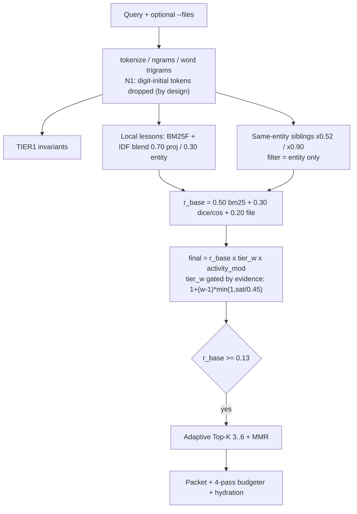
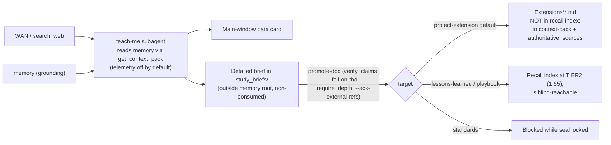

> [!CAUTION]
> **QUARANTINED PEER-AI AUDIT (`quarantine: true` | `authoritative: false` — DO NOT CITE AS VERIFIED FACT)**
> Imported from Claude Sonnet session `e41eebf7-644b-43e6-99e9-e36580ebbce0` (`Memory_Retrieval_Weight_Balance_Audit.md` + empirical probes `probe1.py`–`probe5.py` / `rq.sh` in `scratch/`).
> - **Mandatory Next-Session Validation Gate**: All findings (`F-01`..`F-16`) and proposals (`R-01`..`R-08`) must be validated item-by-item against live `Homunculus` (`51453f6`) code, `SUBSYSTEM-INVARIANTS`, and developer architectural intent before planning or mutating any `Ring 0` or `Ring 1` surface (especially `teach-me` sections, where updates remain actively evolving).

# Memory Retrieval & Weight-and-Balance Audit — Rev 3

> [!IMPORTANT]
> **Agent:** findings are `F-xx` (evidence + anchor), proposals are `R-xx` (verification gate). Proposals await engineer approval. Values are sourced only if tagged `[CODE]`, `[DOC]`, `[MEASURED]`, `[CALC]`; anything tagged `[UNVERIFIED]` was not proven.
> **Engineer:** §1 verdict → §4 broken → **§5 teach-me side-by-side + my case** → **§6 ceiling vectors + my case** → §8 decisions still needed.

## Rev 3 — what your answers changed

| Your answer | Effect |
| :--- | :--- |
| **1.** Teach-me is a separate module that reads memory for grounding (and WAN), outputs a main-window card + a non-consumed detailed file, and enters memory **only via promote** | Audited the real read and promote paths. Read/staging side is sound (S-13). **New F-16: the promote path has a poisoning gap** — exactly your stated concern. F-05 reframed: the issue is the module's *development* lessons, not its output. |
| **2.** Show direct vs partial teach-me items side by side and state a case | §5 table + case. Result: hide `LL-049` + the invariant row; `LL-048` conditionally; **leave `LL-026`, `LL-041`, `LL-028` visible** (reasons in §5). |
| **3.** No good answer on ceilings — recommend vectors | §6: measured battery + 8 decision vectors with reasons + a recommended combination. |
| **4.** Telemetry diagnostic-only | R-08 finalized as diagnostic-only; old Q-C closed. |

Earlier closures stand: cleanroom↔public same-entity recall accepted; N1 numeric ban upheld (F-07 closed).

---

## 0. Scope & Limits

| Item | Detail |
| :--- | :--- |
| System | Recall + weighting (`TIER0`–`TIER5`, hybrid BM25F, packet budgeting) and how add-on modules (teach-me) read/promote through `memory_gateway.py`. |
| Executed | Probes on a **copy** of the vault (`brain/…/scratch/mem`): `probe1-5.py`, `rq.sh`. Real vault/repo never written (Rev-1 check: 0 files newer; repo clean). |
| **Not covered** | `context-pack` content/size; `tests/test_project_memory.py`; `Homunculus_Version_and_Benchmark_Ledger.md` / `LL-044`; NetCom & Orin_Workstation entities. I did **not** run any promotion (it writes memory) — F-16 is from code reading, so parts are `[UNVERIFIED]`. My probe sets are small and self-authored. |

---

## 1. Verdict

Ranking core is sound (9/9 targeted lookups correct at rank #1; off-topic returns nothing). Teach-me's *design* is well contained. The remaining risk is concentrated in **what happens after promotion**, in **doc/enforcement drift**, and in **text normalisation + noise**.

| # | Headline | Severity |
| :--- | :--- | :--- |
| **F-16** | Promoted extensions carrying WAN references (`external_references`) are still added to `authoritative_sources`; `lessons-learned` target auto-writes a "verified root cause" boilerplate | **HIGH / `[LOAD-BEARING]`** |
| F-01 | Weight reference doc matches live code on 0 of 12 compared constants; claimed parity test doesn't exist | HIGH |
| F-03 | Stemmer: `rule`≠`rules`, `bore`≠`bores`, `tune`≠`tuning` → results depend on word form | HIGH |
| F-15 | Locked docs say `--audit` enforces a 600-token packet; it doesn't. Lessons window documented 420/10, enforced 320/12 | HIGH (doc/enforcement gap) |
| F-05 | Teach-me *development* lessons reachable in unrelated projects' recall (hydrated, rank #1) | MED-HIGH |
| F-04 | Generic words recall irrelevant siblings (same class as your part-number concern) | MED-HIGH |
| F-06 | No per-duty budget for `--preflight`/`--kickstart`; token estimator under-counts ~1.7× | MED-HIGH |
| F-08 | Telemetry covers 9 of 80 lessons (now diagnostic-only per your answer) | MED |

---

## 2. Architecture (what the weights act on)





Live corpus (`total_docs=80`): Homunculus 51 lessons (T0×2, T2×11, T3×30, T4×1, T5×7; 14 invariants); Pneuma 10; eight projects 2–3 `TIER2` each.

---

## 3. Strongest Points (keep; expand from these)

| ID | Strength | Evidence |
| :--- | :--- | :--- |
| S-1 | **Evidence-gated gravity** — tier multiplier scales with lexical evidence | [#L7596](file:///home/orin/Projects/Alchemical3D/Homunculus/skills/project-memory/scripts/sync_memory.py#L7596) |
| S-2 | Exact-ID fast path, noise-free (`LL-PNE-04` → single hit `2.85`) | [#L7539-L7541](file:///home/orin/Projects/Alchemical3D/Homunculus/skills/project-memory/scripts/sync_memory.py#L7539-L7541) |
| S-3 | Off-topic query → zero hits | probe N5 |
| S-4 | Paraphrase/synonym/typo robustness without embeddings (9/9 top-1) | §7 battery |
| S-5 | `TIER5` suppression leaks no content | [#L8043-L8049](file:///home/orin/Projects/Alchemical3D/Homunculus/skills/project-memory/scripts/sync_memory.py#L8043-L8049) |
| S-6 | Two-lane `TIER0` | [#L7546-L7580](file:///home/orin/Projects/Alchemical3D/Homunculus/skills/project-memory/scripts/sync_memory.py#L7546-L7580) |
| S-7 | Fully explainable scores (`r_base × w`, matched terms, `#Lstart-Lend`) | packet format |
| S-8 | Bounded activity modifier `[0.85,1.25]`; cannot flip a tier `[CALC]` | [#L5226-L5270](file:///home/orin/Projects/Alchemical3D/Homunculus/skills/project-memory/scripts/sync_memory.py#L5226-L5270) |
| S-9 | Storage integrity: `--audit` PASS (12 projects, 90 files, 0 violations); `0444` archive/standards; hash-chained seal | run on copy |
| S-10 | 4-pass budgeter degrades gracefully | [#L8068-L8079](file:///home/orin/Projects/Alchemical3D/Homunculus/skills/project-memory/scripts/sync_memory.py#L8068-L8079) |
| S-11 | **N1 numeric ban works as intended** — `608ZZ, 6061, 2GT, 2020, 3D, 9x2, 5mm` never score; `M3, PB11, TMC2209` do | [#L4860-L4876](file:///home/orin/Projects/Alchemical3D/Homunculus/skills/project-memory/scripts/sync_memory.py#L4860-L4876) |
| S-12 | Same-entity cleanroom↔public sharing is intended (your Q2) | — |
| **S-13** | **Teach-me read/staging containment is sound:** briefs live in `study_briefs/` outside the memory root; `staging-dir` hard-blocks any path inside it (`STAGING_INSIDE_MEMORY_ROOT_BLOCKED`, [memory_gateway.py#L1171-L1175](file:///home/orin/Projects/Alchemical3D/Homunculus/scripts/memory_gateway.py#L1171-L1175)); its grounding read uses `get_context_pack` (telemetry default `False`, #L493); promotion requires `verify_claims --fail-on-tbd`, `require_depth`, an authoritative source, entity and compartment checks ([#L1259-L1378](file:///home/orin/Projects/Alchemical3D/Homunculus/scripts/memory_gateway.py#L1259-L1378)); context packs already label extensions `epistemic_tag: EXTERNAL` vs `LOCAL_VERIFIED` and strip `[EXTERNAL SCIENCE]` lines from summaries ([sync_memory.py#L7054-L7073](file:///home/orin/Projects/Alchemical3D/Homunculus/skills/project-memory/scripts/sync_memory.py#L7054-L7073)) | code reading |

---

## 4. Findings

### F-16 · HIGH · `[LOAD-BEARING]` — Promote path: WAN-derived content can become ground truth *(new; your Q1)*

Your design (card + non-consumed file; promote only) is the right firewall. Four things on the *far side* of promote weaken it:

| # | Observation | Evidence | Status |
| :--- | :--- | :--- | :--- |
| P-1 | **Destination decides recall weight.** `project-extension` (default) is **not** in the recall index (the entity index holds only lessons + invariants) → reachable only via `context-pack` telemetry lens / `hydrate Extension:`. `lessons-learned` / `playbook` write into the recall index at `TIER2` (weight 1.65; sibling-reachable across the entity at ×0.52). | `record_lesson` default `tier="TIER2"` ([#L1502-L1517](file:///home/orin/Projects/Alchemical3D/Homunculus/scripts/memory_gateway.py#L1502-L1517)); index keys `[CODE]` | verified |
| P-2 | **`lessons-learned` target auto-fills fields.** If `--guardrail` is omitted it takes the first **320 chars of the flattened brief body**; `--root-cause` defaults to the fixed sentence "Verified study/extension root-cause analysis promoted from `<file>`"; symptom defaults to the title ([#L1380-L1396](file:///home/orin/Projects/Alchemical3D/Homunculus/scripts/memory_gateway.py#L1380-L1396)). A brief's opening (card/mental-model prose) is not a guardrail, and the boilerplate asserts "verified root-cause" regardless of content. | code | verified |
| P-3 | **`authoritative: true` is stamped uniformly** (`status: PROMOTED_ENGINEERING_EXTENSION`) whether or not the brief carries `external_references` ([#L1449-L1460](file:///home/orin/Projects/Alchemical3D/Homunculus/scripts/memory_gateway.py#L1449-L1460)). | code | verified |
| P-4 | **WAN-derived extensions still become `authoritative_sources`.** In the fabric builder, an extension with `authoritative: true` + a VRF/sha proof is appended to `verified_ext_sources` at **L7050**; `has_ext_refs` is only computed later (**L7063**) and used solely for the display tag; `auth_sources.extend(verified_ext_sources)` at **L7095** feeds the list passed to `verify_claims.py --sources`. So the `EXTERNAL` label never reaches the authority decision. | [sync_memory.py#L7046-L7095](file:///home/orin/Projects/Alchemical3D/Homunculus/skills/project-memory/scripts/sync_memory.py#L7046-L7095) | order of statements verified; **behavioral consequence `[UNVERIFIED]`** (I did not promote a test brief; I also did not check whether `verify_claims` discounts `[EXTERNAL SCIENCE]` lines when a file is used as a source — grep found external-ref handling only for *targets*, `verify_claims.py#L2556-L2869`) |

**Why it matters:** the human gate (`--ack-external-refs`) protects the *moment of promotion*; P-3/P-4 mean the document then looks like a locally verified engineering source to later verification runs — the circular-grounding hazard your accuracy rules forbid (anti-circularity). It is the one place where WAN content can quietly re-enter as "truth".

> [!NOTE]
> Mitigating factors found: promotion needs VRF + `--ack-external-refs`; summaries in context packs omit `[EXTERNAL SCIENCE]` lines; default target is the non-recalled extension. The gap is narrow but it is exactly the poisoning vector you described.

### F-05 · MED-HIGH — Teach-me *development* lessons reach unrelated recall *(reframed)*

Two different things are called "teach-me lessons":

| Class | Meaning | Where it should live |
| :--- | :--- | :--- |
| **(i) Module-development lessons** | Why `teach_brief.py` broke and how it was fixed (`LL-048`, `LL-049`, …) | Scoped to the module; surfaces only when work targets teach-me |
| **(ii) Promoted subject content** | What a brief teaches about a user's engineering topic | Per project, via promote (F-16 governs this) |

Only class (i) is the F-05 problem. Probe evidence (queries worded with generic overlap — shows reachability, not frequency): `Maker-Tools "write files directly into memory root bypass gateway read-only flags"` → `LL-048` **rank #1 hydrated**; `Pneuma "subagent write allowlist path traversal"` → `LL-049` **rank #1 hydrated**; `Brand "transcript truncation silent git rev-parse"` → `LL-041` rank #1 hydrated.

**Root cause (structural):** `record_lesson` has **no `scope`/`addon` parameter** ([#L1502-L1517](file:///home/orin/Projects/Alchemical3D/Homunculus/scripts/memory_gateway.py#L1502-L1517)). The SDK gives add-ons a private, non-recalled `upsert-extension-slot` for *telemetry*, but their *lessons* go into the shared pool; the sibling filter checks entity only ([sync_memory.py#L7654](file:///home/orin/Projects/Alchemical3D/Homunculus/skills/project-memory/scripts/sync_memory.py#L7654)). Fix belongs at SDK level (R-05), not as a one-off tag.

### F-01 · HIGH — Weight reference doc drifted from live code

| Constant | Doc | Live | Code anchor |
| :--- | :---: | :---: | :--- |
| `TIER2` multiplier | 2.0 | **1.65** | [#L2510](file:///home/orin/Projects/Alchemical3D/Homunculus/skills/project-memory/scripts/sync_memory.py#L2510) |
| `r_base` floor | 0.08 | **0.13** | #L2527 |
| Sibling implicit weight | 0.65 | **0.52** | #L2528 |
| Sibling `r_base` floor | 0.22 | **0.20** | #L2530 |
| Packet token ceiling | 600 | **1800** | #L2546 |
| Capsule symptom / guardrail chars | 75 / 280 | **110 / 340** (+460) | #L2551-L2553 |
| `TIER0` pinned chars | 300 | **360** | #L2554 |
| Rank #2 `TIER1` chars | 420 / 260 | **520 / 300** | #L2549-L2550 |
| Lessons window lines / sections | 420 / 10 | **320 / 12** | #L2559-L2560 |

Doc: [Homunculus_Memory_Weight_and_Scoring_Reference.md](file:///home/orin/Projects/Engineering/memory/Projects/Homunculus/Homunculus_Memory_Weight_and_Scoring_Reference.md) (`last_synced 2026-11-09`; script modified 2026-11-12). It claims parity is checked by `test_project_memory.py`; `grep` over `tests/*.py`, `sync_memory.py`, `scripts/*.py` for `scoring_reference|Weight_and|headroom` → no matches. Doc says "avg ~183 tokens"; measured median 838 (§6).

### F-02 · MED — Config isn't the single source of truth
Dead keys: `tier0_top3_gate_sat`, `numeric_query_weight` (looks like the N1 lever, does nothing), `lesson_field_max_words`, `agents_md_max_bytes` (audit hard-codes `2200` B at [#L9522](file:///home/orin/Projects/Alchemical3D/Homunculus/skills/project-memory/scripts/sync_memory.py#L9522) and `60` lines at #L9528). Hard-coded rank constants absent from config/doc: bm25 component `0.65/0.20/0.15` (#L7526), invariant boost `+0.075` (#L7538), exact-ID `0.95/3.0/0.90`, `rel_conf` divisor `3.2` (#L7490), Dice gate `0.52` (#L7430), sibling-`TIER0` `2.0` + `sat ≥ 0.60` (#L7768-L7771), anti-amnesia gates (#L7856), `TIER4` high-evidence gates (#L7591).

### F-03 · HIGH — Stemmer inconsistent; recall depends on word form
`rule`→`rule` vs `rules`→`rul`; `bore`→`bore` vs `bores`→`bor`; `tune`→`tune` vs `tuned/tuning`→`tun`; over-truncation (`speed`→`spe`, `string`→`str`, `emergency`→`emergenc`) ([#L4809-L4834](file:///home/orin/Projects/Alchemical3D/Homunculus/skills/project-memory/scripts/sync_memory.py#L4809-L4834)). Controlled: `Homunculus "rule"` → `LL-045 1.303 / LL-025 0.865 / LL-001 0.853 / LL-039 0.848`; `"rules"` → `1.182 / 0.797 / 0.792 / LL-003 0.788` (≈8–10 % lower, different 4th hit); `"tuning"` → no hits, `"tune"` → one unrelated hit; `Pneuma "bore"` vs `"bores"` → entirely different sets.

### F-04 · MED-HIGH — Generic words recall irrelevant siblings
`Brand "how does it work after the full run, why"` → 6 Homunculus siblings (`0.47…0.29`), rank #1 a `TIER0`, one hydrated. Cause: 27 stopwords ([#L4762-L4766](file:///home/orin/Projects/Alchemical3D/Homunculus/skills/project-memory/scripts/sync_memory.py#L4762-L4766)), ~20 generic tokens (#L4800-L4803); `how/does/why/after/full/work` count as specific evidence and satisfy the sibling-`TIER0` gate (#L7769). Lesson-template words (`symptom, root, caus, trap, verif`) appear in ≥50 % of all 80 docs but are not listed generic `[MEASURED]`. **Size is not tracking relevance:** filler-query packets have *larger* median size (838 est) than targeted ones (580) — see §6.

### F-06 · MED-HIGH — Ceilings differ by duty (intended) but only one duty has a shrink path
Details and decision in §6. Short form: `--recall` is budgeted in-process; `--preflight` and `--kickstart` have no budget and no shrink passes; the estimator `words×1.3` under-counts by median **1.72–1.82×** vs `chars/4` `[MEASURED]`.

### F-07 · CLOSED — N1 numeric/part-number exclusion is the contract (your Q3). No change.

### F-08 · MED — Telemetry sparse; now diagnostic-only
9 entries / 80 lessons (Homunculus 4, Pneuma 3, Workstation 2). Writers: `--add-lesson` near-miss ([#L3501-L3516](file:///home/orin/Projects/Alchemical3D/Homunculus/skills/project-memory/scripts/sync_memory.py#L3501-L3516)), `--lesson-id` drilldown. Gateway defaults differ: `hydrate` records (default `True`, [memory_gateway.py#L820](file:///home/orin/Projects/Alchemical3D/Homunculus/scripts/memory_gateway.py#L820)), `context-pack` doesn't (`False`, #L493). Write path is unlocked read-modify-write and swallows `OSError` ([#L5212-L5219](file:///home/orin/Projects/Alchemical3D/Homunculus/skills/project-memory/scripts/sync_memory.py#L5212-L5219)); keyed by `(project,id)` only; file `0644`.

### F-09 · LOW-MED — Recency asymmetry
Dated `2026-11-05` → `0.979`; dated `2025-01-01` → `0.900`; **undated → `1.000`**; 45/70 `TIER2–4` lessons undated; only the first heading date is used ([#L5253-L5255](file:///home/orin/Projects/Alchemical3D/Homunculus/skills/project-memory/scripts/sync_memory.py#L5253-L5255)).

### F-10 · LOW-MED — "Rank #n" ≠ score order (MMR + anti-amnesia slot); ledger inherits the order.

### F-11 · MED (content) — Gradient only in one project
7 of 10 projects are all-`TIER2`; `TIER0` only in Homunculus; project IDF weight `0.70` on N=2–3 corpora: `idf_p` = `0.693` (1 of 2 docs) vs `0.182` (2 of 2) `[CALC]`; Homunculus (N=51) `df=1` ≈ `3.55` `[CALC]`.

### F-12 · MED — "Held / Already Loaded at Session Start" only true after `--kickstart`
[#L7962](file:///home/orin/Projects/Alchemical3D/Homunculus/skills/project-memory/scripts/sync_memory.py#L7962); read-only Turn-1 triage and bare `--recall`/`--preflight` don't run kickstart.

### F-13 / F-14 · LOW — `rules/*.md` shown as `rules/.md` (asterisk stripping in subsystem names); `hit_telemetry.json`/`preflight_state.json` are `0644` vs `0600` siblings; commit `d32bd92` mentions `--tier-config`, absent from current script (not verified whether renamed).

### F-15 · HIGH (doc/enforcement gap) — Locked docs claim enforcement `--audit` doesn't perform
`Governance_and_Constraint_Architecture.md` (`0444`, line 91) says `--audit` enforces `<MEMORY_DECISION_PACKET> <= 600 tokens` and `_Lessons_Learned.md <= 420 lines / <= 10 sections`. Code: **no packet check in `--audit`** (only the in-process budgeter); lessons check uses **320 / 12** ([#L9359-L9361](file:///home/orin/Projects/Alchemical3D/Homunculus/skills/project-memory/scripts/sync_memory.py#L9359-L9361)). `SKILL.md` line 104 repeats `420 / 10`. `README.md#L27` says AGENTS.md `≤150` words; code/SKILL say `≤180`.

---

## 5. Teach-me Lessons — Side by Side, and My Case *(your Q2)*

All data from the index and the lesson bodies (read windows ≤ 30 lines for the sealed Archive).

| Item | What it is actually about | Teach-me share | General guardrail also held elsewhere? | Location / seal | **Case** |
| :--- | :--- | :--- | :--- | :--- | :--- |
| **`LL-049`** (T2) | `attest_subagent_execution` write allowlist, `init_brief --out` boundary, backtick handling in `FALSE_TBD_KNOWN_IN_SOURCE`. Files: `teach_brief.py`, `test_teach_me.py` only | **All** | The "staging must not be inside `<memory_root>`" principle is enforced in gateway code (`STAGING_INSIDE_MEMORY_ROOT_BLOCKED`, #L1171), not only in memory | `Homunculus_Lessons_Learned.md#L236-L239`, editable | **HIDE** (scope: teach-me) |
| **Invariant row** `skills/teach-me/scripts/teach_brief.py` (governs `LL-049`) | TIER1 contract for the module | **All** | — | `SUBSYSTEM-INVARIANTS` | **HIDE** (low urgency: invariants only match on a file hit or ≥2 subsystem hits; I did not observe it leaking) |
| **`LL-048`** (T2) | 4 symptoms: (1) raw writes bypassing the gateway; (2) `ensure_directory_fresh()` recreating `Directory/` under read-only flags; (3) flash tags downgrading score≥2 queries; (4) compound modifiers truncating head nouns in `_pack_tokens()` | **Mixed** — (1) is the general gateway-bypass class; (2)–(4) are `teach_brief.py` internals | **Yes for (1):** `LL-047` (Three-Ring isolation, AST `BYPASSED_MEMORY_GATEWAY`) and `PB-HOM-02` (route writes via the gateway) both surfaced for the same probe | `…Learned.md#L229-L234`, editable | **HIDE conditionally** — only after you confirm `LL-047`/`PB-HOM-02` carry the general rule (I saw them co-surface; I did **not** compare bodies line by line against the rule in `LL-048`) |
| **`LL-026`** (T3) | `teach-me` fast path (24→11 turns), shell `.py`-snoop closure, `[Hint]` diagnostics, **and** entity-isolated `Directory/` box-tree hub (`sync_directory_trees`) | **Mixed** — items 1–2 are teach-me/sandbox authoring process; item 3 is core memory architecture | Directory hub is core | Sealed Archive (`0444`, `#L260-L270`) | **LEAVE visible.** Tagging it means editing a sealed Archive (governance unlock/re-seal); weight is low (`TIER3` 1.0; sibling ×0.52); not seen in any probe |
| **`LL-041`** (T2) | Transcript truncation guards, `verify_claims` `git rev-list`, `_parse_step_metrics`, `EROFS_RE` | **Minimal** — `teach_brief.py` is one of four files in the *resolution* list; no symptom concerns teach-me | n/a | `…Learned.md#L180-L185` | **KEEP visible** — hiding would hide core-oracle guardrails |
| **`LL-028`** (T3) | Navigation maps, unified AST kernel, shared-`SourceIndex` oracle batching; `teach_brief.py --verify` speed-up is 1 of 3 sub-results | **Minimal** | n/a | Sealed Archive `#L272-L283` | **KEEP visible** |

**My case**
1. **Hide only what is wholly the module's own:** `LL-049` and its invariant row. `LL-048` second, conditional on the general-rule check.
2. **Do not hide `LL-041` / `LL-028`.** They only name `teach_brief.py` among shared oracles; scoping them would remove guardrails for `verify_claims`/`sync_memory` work.
3. **Don't derive scope automatically from `touched_files`.** That heuristic would classify only `LL-049` correctly (its two files are teach-me only); `LL-048` includes `memory_gateway.py`, and `LL-026/041/028` span core scripts. It would be right only on the cleanest case, and your rule "Ask Before Coding Heuristics" argues for an explicit author-assigned tag.
4. **Scope is the right abstraction, not a separate project** (R-05): a scope attribute honored by recall/preflight/context-pack keeps lessons next to the code they describe, avoids touching the sealed Archive, and gives every future add-on the same isolation for free. Separate-project is the fallback if you want a hard physical boundary (costs: seal/`sudo:` steps for `LL-026`).
5. **Bidirectional benefit:** teach-me grounds itself through `get_context_pack`, whose `guardrails` lens includes sibling inheritance ([playbook line 50](file:///home/orin/Projects/Alchemical3D/Homunculus/templates/community_sdk/Addon_Memory_Integration_Playbook.md)); a scope filter also stops teach-me's *own* seed packs from pulling in its own repair history while grounding on a hardware project.

---

## 6. Ceilings — Measured, Side by Side, and Decision Vectors *(your Q3)*

### 6.1 Documented vs enforced vs measured

`[MEASURED]` on the vault copy: recall = 30 packets (10 projects × {title-derived, generic, filler} queries); preflight = 5 Homunculus scripts; kickstart = all 10 projects. "est" = engine estimator `words×1.3`; "c/4" = chars÷4 proxy (not the model tokenizer — direction solid, magnitude approximate).

| Duty | Documented `[DOC]` | Enforced `[CODE]` | Measured: est / c/4 |
| :--- | :--- | :--- | :--- |
| `AGENTS.md` | `≤180` w / `≤2200` B (SKILL L104); README says `≤150` w | audit: 180 w + `2200` B hard-coded | 1,620 B |
| Decision Profile | `≤60` lines; text says capsules `≤450` tok | `≤60` lines hard-coded; **no code anywhere for 450 tokens** (only `450` in config is a *character* cap, unrelated) | 2,875 B |
| **`--recall`** | `≤600` (AGENTS.md, Commands ref L98, Governance L91); `≤1,400` (docstring #L7254); `≤1,800` (invariant row) | in-process budgeter to `1800` (4 passes); **audit: none** | est median **838**, min 280, max 1,276; c/4 median **1,439**, max 2,286; 1 of 30 exceeds 1,800 by c/4 |
| **`--preflight`** | `≤600` (AGENTS.md, Commands ref L98) | **none** on the wrapper | est **1,397–1,833**; c/4 **2,735–3,502** (5 scripts) |
| **`--kickstart`** | none found | none | est **322–1,820**; c/4 **571–3,654** (Homunculus largest; others ≤ 1,439) |
| Hydration / capsules | doc `75/280` chars | `1350` hydrate; `110/340/460` capsule | — |
| Lessons window | `≤420` L / `≤10` sec | **`320` / `12`** | — |
| Gateway `context-pack` | depth `radar/standard/deep`, no token figure | row caps `3/6/12`, Top-K `3/auto/6` ([#L550-L551](file:///home/orin/Projects/Alchemical3D/Homunculus/scripts/memory_gateway.py#L550-L551), #L755) | **not measured** |

**Four measured facts that shape the decision**

1. **Size doesn't follow relevance.** Median est: filler **838** > title-derived **580** (generic 991). Budget is being spent on noise (F-04).
2. **600 is reachable for recall** — with the ceiling forced to 600 in-process, 30/30 packets finished ≤594 est — **but only because passes 2–4 remove hydration and evidence snippets** ([#L8068-L8079](file:///home/orin/Projects/Alchemical3D/Homunculus/skills/project-memory/scripts/sync_memory.py#L8068-L8079)); median fell 838 → 532 (−37 %). Ranking is unaffected (budgeting runs after ranking). By c/4 the same packets are median 899, max 1,095 — so "600" as written is closer to ~900–1,100 real tokens.
3. **Preflight and kickstart have no shrink path** and run 2–3× the recall packet. Kickstart tracks the number of `TIER1` invariant rows (Homunculus 14 → 14.6 kchars; Pneuma 6 → 5.8 k; projects with 1–3 → 2.3–3.7 k; ≈0.9 k chars/row from the endpoints `[CALC]`, correlation not proof — Homunculus also has 2 `TIER0` laws and a larger handoff).
4. **Estimator error is stable:** median c/4 ÷ est = **1.72** (ceiling 1800) / **1.82** (ceiling 600) — a calibration constant, not noise.

### 6.2 Decision vectors (you asked for options and reasons)

| # | Vector | How it works | Why you might choose it | Why not / risk | Evidence here |
| :--- | :--- | :--- | :--- | :--- | :--- |
| **V1** | **Named duty classes** | Three budgets with names: `radar` (always/near-always loaded), `packet` (on-demand recall), `cold-load` (kickstart/preflight) | Matches the three clusters already in docs/code; each gets its own enforcement and its own doc line | Needs you to pick a number per class | Docs cluster as `450/600` · `1,800` · none; measured populations differ 2–4× |
| **V2** | One global ceiling | A single number for everything | Simplest to state | Either cripples preflight/kickstart (no shrink path) or is meaningless at 1,800 | Preflight/kickstart 1,400–1,833 est vs recall median 838 |
| **V3** | Distribution-derived (p95 + headroom) | Set budgets from measured percentiles | Grounded in reality; no guessing | Ratchets: budgets silently grow with corpus (kickstart scales with invariant count) | Kickstart range 322 → 1,820 |
| **V4** | Fraction of context window | Budget = % of the running client's window, per duty | Ties spend to real cost across clients (`enabled_clients` lists four) | Memory engine doesn't know the client/window; needs a client profile | — |
| **V5** | Cut by marginal value, not tokens | Stop adding hits below a relative-score gate; fix noise first | Attacks the cause: noise inflates size | Needs F-04 fixed to be effective; adaptive Top-K already partial | Filler median 838 > title 580 |
| **V6** | Per-component sub-budgets | Separate caps for invariants / capsules / hydration | Preserves value ordering (TIER1 Must-Keep first); already partly present (rank caps) | More knobs to document | Budgeter trims Rank #2 before Rank #1 |
| **V7** | **Budget in characters, not tokens** | Enforce `chars`, publish token equivalents as information | Exact, deterministic, tokenizer-independent; config is already mostly char-based (capsules, hydration) — removes the estimator debate | Chars ≠ cost across languages/code density | Estimator off by 1.72–1.82× |
| **V8** | Enforce-by-test | Golden battery asserts each duty ≤ its budget; `--audit` fails on overrun | Independent of which numbers you pick; closes F-15 | Needs the battery (R-14) | `--audit` PASSed with packets above the documented 600 |

**My case — a combination, in this order**
1. **V1 + V7:** adopt three named duty classes and budget them in **characters** (token figures become derived, informational). This fixes the labeling problem (F-06), removes the estimator error, and gives preflight/kickstart a number for the first time.
2. **V5 before lowering any number:** fix noise (R-03/R-04) first; today a lower ceiling would just trim useful hydration while noise survives.
3. **V3 as a monitor, not a contract:** record per-duty p50/p95 so the next review is data-driven and corpus growth is visible (especially kickstart vs. invariant count).
4. **V8 to close the loop:** a test asserting each class ≤ its budget, plus `--audit` enforcement, so the locked docs stop describing checks that don't exist (F-15).
5. **Defer V4/V6** until a client profile or a measured need exists.

A decision procedure that needs no guessing: (a) pick the unit (chars); (b) take the measured p95 per duty as **provisional** budgets; (c) re-measure after F-03/F-04 fixes; (d) tighten only where the shrink path preserves what you value (hydration); (e) lock via test and update docs from config (R-01/R-06).

---

## 7. Probe Battery (reproducible)

`scratch/rq.sh <Project> "<query>"`.

| # | Project | Query | Result | Verdict |
| :--- | :--- | :--- | :--- | :---: |
| Q1 | Pneuma | `Klipper shutdown_speed emergency stop fan blast` | `LL-PNE-04 1.79`, `LL-PNE-09 0.93` | ✅ |
| Q2 | Pneuma | `pump runs at full power after the printer faults` | `LL-PNE-04 1.36` #1; 2 noisy siblings | ✅/⚠ |
| Q3 | Pneuma | `8 insert pockets versus 5 + 2 allocation` | `LL-PNE-06 1.37` | ✅ |
| Q4 | Pneuma | `screw boss count disagrees with parts list` | `LL-PNE-06 1.26`, `LL-PNE-08 0.78` | ✅ |
| Q5 | Pneuma | `why single pump solenoid diversion was abandoned` | `TIER5_SUPPRESSED LL-PNE-01` + 3 junk | ✅/❌ |
| N1 | A3DP | `2GT belt tension` | `LL-GAN-02 1.49`, `LL-GAN-03 1.42` | ✅ |
| N2 | Alembic | `6mm OD tube O-ring 9x2` | `LL-ALM-02 1.23`, `LL-ALM-03 1.14` | ✅ |
| N3 | Pneuma | `shutdwon_speed estop fan` | `LL-PNE-04 1.29` | ✅ |
| N4 | Pneuma | `LL-PNE-04` | single `2.85` | ✅ |
| N5 | Brand | `kubernetes ingress controller autoscaling` | none | ✅ |
| N7 | Maker-Tools | `threadlocker aluminum plate stripped threads` | `LL-GAN-01 0.79` | ✅ |
| F | Brand | `how does it work after the full run, why` | 6 irrelevant siblings incl. TIER0 | ❌ |
| T1 | Maker-Tools | `write files directly into memory root bypass gateway read-only flags` | `LL-048` #1 hydrated | ❌ |
| T2 | Pneuma | `subagent write allowlist path traversal` | `LL-049` #1 hydrated | ❌ |
| T4 | Brand | `transcript truncation silent git rev-parse` | `LL-041` #1 hydrated | ⚠ (not teach-me; see §5) |

Scorecard: targeted 9/9; filler 0/2 clean; teach-me development-lesson isolation 0/2 (T4 excluded: `LL-041` should stay visible).

---

## 8. Decisions Still Needed

| # | Question | Blocks |
| :--- | :--- | :--- |
| **D-1** | **Scope mechanism (F-05):** approve an SDK-level `scope` attribute (honored by recall/preflight/context-pack) over a separate project? Approve hide-set `LL-049` + invariant row, and `LL-048` after the general-rule check? Leave `LL-026/041/028` visible? | R-05 |
| **D-2** | **F-16 policy:** should extensions whose frontmatter has non-empty `external_references` be **excluded from `authoritative_sources`** (and from `verified_ext_sources`) even with VRF? And should the `lessons-learned` target require an explicit `--guardrail` (no auto-fill from the brief body)? | R-15 |
| **D-3** | **Ceilings:** accept V1+V7 as the framework? Numbers are yours; I suggest provisional p95 from §6.1 after F-03/F-04 are fixed. Should `--audit` enforce them? | R-06 |
| D-4 | Is the Teach-Me Sandbox Dossier file in `Projects/Homunculus/` allowed to appear in `context-pack` (not tested)? | R-05 |

*Closed:* telemetry influence on ranking → **diagnostic-only**.

---

## 9. Expansion Roadmap (proposals — not applied)

| ID | Proposal | Addresses | Verification gate |
| :--- | :--- | :--- | :--- |
| **R-15** | **Harden the promote path:** (a) exclude extensions with non-empty `external_references` from `verified_ext_sources`/`authoritative_sources`, or require an explicit second flag; (b) stamp provenance in the promoted frontmatter (`external: true`) and make `authoritative` mean *locally verified only*; (c) `lessons-learned` target must receive explicit `--symptom/--root-cause/--guardrail` — no body-derived auto-fill, no boilerplate "verified" sentence; (d) add a test that promotes a fixture brief containing `[EXTERNAL SCIENCE]` and asserts it is absent from `authoritative_sources`. | F-16 | Fixture promote → not in `authoritative_sources`; `verify_claims` cannot ground a claim on its external lines; default `project-extension` path unchanged. |
| **R-05** | **Scope attribute (SDK-level):** add `scope` (e.g., `addon:teach-me`) to `record_lesson` / `record_playbook` / invariant rows; recall, preflight, context-pack and router generation hide scoped items unless query/`--files`/preflight target names the scope; footer `[SCOPE_SUPPRESSED:n]` (IDs only). Apply to `LL-049` + invariant row (and `LL-048` per D-1) via `--reinforce`/repair route, not by hand-editing sealed files. | F-05 | T1/T2 no longer surface scoped items; `teach_brief.py` / "teach-me" queries still do; `--audit` clean; `LL-041/028/026` unchanged. |
| **R-06** | **Per-duty budgets** (V1+V7+V8): one `budgets` section keyed by duty, in characters; docs/AGENTS/SKILL/Governance generated from it; enforce in `--audit`; give preflight/kickstart shrink passes; fix `420/10` vs `320/12`, `150` vs `180`. | F-06, F-15 | Test: every duty ≤ its budget over the battery; audit fails on overrun; locked docs need the unlock/seal protocol. |
| **R-08** | **Diagnostic-only recall telemetry** (your Q4): events `surfaced` / `drilled` / `reinforced`, **none feeding score**; record `caller` (`recall` / `preflight` / `context-pack:<addon>`) so teach-me seeding doesn't read as engineering use; append-only `.cache/hit_events.jsonl` folded by an existing sync command (no read-modify-write race); key `(project,id,content_sha)`, prune dead IDs, `0600`; never log query text; dedupe per `(id,caller,day)`; `--no-telemetry` parity for recall; visible `[TELEMETRY_WRITE_FAILED]` instead of silent swallow; align gateway defaults. Output: a review report ("surfaced N×, never drilled"), nothing automatic. | F-08 | N concurrent recalls → N events none lost; read-only run writes nothing and warns; **ranking byte-identical with telemetry on/off**. |
| R-01 | Generate weight reference from `MEMORY_SCORING_CONFIG` + hard parity test (every doc value = config; every config key used or deleted). | F-01, F-02 | Test fails today (12 mismatches + 4 dead keys), passes after. |
| R-02 | Move hard-coded rank constants into named config keys; wire/delete dead keys. | F-02 | Golden scores unchanged (±0.001). |
| R-03 | Stemmer property test over the 3,551-term vocab + fix (or query-side union of variants). | F-03 | `rule`≡`rules`, `bore`≡`bores`, `tune`≡`tuning`; vectors rebuilt. |
| R-04 | Conversational stopwords + corpus-derived genericity; require ≥1 specific token/file hit for any sibling and sibling-`TIER0`. **Do not** raise the implicit-sibling stem-coverage gate to ≥0.35 (listed *Never Re-Add*). | F-04 | Filler battery → 0 hits; Q1–N7 top-1 unchanged. |
| R-09 | Symmetric recency (explicit `last_verified:` or median-of-dated for undated). | F-09 | Equal-age twins score equally. |
| R-10 | Label packet order as diversity-adjusted (or sort); sort ledger line. | F-10 | Monotone or labeled. |
| R-11 | Small-N IDF guard (`w_p = N/(N+k)`). | F-11 | Battery stable. |
| R-12 | Condition the "held" label on kickstart having run. | F-12 | Cold `--recall` shows relevant `TIER0` capsules. |
| R-13 | Preserve `*` in subsystem names; `0600` telemetry files. | F-13/14 | Index shows `rules/*.md`. |
| R-14 | Promote the §7 battery + §6.1 size battery + `LL-044` benchmark into `tests/`. | All | Golden top-1 / must-be-empty / per-duty budget assertions. |

*(R-07 withdrawn; R-08 old ranking-influence design superseded.)*

---

## 10. Governance & Execution Constraints

> [!WARNING]
> `sync_memory.py` and `memory_gateway.py` are sealed Ring 0 (`kernel_seal.json`): edits need an explicit **`sudo:`** request and, per `SKILL.md §4`, a Track-2 **`[SANDBOX-PENDING]`** (`OS Dry-Run +faults`). Vector rebuilds change `vectors_digest`; re-run `--audit` and the seal. Locked docs (`Governance_and_Constraint_Architecture.md`, `0444`) need `--unlock-memory-rules → edit → --seal-governance --user-confirmed --reason … → --lock-memory-rules` with a 3-Part Governance Advisory.

- Run `--preflight sync_memory.py` / `memory_gateway.py` and read their `SUBSYSTEM-INVARIANTS` (Must-Keep / Never Re-Add) before any edit.
- Teach-me itself is Ring 1 (`--unlock-scope teach-me`), but R-05/R-15 touch Ring 0 (gateway + engine); don't split them across rings informally.
- Moving/tagging anything in the sealed Archive (`LL-026`, `LL-028`) is a governance event (`retired_tier5_hashes`, seal hash).
- Record accepted fixes via `--add-lesson` (AGENTS.md rule 3); module-development lessons for teach-me should carry the new scope once R-05 exists.

## 11. Reproduction

```bash
S=/home/orin/.gemini/antigravity-cli/brain/e41eebf7-644b-43e6-99e9-e36580ebbce0/scratch
python3 $S/probe1.py   # F-01/F-02/F-03
python3 $S/probe2.py   # F-08/F-09
python3 $S/probe3.py   # df distribution
python3 $S/probe4.py   # F-03 controlled, packet sizes
python3 $S/probe5.py   # §6.1: 30 recall packets @1800 and @600, 5 preflights
$S/rq.sh Maker-Tools "write files directly into memory root bypass gateway read-only flags"   # F-05
# F-16 (code reading): memory_gateway.py#L1380-L1396, #L1449-L1460; sync_memory.py#L7046-L7095
```

---

### ▪ Project State Ledger
- **Concept**: Read-only audit of how memories are called and weighted, including how a separate teach-me module reads and promotes; hand off findings; change nothing.
- **Memory**: Turn-1 Triage (`AGENTS.md`, `README.md`, weight ref, index/cache; `teach-me/SKILL.md`; `memory_gateway.py` promote/staging; lesson bodies `LL-026/028/041/047/048/049`, `PB-HOM-02`) -> `T0`: `LL-027`, `LL-032` (not loaded) | `Hits`: none (no `--kickstart` on the real vault) | `Suppressed`: n/a
- **Protected**: `[PROTOCOL-01]` No writes to vault/repo/config · `[PROTOCOL-02]` Ring 0 untouched · `[PROTOCOL-03]` N1 numeric exclusion is the engineer's contract · `[PROTOCOL-04]` Same-entity cleanroom↔public recall accepted · `[PROTOCOL-05]` Telemetry is diagnostic-only (never affects ranking) · `[PROTOCOL-06]` Teach-me output is non-consumed; entry to memory only via promote
- **Active**: `[OPEN-01] [LOAD-BEARING]` F-16 promote-path poisoning (D-2) · `[OPEN-02] [LOAD-BEARING]` F-15 / ceilings (D-3) · `[OPEN-03]` F-05 scope mechanism (D-1) · `[OPEN-04] [LOAD-BEARING]` F-01 doc drift · `[OPEN-05] [LOAD-BEARING]` F-03 stemmer · `[SANDBOX-PENDING-06]` any R-xx implementation · `[UNVERIFIED-07]` F-16 P-4 behavioral consequence (needs fixture promote in a sandbox) · `[OPEN-08] [ISOLATED]` F-13/F-14
- **Threat**: `CLEAR` for this audit. Rework risk in implementation: R-05 and R-15 both edit Ring 0 gateway/engine (sequence together); R-04 must not violate the sibling-gate *Never Re-Add*; hiding `LL-048` must not remove the only copy of the general gateway rule (Chesterton's Fence); R-06 edits locked `0444` docs.
