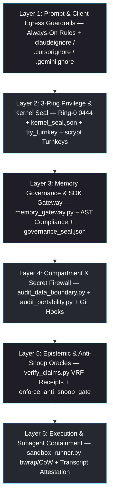

> [!CAUTION]
> **QUARANTINED INTERNAL AUDIT (`quarantine: true` | `authoritative: false` — DO NOT CITE AS VERIFIED FACT PRIOR TO REVIEW)**
> Imported from internal Gemini Carbon session **"Opencode Auth Login Instructions"** (`b4e4ead6-10c1-48ef-aaa7-83bf3c8c1892`: `homunculus_security_and_performance_audit.md` + `scratch/bench_security_cli.py` & `scratch/security_cli_telemetry.md`).
> - **Mandatory Next-Session Gate**: When picking up the handoff, start **immediately with a unified Review & Planning Session** (alongside `2026-11-12_Claude_Sonnet_Memory_Retrieval_Weight_Balance_Audit_Rev3.md`) validating all findings (`Cracks 1`–`7`), latency benchmarks, and `Tier A`/`B`/`C` options against live `Homunculus` (`51453f6`) structure and developer architectural intent **before making any further code, rule, skill, or memory changes**.

# 🛡️ Homunculus Security Architecture: Capability, Performance & Alternatives Audit

- **Target Repository**: [`Homunculus`](file:///home/orin/Projects/Alchemical3D/Homunculus/README.md) (`HEAD SHA: 51453f63a444` · `Tree Hash: 2ca5ab86e3ec` · `108` files)
- **Entity / Compartment**: `Alchemical-3D` / `cleanroom`
- **Host Benchmark Environment**: `Linux` · `Python 3.14.9` (`/usr/bin/python3`) · `/usr/bin/bwrap` · `/usr/bin/rg` · `/usr/bin/git`

> [!IMPORTANT]
> **Executive Synthesis (`Truth Before Comfort`)**
> `Homunculus` (`v0.3.1`) implements a sophisticated **zero-pip, cross-OS defense-in-depth architecture** for AI coding workflows—combining `3-Ring` file locking, `/dev/tty` human-presence challenges, burn-on-use `scrypt` turnkeys, multi-encoding secret/path boundary gates, AST gateway checks, and `Bubblewrap` CoW sandboxes.
>
> However, code-level inspection and empirical benchmarking expose **two structural realities**:
> 1. **Security Boundary Limit**: Almost all enforcement operates **cooperatively inside the same POSIX UID** using unkeyed SHA-256 seal files (`0444`), leaves **four actionable implementation gaps** (silent skip of `.xlsx`/`.3mf` ZIP containers, open network + full host `/` & `os.environ` exposure inside `bwrap`, missing `tty_turnkey` checks on `sync_memory.py` governance flags, and empty client `permissions.deny` / `PreToolUse` secret blockers).
> 2. **Performance Bottleneck**: Warm in-process primitives are sub-millisecond (`< 1 ms` seal check, `4.34 us` HMAC), but **CLI subprocess cold-starts (`54.44 ms` and `58.09 ms`)** and **pure-Python line-by-line regex scanning (`404.76 ms` and `445.79 ms` on `108` files vs. `6.43 ms` in `ripgrep` — `62.9x` faster)** dominate wall-clock hook and audit times.

---

## 1. Current Multi-Layer Security Architecture & Capabilities

| Layer | Core Modules | Verified Capabilities | Enforcement Type |
| :--- | :--- | :--- | :--- |
| **1. Client Context & Prompt Firewall** | [`data-and-credential-safety.md`](file:///home/orin/Projects/Alchemical3D/Homunculus/rules/data-and-credential-safety.md#L9-L51), [`.claudeignore`](file:///home/orin/Projects/Alchemical3D/Homunculus/templates/ignore/.claudeignore#L1-L30) | Blocks secret reads/echoes in prompt rules; excludes `.env*`, `*.pem`, `*.key`, `id_*`, `corpus_inbox/`, and `study_briefs/` from cloud IDE indexers. | Instructional + Client Indexer Advisory |
| **2. `3-Ring` Kernel Seal & `sudo:` Escalation** | [`homunculus_paths.py`](file:///home/orin/Projects/Alchemical3D/Homunculus/scripts/homunculus_paths.py#L1494-L2025), [`kernel_seal.json`](file:///home/orin/Projects/Alchemical3D/Homunculus/scripts/kernel_seal.json#L1-L25) | Seals `39` `Ring 0` files + `9` builtin `Ring 1` files (`0444`/`0555` + SHA-256); resolves real UID home via `pwd.getpwuid(os.getuid())` to defeat `HOME` spoofing; enforces `/dev/tty` hex challenges (`tty_turnkey`), `scrypt` (`n=16384, r=8, p=1`) burn-on-use remote turnkeys, and `SPLASH_EXPOSURE_BLOCKED`. | Same-UID Cooperative + TTY Presence |
| **3. Memory Gateway & Governance Seal** | [`memory_gateway.py`](file:///home/orin/Projects/Alchemical3D/Homunculus/scripts/memory_gateway.py#L130-L145), [`audit_skill_hygiene.py`](file:///home/orin/Projects/Alchemical3D/Homunculus/skills/skill-architect/scripts/audit_skill_hygiene.py#L520-L681), [`sync_memory.py`](file:///home/orin/Projects/Alchemical3D/Homunculus/skills/project-memory/scripts/sync_memory.py#L4000-L4180) | Isolates `Ring 1/2` writes through `MEMORY_SDK_V1` + non-consumed `addon_staging/`; AST-audits `BYPASSED_MEMORY_GATEWAY`; seals `13` governance files + `12` project invariant blocks in `governance_seal.json` + hash-chained `governance_audit_log.jsonl`; blocks `CROSS_ENTITY_CONTAMINATION`. | Static AST + Subprocess Gate + SHA-256 Chain |
| **4. Multi-Compartment Data & Git Firewall** | [`audit_data_boundary.py`](file:///home/orin/Projects/Alchemical3D/Homunculus/scripts/audit_data_boundary.py#L66-L108), [`audit_portability.py`](file:///home/orin/Projects/Alchemical3D/Homunculus/scripts/audit_portability.py#L56-L125), [`pre-commit.sh`](file:///home/orin/Projects/Alchemical3D/Homunculus/templates/hooks/pre-commit.sh#L76-L96), [`pre-push.sh`](file:///home/orin/Projects/Alchemical3D/Homunculus/templates/hooks/pre-push.sh#L66-L70) | Enforces `3` compartments (`private`, `public`, `cleanroom`), zero-plaintext `CLEANROOM_FORBIDDEN_SHA256` token checks, `16 MB` direct + `4 MB` streaming `UTF-8/16/32` scans (`4096`-byte aligned overlap), symlink-escape blocking, and pre-push remote URL + commit author email verification. | Deterministic Pre-Commit / Pre-Push Gate |
| **5. Anti-Snoop & Provenance Oracles** | [`homunculus_paths.py`](file:///home/orin/Projects/Alchemical3D/Homunculus/scripts/homunculus_paths.py#L243-L297), [`verify_claims.py`](file:///home/orin/Projects/Alchemical3D/Homunculus/skills/claim-verification/scripts/verify_claims.py#L2194-L2330) | Stack-frame `enforce_anti_snoop_gate()` blocks `python3 -c`, `exec()`, and external script imports of protected oracles; cryptographic `VRF-<12hex>` claim receipts quarantine `Quarantine/`, `SESSION-HANDOFF`, and `*_Lessons_*.md`. | Python Stack Inspection + SHA-256 Receipt |
| **6. CoW OS Sandbox & Subagent Attestation** | [`sandbox_runner.py`](file:///home/orin/Projects/Alchemical3D/Homunculus/skills/engineering-sandbox/scripts/sandbox_runner.py#L262-L388), [`teach_brief.py`](file:///home/orin/Projects/Alchemical3D/Homunculus/skills/teach-me/scripts/teach_brief.py#L2405-L2510) | `3`-tier CoW tree cloning (`cp --reflink=auto` / APFS `cp -c` / `shutil.copytree`) + Linux `bwrap` read-only `/` mount + pre/post host SHA-256 check; post-hoc JSONL transcript attestation (`attest_subagent_execution`, `ADHOC_CAD_SNOOP_RE`, `SHELL_PY_SNOOP_RE`). | Linux User Namespaces (Opt-In) + Post-Hoc Log Audit |

---

## 2. Empirical Performance Telemetry (`HEAD SHA: 51453f63a444`)

Measured directly on this workstation (raw CLI telemetry receipt in [`security_cli_telemetry.md`](file:///home/orin/.gemini/antigravity-cli/brain/b4e4ead6-10c1-48ef-aaa7-83bf3c8c1892/scratch/security_cli_telemetry.md)):

| Security Gate / Operation | Median Latency | Min / Max | Bottleneck Driver |
| :--- | :---: | :---: | :--- |
| `python3 -c pass` (Interpreter Baseline) | `7.46 ms` | `7.34 ms` / `8.26 ms` | Bare Python `3.14.9` fork + runtime init |
| `homunculus_paths.py --verify-seal --quiet` | `58.09 ms` | `56.29 ms` / `60.0 ms` | Module import + regex compilation (`~50 ms`); actual `os.scandir` check is `< 1 ms` warm |
| `audit_data_boundary.py --staged` (`0` staged files) | `54.44 ms` | `50.71 ms` / `55.37 ms` | Python startup + `homunculus_paths` import + `git diff`/`ls-files` forks |
| End-to-end `pre-commit.sh` (`0` staged files) | `130.06 ms` | `129.56 ms` / `147.38 ms` | Spawns **`3` sequential Python processes** (root probe + `--verify-seal` + `--staged`), rising to `[CALC: 130.06 + 232.47 = 362.53]` `ms`+ when `sync_memory.py --audit` triggers |
| `sync_memory.py --audit` (`governance_seal.json`) | `232.47 ms` | `231.76 ms` / `233.84 ms` | Importing `10,592`-line `sync_memory.py` + multi-file Markdown frontmatter/link walk |
| `audit_skill_hygiene.py --audit --strict-structure` | `388.57 ms` | `387.19 ms` / `390.39 ms` | Full Python AST walk (`audit_ring12_gateway_compliance`) + adapter drift build |
| `audit_data_boundary.py --compartment cleanroom --worktree` (`108` files) | `404.76 ms` | `403.93 ms` / `406.84 ms` | Pure-Python $O(\text{lines} \times \text{rules})$ `re` loop + per-token SHA-256 hashing |
| `audit_portability.py --repo Homunculus` (`108` files) | `445.79 ms` | `442.44 ms` / `447.94 ms` | Duplicate full-repo walk + AST stdlib check overlapping `audit_data_boundary.py` |
| **Probe**: `ripgrep` (`rg`) 10-pattern scan across `Homunculus` (`108` files) | **`6.43 ms`** | `5.17 ms` / `11.13 ms` | **`62.9x` faster** than `audit_data_boundary.py --worktree` via Rust SIMD/DFA automata |
| **Probe**: Current `bwrap` spawn vs. Hardened `bwrap` (`--unshare-all --clearenv --tmpfs $HOME`) | `1.89 ms` vs. **`2.73 ms`** | `1.72 ms` / `2.93 ms` | Full network + `$HOME` + env isolation adds **only `[CALC: 2.73 - 1.89 = 0.84]` `ms`** |
| **In-Process Crypto**: `scrypt` turnkey KDF vs. `hmac.digest` SHA-256 seal MAC | `23.76 ms` vs. **`4.34 us`** | — | Keyed HMAC verification on `kernel_seal.json` costs `4.34 us` |

---

## 3. Identified Security Cracks & Architectural Blind Spots

> [!WARNING]
> **Load-Bearing Cracks Exposed by Code Inspection (`Cracks 1–4`)**
> Cracks `1`–`3` represent direct **specification-vs-implementation gaps** in live `HEAD 51453f63a444`; Crack `4` defines the fundamental boundary of same-UID cooperative locking.

1. **`[LOAD-BEARING]` Silent Skip of `.xlsx`, `.docx`, `.3mf` & `.zip` Containers (`Spec-vs-Code Gap`)**:
   - [`data-and-credential-safety.md`](file:///home/orin/Projects/Alchemical3D/Homunculus/rules/data-and-credential-safety.md#L42) states that `audit_data_boundary.py` scans `.xlsx` workbooks for leaked paths and metadata.
   - In [`audit_data_boundary.py`](file:///home/orin/Projects/Alchemical3D/Homunculus/scripts/audit_data_boundary.py#L49-L57) and [`detect_text_encoding()`](file:///home/orin/Projects/Alchemical3D/Homunculus/scripts/audit_data_boundary.py#L329-L355), `zipfile` is never imported; ZIP-based `.xlsx` and `.3mf` files start with `PK\x03\x04` deflate streams, fail null-byte text heuristics, return `(None, 0)`, and are **silently skipped without scanning embedded XML sheets or metadata**.
2. **`[LOAD-BEARING]` Open Network, Full Host Read (`--ro-bind / /`) & Credential Env Leak Inside `sandbox_runner.py`**:
   - [`run_in_bwrap()`](file:///home/orin/Projects/Alchemical3D/Homunculus/skills/engineering-sandbox/scripts/sandbox_runner.py#L348-L373) omits `--unshare-net`, `--unshare-ipc`, `--new-session`, and `--clearenv`, and mounts the entire host `/` read-only without masking `$HOME` (`~/.ssh`, `~/.config`, `~/.aws`, sibling `private` client repos) or live user agent sockets (`SSH_AUTH_SOCK`). Untrusted or faulty code inside `sandbox_runner.py` can read any user-readable host secret and exfiltrate it over live TCP/DNS.
   - On macOS and Windows ([`sandbox_runner.py`](file:///home/orin/Projects/Alchemical3D/Homunculus/skills/engineering-sandbox/scripts/sandbox_runner.py#L314-L346)), the fallback merely runs `subprocess.run` in a cloned folder with full write access to the live host filesystem and network, catching damage only *after* execution via SHA-256 diffing.
3. **`[LOAD-BEARING]` Unattended AI Subshell Bypass on `sync_memory.py` Governance Flags** *(logged in [`Alchemical-3D_Tasks.md`](file:///home/orin/Projects/Engineering/memory/Tasks/Alchemical-3D_Tasks.md#L61))*:
   - [`set_memory_rules_lock_state()`](file:///home/orin/Projects/Alchemical3D/Homunculus/skills/project-memory/scripts/sync_memory.py#L4000-L4038) and [`seal_memory_governance()`](file:///home/orin/Projects/Alchemical3D/Homunculus/skills/project-memory/scripts/sync_memory.py#L4117-L4180) do not yet invoke `homunculus_paths._require_interactive_tty_if_needed()`, letting a non-interactive shell pass `--unlock-memory-rules` and `--seal-governance --user-confirmed --reason "..."` directly.
4. **`[LOAD-BEARING]` Same-UID `0444` & Unkeyed SHA-256 Self-Forgery**:
   - Because AI tool subshells run as the file owner UID, any unsandboxed process can call `os.chmod(path, 0o644)` on `Ring 0` scripts, `kernel_seal.json`, or `governance_audit_log.jsonl`, recompute the unkeyed SHA-256 `seal_digest` ([`homunculus_paths.py`](file:///home/orin/Projects/Alchemical3D/Homunculus/scripts/homunculus_paths.py#L1421-L1423)) or hash chain ([`sync_memory.py`](file:///home/orin/Projects/Alchemical3D/Homunculus/skills/project-memory/scripts/sync_memory.py#L4077)), and re-lock to `0444`.
5. **`[ISOLATED]` Empty Client-Harness `permissions.deny` / `PreToolUse` Secret Blockers**:
   - Keeping `PostToolUse` empty (`{}`) in [`settings.json`](file:///home/orin/Projects/Alchemical3D/Homunculus/adapters/claude_code/settings.json#L1-L5) rightly avoids mid-task churn, but omitting static `permissions.deny` rules leaves `.env*`, `~/.ssh/*`, and `--no-verify` blocking entirely dependent on LLM prompt compliance before commit time.
6. **`[ISOLATED]` Narrow Secret Regex Catalog, Zero Entropy Check & Rule-Only Prompt-Injection Defense**:
   - [`UNIVERSAL_SECRET_PATTERNS`](file:///home/orin/Projects/Alchemical3D/Homunculus/scripts/audit_data_boundary.py#L85-L96) covers `10` prefix families (missing AWS `40`-char secret keys, GCP service-account `"private_key_id"`, Stripe `sk_live_`, HuggingFace `hf_`, GitLab `glpat-`, npm `npm_`, JWTs, and high-entropy unprefixed secrets), and spawns per-blob `git cat-file blob` processes (`#L614`) rather than a single `git cat-file --batch` pipe.
   - Prompt-injection quarantine is purely instructional; zero invisible Unicode tag or bidirectional override character smuggling or hidden HTML directive scanning exists.
7. **`[ISOLATED]` AST Static Gate Evasion & Lease/Promotion TOCTOU**:
   - [`audit_ring12_gateway_compliance()`](file:///home/orin/Projects/Alchemical3D/Homunculus/skills/skill-architect/scripts/audit_skill_hygiene.py#L571-L660) tracks syntactic imports and seed variable names (`mem_root`, `memory_root`, `vault_root`), missing `os.open()`, aliased path variables, or string-concatenated imports; [`promote_document()`](file:///home/orin/Projects/Alchemical3D/Homunculus/scripts/memory_gateway.py#L1341-L1375) and `.cache/sudo_lease.json` lack `fcntl.flock` / SHA-256 TOCTOU pinning between check and write.

---

## 4. Alternative Options Matrix (Performance, Security, or Both)

To preserve Homunculus's **Zero-Install Drop-In (`Python 3.10+` stdlib)** promise while offering major upgrades in speed and containment, alternatives split cleanly into **three progressive tiers**:

### Tier A — Drop-In Zero-Dependency Upgrades *(Better Security + Better Performance, 100% Python Stdlib)*

| Option | Replaces / Upgrades | Security Gain | Performance Gain | Trade-Off / Complexity |
| :--- | :--- | :--- | :--- | :--- |
| **A1. Hardened `bwrap` Profile + macOS Seatbelt Wrapper** | Open-net / full-`/` `run_in_bwrap()` in `sandbox_runner.py` | Adds `--unshare-all` (blocks all network/socket exfiltration), `--new-session` (blocks `TIOCSTI`), `--clearenv` (allowlisting only `PATH`/`LANG`/`TERM`), and `--tmpfs $HOME` (mounting **only** the CoW target + Homunculus scripts into `$HOME`); adds macOS Seatbelt (`sandbox-exec`) `(deny network*) (deny file-write*)` profile on Darwin. | **`[CALC: 2.73 ms - 1.89 ms = 0.84 ms]`** spawn delta (`1.89 ms` $\rightarrow$ `2.73 ms`) | Opt-in `--allow-net` flag needed only if a test explicitly requires network. |
| **A2. Single-Process Consolidated `pre-commit` Gate + Combined Regex DFA** | `3` sequential Python spawns in `pre-commit.sh` + $O(N \cdot M)$ regex loop + per-blob `git cat-file` | Eliminates partial-hook race windows; merges `audit_portability.py` + `audit_data_boundary.py` scans into one pass with `git cat-file --batch`. | Eliminates `2` redundant Python interpreter startups from `pre-commit.sh` (`130.06 ms` baseline; `[TBD: Measure consolidated single-process pre-commit latency]`) and merges the `[CALC: 404.76 ms + 445.79 ms = 850.55 ms]` dual worktree scan (`[TBD: Measure single-pass combined regex worktree latency]`). | Requires `1` CLI flag (`--pre-commit-gate`) in `audit_data_boundary.py`. |
| **A3. Stdlib `zipfile` XML/Metadata Inspector + Expanded Secret/Unicode Scanner** | Binary skip of `.xlsx`/`.3mf` + `10`-pattern regex list | Closes **Crack 1** by streaming `.xml`/`.rels` entries inside `.xlsx`, `.docx`, and `.3mf` via stdlib `zipfile` (with decompression-ratio cap against zip bombs); adds GCP/Stripe/HF/GitLab/NPM/JWT patterns, assignment-scoped Shannon entropy (`[TBD: Calibrate assignment-scoped Shannon entropy threshold]`), and Unicode bidirectional/tag character smuggling detection. | Zero cost on repos without `.xlsx`/`.3mf` (`[TBD: Benchmark zipfile XML streaming scan latency on .xlsx/.3mf assets]`). | Entropy threshold must scope strictly to `key/secret/token/password = "..."` literals to avoid flagging git SHAs. |
| **A4. Declarative Client `permissions.deny` + `sync_memory.py` `tty_turnkey` Parity** | Prompt-only secret read rule + unguarded `sync_memory.py` governance flags | Generates native declarative `permissions.deny` rules in `.claude/settings.json` (`Read(**/.env*)`, `Read(~/.ssh/**)`, `Read(**/*turnkeys*.json)`, `Bash(*--no-verify*)`), wires `_require_interactive_tty_if_needed()` into `sync_memory.py` (**Crack 3**), and pins `promote_document` by SHA-256 + `fcntl.flock`. | Zero additional Python subprocess overhead (enforced natively by client harness before tool dispatch; preserves `LL-002` zero `PostToolUse` churn). | Client-native `permissions.deny` syntax differs across Claude Code vs. Cursor vs. Antigravity (`build_adapters.py` already renders per-client files). |
| **A5. Python Runtime Audit Hook (`sys.addaudithook`) for In-Process Ring-1/2 Execution** | Static AST-only `audit_ring12_gateway_compliance` (**Crack 7**) | Traps real runtime `open`, `os.chmod`, `subprocess.Popen`, and `urllib` events at the CPython C-API boundary regardless of string concatenation, `getattr`, or variable aliasing. | C-level callback dispatch (`[TBD: Benchmark sys.addaudithook per-syscall latency]`). | Only governs code running inside the audited Python process (paired with `A1` `bwrap` for child binaries). |

---

### Tier B — Opportunistic Hybrid Native Acceleration *(Zero-Install Stdlib Fallback Preserved)*

| Option | Replaces / Accelerates | Security Gain | Performance Gain | Trade-Off / Complexity |
| :--- | :--- | :--- | :--- | :--- |
| **B1. Hybrid `ripgrep` (`rg --json`) Pre-Filter + Python Verifier** | Pure-Python full-repo file reading in `--worktree` / `--all-in-root` / `audit_portability.py` | Automatically detects `/usr/bin/rg` when present (`shutil.which("rg")`), runs multi-pattern SIMD/DFA + UTF-16/UTF-8 candidate line extraction in Rust, and feeds only candidate matches (plus `.xlsx`/`.3mf` archives) to Python's exact SHA-256/redaction verifier—falling back transparently to pure Python when `rg` is absent. | **`62.9x` faster worktree scan** (**`404.76 ms` $\rightarrow$ `6.43 ms`** measured across `108` files on `Homunculus`). | Must keep `--no-ignore-vcs` on `rg` when auditing untracked/staged targets so `.gitignore` rules match `audit_data_boundary.py` semantics. |
| **B2. Persistent Local Unix-Socket Security Micro-Daemon (Optional Warm Mode)** | Repeated `54.44 ms`, `58.09 ms`, and `232.47 ms` Python CLI cold-starts across hooks & gateways | Holds verified `kernel_seal`, `governance_seal`, compiled regexes, and `memory_gateway` index warm in a single `0600` `$XDG_RUNTIME_DIR/homunculus.sock` server with `SO_PEERCRED` PID/UID verification. | Eliminates repeated Python import cold-starts (`58.09 ms` and `232.47 ms` $\rightarrow$ `[TBD: Benchmark warm Unix-socket daemon latency]`). | Adds daemon lifecycle/idle-timeout state; best reserved as an opt-in workstation turbo mode (`--daemon=auto`) rather than default Drop-In. |
| **B3. Optional `gitleaks` / `trufflehog` Plug-In Adapter in `pre-push.sh`** | `10`-rule stdlib secret catalog on large enterprise repos | Adds vendor secret detectors + historical git packfile scanning when `gitleaks` is installed on the workstation. | Native compiled multi-commit history scan (`[TBD: Benchmark gitleaks pre-push scan latency]`). | External binary (`NOT_INSTALLED` by default); keep strictly optional behind `if command -v gitleaks`. |

---

### Tier C — High-Assurance Cryptographic & OS Kernel Enforcement *(Defeats Same-UID Self-Forgery — Crack 4)*

Because **same-UID `0444` files can always be `chmod`ded and re-hashed by an unsandboxed process running as the same user**, achieving **true cryptographic or kernel-enforced immutability** requires anchoring trust outside writable same-UID disk files:

| Option | Mechanism | Defeats Same-UID Forgery? | Measured / Expected Overhead | Operational UX |
| :--- | :--- | :---: | :---: | :--- |
| **C1. `ssh-agent` / Hardware-Key (OpenSSH Ed25519 / FIDO2) Signed Seals (`ssh-keygen -Y sign`)** | Signs `kernel_seal.json` and `governance_seal.json` during `h-sudo seal` using OpenSSH's built-in `ssh-keygen -Y sign` + `ssh-keygen -Y verify` (shipped standard on Linux, macOS & Windows). If backed by a YubiKey (`ed25519-sk` touch-required) or passphrase-locked key, an AI subshell **cannot forge a valid seal signature** even if it runs `os.chmod(0o644)`! | **Yes (Cryptographic)** — verifiable offline by anyone via public `allowed_signers`. | Zero extra cost on warm in-process reads; CLI signature check on `--verify-seal` / `pre-commit` (`[TBD: Benchmark ssh-keygen -Y verify latency]`). | Zero third-party packages (`ssh-keygen` is pre-installed on all `3` target OSes); pairs naturally with `h-sudo`. |
| **C2. Root-Owned / OS-Keychain Keyed HMAC Seal (`4.34 us`)** | Stores a `32`-byte seal key in macOS Keychain / Windows DPAPI / Linux `keyctl` session keyring (or a `root:root` `0400` key verified by a minimal setuid/polkit helper) and computes `hmac.digest(key, canonical_seal, "sha256")`. | **Yes (when key is in root/hardware keychain)** | **`4.34 us`** in-process (`hashlib`/`hmac` stdlib). | Requires one-time workstation `sudo` / OS Keychain enrollment during `h-sudo` setup. |
| **C3. Linux Kernel `chattr +i` / Separate `homunculus-gov` POSIX User + `sudoers` Helper** | `Ring 0` files and `governance_seal.json` are owned by `root` (or a dedicated `homunculus` service account) or marked `chattr +i` (`EXT4`/`Btrfs`/`XFS` immutable inode bit). Even `os.chmod(0o644)` by the user UID fails at the Linux VFS syscall layer with `EPERM`! | **Yes (Absolute Kernel VFS Prevention — Zero TOCTOU)** | Zero userspace Python overhead (enforced directly in Linux VFS inode check). | Workstation Track-1 (`install.sh --hardened`) option only; requires one-time OS `sudo` setup (not applicable to Zero-Admin corporate laptops). |
| **C4. Linux Landlock LSM (`landlock_create_ruleset` via `ctypes`) Inside Python Runners** | Uses Linux unprivileged **Landlock LSM** (`3` syscalls via stdlib `ctypes`, zero `bwrap` binary needed) inside `sandbox_runner.py` and subagent runners to irrevocably drop write/read access to `~/.ssh`, `~/.config`, `<memory_root>`, and `Ring 0` at the kernel level for the process and all child processes. | **Yes (Kernel LSM Mandatory Access Control for Process Tree)** | In-process syscall faster than `1.89 ms` `bwrap` fork (`[TBD: Benchmark ctypes Landlock ruleset apply latency]`). | Linux kernel `5.13+` only (graceful fallback to `bwrap` / macOS `sandbox-exec`). |

---

## 5. Recommended Prioritized Roadmap

1. **Immediate High-ROI Wave (`Tier A1 + A2 + A3 + A4` — Zero-Install Stdlib Compatible)**:
   - Close **Cracks 1, 2, 3 & 5** while **eliminating `2` redundant Python spawns from `pre-commit.sh` (`130.06 ms` baseline)**:
     1. Harden `sandbox_runner.py` `bwrap` (`--unshare-all`, `--new-session`, `--clearenv`, `--tmpfs $HOME` — **`[CALC: 2.73 ms - 1.89 ms = 0.84 ms]`** cost) + add macOS `sandbox-exec` profile.
     2. Wire `_require_interactive_tty_if_needed()` into `sync_memory.py` governance flags (**Crack 3**) + add `fcntl.flock` & SHA-256 pinning to `promote_document` and `sudo_lease.json`.
     3. Add stdlib `zipfile` XML/metadata scanning for `.xlsx`/`.3mf` (**Crack 1**), expand secret patterns + scoped entropy + Unicode bidi/tag smuggling checks, and switch `git cat-file` to `--batch`.
     4. Consolidate `pre-commit.sh` into a single Python invocation + emit static `permissions.deny` rules in client adapters.
2. **Fast Monorepo Acceleration Wave (`Tier B1` — Opportunistic `ripgrep` Fast-Path)**:
   - Add `shutil.which("rg")` fast-path to `audit_data_boundary.py --worktree` and `audit_portability.py` with automatic pure-Python fallback (**`62.9x` measured speedup: `404.76 ms` $\rightarrow$ `6.43 ms`**).
3. **Cryptographic & Kernel-Immutable Workstation Wave (`Tier C1 + C3/C4` — Opt-In Workstation Hardening)**:
   - Add OpenSSH `ssh-keygen -Y sign/verify` (Ed25519 / YubiKey `ed25519-sk`) seal signatures to `kernel_seal.json` and `governance_seal.json` (portable across Windows/macOS/Linux with `0` pip dependencies), plus optional `install.sh --hardened-immutable` (`chattr +i` / Landlock LSM) for developer workstations to eliminate same-UID `0444` self-forgery (**Crack 4**).
