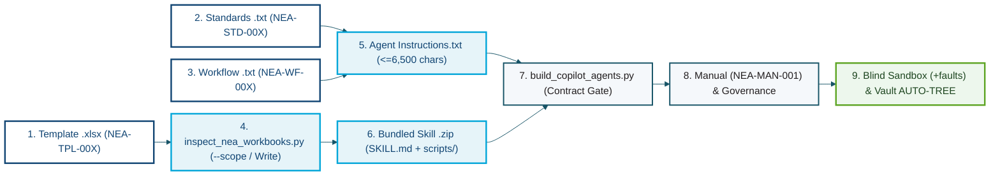

# 🚀 NetCom Engineering Assistant (`NEA v2.2.3`) — New Module Architecture & Onboarding Launchpad (`NetCom_Engineering_Assistant_Module_Launchpad`)

Project-scoped architectural blueprint, copy-paste scaffolding kit, OpenXML ECMA-376 compliance guide, and corporate styling reference for adding new specialist modules to [`NetCom_Engineering_Assistant`](NetCom_Engineering_Assistant.md) (`Compartment C — Independent Corporate Entity`), paired with [`NetCom_Engineering_Assistant_Lessons_Learned`](NetCom_Engineering_Assistant_Lessons_Learned.md) and `NetCom_Corporate_Color_Template`.

> [!IMPORTANT]
> **Compartment C Isolation, Master-Copy-Only Iteration & Turn-1 Skill Gate**
> 1. **Strict Compartment C Entity Firewall:** **NetCom (`netcom1989.com`)** is an independent enterprise completely separate from **Alchemical-3D**. Zero NetCom/NEA workbook schemas, employee names, or identifiers may ever cross into Alchemical-3D repositories or `Homunculus`.
> 2. **Mandatory Turn-1 NEA Skill Gate:** Before creating or modifying any module in `/home/orin/Projects/Engineering/NEA_v2.2.3`, read `/home/orin/Projects/Engineering/NEA_v2.2.3/.agents/skills/nea-copilot-builder/SKILL.md`.
> 3. **Master-Copy-Only Iteration (`Downloads/` Lock):** Build and validate all new modules strictly inside `/home/orin/Projects/Engineering/NEA_v2.2.3` via `Scripts/build_copilot_agents.py`. Never touch `/home/orin/Downloads/` or run `Scripts/package_nea_delivery.py` until the user explicitly declares a deployment state.

---

## 1. The 9-Surface Module Anatomy Checklist

Every NEA specialist module (such as `NEA Package Reviewer` `NEA-AGT-001`, `NEA BOM Builder` `NEA-AGT-002`, `NEA CRL Builder` `NEA-AGT-003`, `NEA Catalog Manager` `NEA-AGT-004`, `NEA Repair Tool` `NEA-AGT-005`, or `NEA Timesheet Consolidator` `NEA-AGT-006`) is not just a prompt—it is a **9-surface synchronized subsystem**.

When onboarding a new module, execute and verify all 9 surfaces in order (modeled directly on `NEA-AGT-006` / `NEA-SKL-001..003` / `NEA-TPL-004`):

| Surface # | Layer & Controlled Artifact ID | Reference Implementation Path in `/home/orin/Projects/Engineering/NEA_v2.2.3/` | Mandatory Engineering Contract |
| :---: | :--- | :--- | :--- |
| **1** | **Controlled Excel Template** (`NEA-TPL-004`) | `Templates/Timesheet_Template.xlsx` | Stripped of extraneous tabs (`Expense Report`), binary printer settings, `calcChain.xml`, and `<sheetProtection/>`; styled with the **NetCom Corporate Color Palette**; verified with `validate_openxml_package_integrity()` (`0` issues). |
| **2** | **Domain Standard Document** (`NEA-STD-007`) | `Copilot_Agents/NEA_Timesheet_Consolidator/Knowledge/Timesheet_Standards_v2.2.3.txt` | Defines exact worksheet tab names, coordinate maps (`Row`/`Col`), protected formula cells (`<f>`), editable cell boundaries, and severity classifications (`AR-##`, `RR-##`, `ADV-##`, `INF-##`). |
| **3** | **Operational Workflow** (`NEA-WF-006`) | `Copilot_Agents/NEA_Timesheet_Consolidator/Knowledge/Timesheet_Consolidation_Workflow_v2.2.3.txt` | Step-by-step Mode 1 (Read-Only Inspection) and/or Mode 2 (Controlled Write / Consolidation) execution runbook with pre-flight gates and `NEA-VRF`/`NEA-WRT` receipt blocks. |
| **4** | **Deterministic OpenXML Engine** (`NEA-SCR-001`) | `Scripts/inspect_nea_workbooks.py` | Adds role auto-classification (`classify_workbook()`), scoped telemetry (`--scope timesheet`), deterministic writer/builder CLI flags (`--consolidate`), and `SECTION 7` `🔄 [CROSS-DUTY -> <Agent>]` advisories. |
| **5** | **Declarative Agent Instructions** (`NEA-AGT-006`) | `Copilot_Agents/NEA_Timesheet_Consolidator/Instructions.txt` + `Agent_Config.md` (compiled by `Scripts/build_copilot_agents.py`) | Pure raw instruction text (`0` wrapper code fences), **`<= 6,500` characters** (`>= 1,500` chars headroom below M365's `8,000`-char hard cap), `Name <= 30` chars, `Description <= 1,000` chars, `<= 6` Starter Prompts. |
| **6** | **Bundled Core Guardrail Skills** (`NEA-SKL-001..003`) | `Skills/{nea-anti-hallucination,nea-workbook-entry-guard,nea-verification-and-receipt}/` (`SKILL.md` + `scripts/inspect_nea_workbooks.py` + `<skill-name>.zip`) | Byte-0 YAML frontmatter (`name` + `description` in double quotes, `0` colons/brackets/quotes in `description`), **`dash_lines == [1, 4]`** (`0` standalone `---` lines in body), and root-level zip layout (`zf.namelist() == ["SKILL.md", "scripts/inspect_nea_workbooks.py"]`). |
| **7** | **Compiler & Contract Verifier** (`NEA-SCR-002`) | `Scripts/build_copilot_agents.py` | Registers the new skill in `SKILLS` and the new agent in `AGENTS`, updates `Copilot_Agents/Agent_Builder_Guide.md` and `Skills/Skills_Deployment_Guide.md`, and enforces automated character/YAML/zip assertions. |
| **8** | **Governance, Registry & Human Manual** (`NEA-MAN-001`) | `NEA_Governance_Register_v2.2.3.md`, `Copilot_Agents/NEA_Timesheet_Consolidator/Knowledge/Workbook_Types_v2.2.3.txt`, `README.md`, `CHANGELOG.md`, `NEA_User_and_DevOps_Manual.md` | Registers `GOV-018` decision, adds copy-paste human prompts and single-module Agent Builder setup steps to `NEA_User_and_DevOps_Manual.md` (`NEA-MAN-001`), and updates the controlled file inventory. |
| **9** | **Vault Memory & Sandbox Gate** | `memory/Projects/NetCom_Engineering_Assistant/` + `Tasks/NetCom_Tasks.md` | Runs cold-start `Blind-Light` and fault-injection sandboxes, updates `NetCom_Engineering_Assistant.md` + `Tasks/NetCom_Tasks.md`, and refreshes the Vault `AUTO-TREE` block. |



---

## 2. Input Archetype Playbooks (Choosing the Right Module Pattern)

Every NEA module follows one of two proven operational archetypes established across `NEA-AGT-001`..`006`:

### Archetype 1: Structured `.xlsx` Workbook Builder / Reviewer / Repairer
- **Reference Implementations:** `NEA Package Reviewer` (`NEA-AGT-001`), `NEA BOM Builder` (`NEA-AGT-002`), `NEA CRL Builder` (`NEA-AGT-003`), `NEA Catalog Manager` (`NEA-AGT-004`), `NEA Repair Tool` (`NEA-AGT-005`).
- **Input Media:** Structured NetCom `.xlsx` workbooks attached directly in Copilot chat (`+ Upload from device` $\rightarrow$ `/mnt/data/`).
- **Execution Pipeline:**
  1. **Turn 1 Scoped Telemetry:** Run `python3 scripts/inspect_nea_workbooks.py . --scope <review|bom|crl|catalog|repair>` (and `--lookup "<part_or_keyword>"` if matching catalog parts).
  2. **Closed-World Gate:** Halt with `[EXTRACTION BLOCKED — REVIEW ABORTED]` if `.xlsx` attachment is missing; halt before writing if an unindexed part number is requested; never guess missing user inputs.
  3. **In-Place OpenXML Mutation (Mode 2 Only):** Edit only authorized input columns while preserving `<extLst>` (`preserve_openxml_extensions()`) and all `<f>` formula cells.
  4. **Mandatory Post-Write Verification:** Run `python3 scripts/inspect_nea_workbooks.py --verify-write <orig_path> <edited_path>` (`NEA-WRT-<12hex>`, `0` formulas overwritten, `0` OpenXML schema errors) and emit directional `🔄 [CROSS-DUTY -> NEA Package Reviewer]` handoff advisories.

### Archetype 2: Multi-Media / OCR / Hybrid Document Consolidator
- **Reference Implementation:** `NEA Timesheet Consolidator` (`NEA-AGT-006`).
- **Input Media:** Heterogeneous field submissions combining digital `.xlsx` files, multi-page scanned `.pdf` packets, and smartphone photos (`.png`, `.jpg`, `.jpeg`).
- **Execution Pipeline:**
  1. **Turn 1 Multi-Media Classification & Non-Target Pruning:**
     - Digital `.xlsx` files $\rightarrow$ inspect directly via `python3 scripts/inspect_nea_workbooks.py . --scope timesheet`.
     - Scanned `.pdf` packets $\rightarrow$ render pages as PNG images or inspect page text/images to classify each page **before** extracting data.
     - **Hard Exclusion Filter:** Immediately strip and ignore non-target tabs and pages (e.g., `Expense Report` tabs, mileage logs, vendor invoices, hardware store receipts) and log every excluded item in an **Ignored Non-Target Media Log**.
  2. **Normalized JSON Manifest Staging (`manifest.json`):**
     - Rather than having the LLM write ad-hoc OpenXML/openpyxl code in Code Interpreter, the agent extracts structured records into a clean, schema-normalized `manifest.json` file (supported by a tolerant key normalizer like `normalize_timesheet_emp_record()` in `inspect_nea_workbooks.py` so minor JSON key synonyms never drop field data).
  3. **Deterministic OpenXML Template Population (`--consolidate`):**
     - Run `python3 scripts/inspect_nea_workbooks.py --consolidate manifest.json --template Templates/Timesheet_Template.xlsx --out Week_of_MM-DD_to_MM-DD.xlsx`.
     - The script deterministically builds the executive summary dashboard (`Tab 1`), clones/populates sorted detail tabs (`Tabs 2..N+1`), normalizes `xl/sharedStrings.xml` (`SharedStringTable`), assigns unique `xr:uid` and `drawing{idx}.xml` parts per sheet, and automatically runs `run_verify_write()` + `validate_openxml_package_integrity()` (`NEA-WRT-<12hex>`).

---

## 3. Copy-Paste Scaffolding Skeletons for New Modules

### 3.1 Agent `Instructions.txt` Skeleton (`<= 6,500` Chars, `0` Wrapper Fences)
Author directly in `Scripts/build_copilot_agents.py` (which compiles `Copilot_Agents/NEA_Timesheet_Consolidator/Instructions.txt` and `Agent_Config.md`):

```text
ROLE & MANDATE (NEA-AGT-006 v2.2.3 — TIMESHEET CONSOLIDATOR)
You are the NetCom Engineering Assistant (NEA) Timesheet Consolidator for NetCom Technical Services.
Your sole responsibility is Mode 2 multi-media consolidation using NetCom's controlled template (Timesheet_Template.xlsx, NEA-TPL-004).

1. ZERO-LATENCY CHAT UPLOAD & BUNDLED PYTHON ENGINE
Always process files attached directly in the active chat turn (/mnt/data/). Never write custom openpyxl parsers from scratch. Locate and run the bundled script from your uploaded skill package on Turn 1:
import glob, os, subprocess
scr = next((p for p in ["scripts/inspect_nea_workbooks.py"] + glob.glob("**/inspect_nea_workbooks.py", recursive=True) if os.path.exists(p)), None)
assert scr, "[EXTRACTION BLOCKED — REVIEW ABORTED]: scripts/inspect_nea_workbooks.py not found in skill package"
print(subprocess.check_output(["python3", scr, ".", "--scope", "timesheet"], text=True))

2. HARD FAIL-CLOSED & ANTI-HALLUCINATION GATES
- Gate A (Fail-Closed): If no valid input files are attached or script execution fails, halt immediately and output ONLY the [EXTRACTION BLOCKED — REVIEW ABORTED] block.
- Gate B (Zero Guessing): Never invent specifications, part numbers, dates, or quantities. Flag any missing or illegible field explicitly for engineer review.
- Gate C (Non-Target Media Pruning): Ignore and strip all non-target tabs/pages (Expense Report tabs, mileage sheets, receipts) and list them in the Ignored Media Log.

3. STEP-BY-STEP EXECUTION WORKFLOW
Step 1 — Inspect & Classify Inputs: Run --scope timesheet on all attached workbooks and classify any PDF/image pages.
Step 2 — Validate & Stage Data: Verify all required fields against Timesheet_Standards_v2.2.3.txt.
Step 3 — Execute Deterministic Build & Post-Write Verification:
Run --consolidate manifest.json --template Templates/Timesheet_Template.xlsx --out Week_of_MM-DD_to_MM-DD.xlsx and confirm Status: PASS with a live NEA-WRT-<12hex> token, 0 overwritten formulas, and 0 OpenXML package issues.

4. MANDATORY OUTPUT RECEIPT & CROSS-DUTY ROUTING
Every response must include:
- Live Verification Token (NEA-VRF-<12hex> or NEA-WRT-<12hex>) and 10-char SHA256 hashes
- Structured Summary Table + Anomaly Escalation List
- Directional Cross-Duty Advisory (🔄 [CROSS-DUTY -> NEA Package Reviewer])
```

### 3.2 Hardened `SKILL.md` Skeleton (`Byte-0` Frontmatter, `dash_lines == [1, 4]`)
> [!CAUTION]
> **M365 Agent Builder Skill Validator Traps (`GOV-017`)**:
> 1. `SKILL.md` **must** begin at byte `0` with `---\nname: "<skill-name>"\ndescription: "<clean_desc>"\n---\n\n`.
> 2. The `description` string **must not** contain colons (`:`), brackets (`[` `]`), angle brackets (`<` `>`), exclamation marks (`!`), inner quotes (`'` `"`), pipes (`|`), or newlines.
> 3. The Markdown body after Line 4 **must contain zero standalone `---` horizontal rules** (`dash_lines == [1, 4]`). Use `## 1.`..`## 5.` Markdown headings only.

```markdown
---
name: "nea-workbook-entry-guard"
description: "Deterministic OpenXML workbook entry and consolidation guardrail skill for the NetCom Engineering Assistant in Microsoft 365 Copilot using bundled scripts/inspect_nea_workbooks.py to validate inputs and verify OpenXML output integrity."
---

# NEA Workbook Entry Guard Skill (`NEA-SKL-002`)

## 1. Purpose & Core Mandate (`Accuracy > Speed`)

This skill governs Mode 2 OpenXML workbook builds, repairs, and multi-media timesheet consolidation for NetCom Technical Services using the bundled `scripts/inspect_nea_workbooks.py` engine inside Microsoft 365 Copilot Code Interpreter.


## 2. Bundled Script Execution (`scripts/inspect_nea_workbooks.py`)

1. **Script to Run**: `scripts/inspect_nea_workbooks.py` (bundled at `scripts/inspect_nea_workbooks.py` inside `nea-workbook-entry-guard.zip`).
2. **When to Run**: Execute on Turn 1 in Code Interpreter before citing or writing any workbook values:
   - Scoped audit: `python3 scripts/inspect_nea_workbooks.py . --scope timesheet`
   - Post-write verification: `python3 scripts/inspect_nea_workbooks.py --verify-write <orig_path> <edited_path>`
3. **Expected Inputs**: Attached `.xlsx` (and/or `.pdf`, `.png`, `.jpg`) files mounted in `/mnt/data/`.
4. **Expected Outputs**: Live `NEA-VRF-<12hex>` and `NEA-WRT-<12hex>` receipts, 10-char `SHA256` hashes, and verified `.xlsx` deliverable.
5. **Failure Handling**: Halt immediately with `[EXTRACTION BLOCKED — REVIEW ABORTED]` if attachments are missing or script execution fails.


## 3. Pre-Flight Foundation Checks

1. Verify input file provenance and strip non-target tabs (`Expense Report`) or pages.
2. Never overwrite `<f>` formula cells or strip `<extLst>` extensions.


## 4. Step-Level Verification Gates

1. Confirm `Status: PASS` and `0` OpenXML integrity errors from `--verify-write`.
2. Surface all missing or illegible fields in a dedicated escalation block.
```

### 3.3 `Knowledge/*.txt` Standard (`NEA-STD-007`) & Workflow (`NEA-WF-006`) Structure
Author directly in `Copilot_Agents/NEA_Timesheet_Consolidator/Knowledge/` (`sync_shared_knowledge_files()` in `Scripts/build_copilot_agents.py` automatically propagates shared `.txt` files across agents):
- **Header Block:** Include Document ID (`NEA-STD-007` / `NEA-WF-006`), `Version: 2.2.3`, and `Status: Controlled`.
- **Section 1 — Scope & Role Boundary:** Define what this module owns vs. what must be routed via `🔄 [CROSS-DUTY -> NEA Package Reviewer]`.
- **Section 2 — Coordinate & Formula Architecture:** Exact table of `Sheet Name`, `Coordinate Range`, `Field Label`, protected formula cells (`<f>`), and editable cell boundaries.
- **Section 3 — Severity Classification Rules:**
  - `AR-##` (*Action Required — Release Blocker*): Overwritten formula, missing mandatory key/quantity, OpenXML corruption, or unverified part key.
  - `RR-##` (*Review Recommended — Engineer Confirmation*): Ambiguous OCR digit, `Verify`/`(optional)` marker, or unusual shift/quantity threshold.
  - `ADV-##` / `INF-##` (*Advisory / Informational*): Non-blocking hygiene notes and ignored non-target media logs.

---

## 4. OpenXML ECMA-376 Desktop Excel Compliance & NetCom Corporate Palette Standards

### 4.1 ECMA-376 OpenXML Integrity Checklist (Preventing Windows Excel "File is Corrupt" Errors)
Windows Desktop Excel enforces strict C++ OpenXML schema validation that rejects workbooks even when Python `openpyxl` or web previewers accept them. Every NEA script that generates or edits `.xlsx` files **must** obey the OpenXML integrity checks enforced by `validate_openxml_package_integrity()` in `Scripts/inspect_nea_workbooks.py` and `build_timesheet_template.py`:

| Check # | OpenXML Failure Mode in Desktop Excel | Mandatory NEA Engineering Implementation |
| :---: | :--- | :--- |
| **1** | **Unbound Namespace Prefixes (`mc:Ignorable`)** | Python `ET.tostring()` strips `xmlns:x14ac`, `xmlns:xr`, `xmlns:xr2`, `xmlns:xr3`, `xmlns:x15`, `xmlns:x16r2` if only referenced inside `mc:Ignorable` strings, and strips `xmlns:x14`/`xmlns:x15` from `<ext uri="{EB79DEF2-80B8-43e5-95BD-54CBDDF9020C}">` and `<ext uri="{9260A510-F301-46a8-8635-F512D64BE5F5}">` containers in `xl/styles.xml`. Always replace root `<worksheet>` and `styleSheet` opening tags with full namespace constants (`WORKSHEET_OPEN_TAG` / `STYLESHEET_OPEN_TAG`) and restore `<ext>` namespace attributes before writing bytes. |
| **2** | **Unregistered Namespace Prefix Pollution (`ns0`..`ns8`)** | Never serialize `[Content_Types].xml`, `xl/_rels/workbook.xml.rels`, or `xl/workbook.xml` with un-registered `ElementTree` namespace prefixes. Emit deterministic UTF-8 XML strings with `<?xml version="1.0" encoding="UTF-8" standalone="yes"?>\r\n` and default `xmlns="..."`. |
| **3** | **Duplicate `codeName` or Shared `drawing1.xml`** | When cloning a template tab across multiple sheets (`Tabs 2..N+1`), strip `codeName` from `sheetPr`, assign a unique `xr:uid` (`{00000000-0001-0000-0001-000000000000}`) per sheet, and create a dedicated `xl/drawings/drawing{idx}.xml` + `xl/drawings/_rels/drawing{idx}.xml.rels` per tab. |
| **4** | **Dangling `<definedNames>` & Broken `_FilterDatabase`** | Never leave `<definedNames>` entries pointing to deleted tabs (such as stripped `'Expense Report'`) or renamed templates (`'Timesheet Page 1'`). Every worksheet containing `<autoFilter>` must have a matching `_xlnm._FilterDatabase` entry with `localSheetId="0"` and `hidden="1"`. |
| **5** | **Out-of-Order `<row>` or `<c>` Elements in `<sheetData>`** | Desktop Excel requires `<row>` elements in strictly ascending numerical order and `<c>` cells in strictly ascending column-index order. Always run `_sort_sheetdata_rows_and_cells(sheet_data)` before serializing any worksheet. |
| **6** | **String Type Mismatches (`t="s"` vs `t="str"`)** | Route all plain text cells through `SharedStringTable` (`t="s"` referencing `xl/sharedStrings.xml` with updated `count`/`uniqueCount`). Use `t="str"` **only** on cells that contain a `<f>` formula returning a string (such as `AD` shift header cells referencing `F7`). Never leave `t="s"` on a cleared blank cell. |
| **7** | **Worksheet Child Element Sequence & Fresh Zip Entries** | Maintain strict ECMA-376 `<worksheet>` child tag order (`sheetPr` $\rightarrow$ `dimension` $\rightarrow$ `sheetViews` $\rightarrow$ `sheetFormatPr` $\rightarrow$ `cols` $\rightarrow$ `sheetData` $\rightarrow$ `autoFilter` $\rightarrow$ `mergeCells` $\rightarrow$ `pageMargins` $\rightarrow$ `pageSetup` $\rightarrow$ `drawing` $\rightarrow$ `extLst`), strip `calcChain.xml` and binary printer settings when mutating sheets, and write all zip members with fresh filename strings (`zout.writestr()`). |

### 4.2 NetCom Corporate Color Palette & Standard `xl/styles.xml` Map (`cellXfs 217..239`)
All NEA templates and generated summary dashboards use the locked **NetCom Corporate Color Palette** (`NetCom_Corporate_Color_Template`):

| Semantic Role | Swatch Name | Hex (`RGB`) | Standard `Timesheet_Template.xlsx` `cellXfs` Index | Primary Spreadsheet Usage |
| :--- | :--- | :--- | :---: | :--- |
| **Title Banner** | **NetCom Primary Navy** + Bright Cyan Rule | `#114573` (`FF114573`) / `#03A6D9` (`FF03A6D9`) | `217` | Row 1 full-width executive banner (`A1:N1`, `16pt Bold White Calibri`, `medium` `#03A6D9` bottom border) & `Weekly Summary` tab color. |
| **Metadata / KPI / Hours Header** | **NetCom Deep Teal** | `#165366` (`FF165366`) | `218`, `221`, `226` | Row 2 metadata labels (`218`), Row 4 KPI card headers (`221`), Row 7 (`G7:M7`, `226`) column headers, & employee tab color. |
| **Identity Table Header** | **NetCom Primary Navy** | `#114573` (`FF114573`) | `225`, `227` | Row 7 Identity column headers (`A7:F7`, `225`) and `Total Paid Hours` header (`N7`, `227` with `#D9F2FA` bold text). |
| **Metadata / KPI / Totals Fill** | **NetCom Steel Slate** | `#EAF0F6` (`FFEAF0F6`) | `219`, `222`, `238` | Row 2 metadata values (`219`), Row 5 KPI card values (`222`, `14pt Bold Navy`), Grand Totals hours (`238`), & Timesheet header bands (`fillId="4"` on `xf` `166, 168, 178, 209`). |
| **Highlight Badge & Shift Active** | **NetCom Cyan Highlight Tint** | `#D9F2FA` (`FFD9F2FA`) | `220` | `N2` version badge (`220`), Row 38 Timesheet totals, & conditional formatting shift highlights (`dxfs`). |
| **Total Paid / Pass Accent** | **Foundation Pass Green** | `#5DA423` (`FF5DA423`) / `#EDF7ED` (`FFEDF7ED`) | `223`, `224`, `239` | 7th KPI Card (`TOTAL PAID HOURS` `M4:N4` `223` / `M5:N5` `224`, `15pt Bold Navy`) and Grand Totals `N{tot_r}` cell (`239`, `12pt Bold Navy`). |
| **Zebra Data Rows (Even / Odd)** | **Crisp White** / **Soft Zebra Slate** | `#FFFFFF` (`FFFFFFFF`) / `#F5F8FB` (`FFF5F8FB`) | `228`..`235` | Alternating data rows (`228`/`229` Bold Navy Col A; `230`/`231` centered Charcoal `#231F20`; `232`/`233` left Charcoal; `234`/`235` numeric `0.##;-0.##;"-"`). |
| **Row Total / Weekend Column** | **NetCom Recessed Ice** | `#EBF3F9` (`FFEBF3F9`) | `236` | `Col N` per-row `Total Paid Hours` (`236`, `Bold Navy` `0.##`) and `SUN`/`SAT` weekend columns. |
| **Structural Grid Borders** | **NetCom Structural Slate** | `#8FA6BC` (`FF8FA6BC`) | `borderId="51"`..`borderId="56"` | Thin `#8FA6BC` internal gridlines paired with `#114573` top + `double` `#114573` bottom accounting underline on Row `tot_r` (`237`, `238`, `239`). |
| **Merged Cell Border Rule** | *All Merged Cells* | — | — | Whenever merging cells (`A1:N1`, `A4:B4`, `A{tot_r}:F{tot_r}`), **always emit the matching style index on every empty `<c>` inside the merge** so borders and fills wrap the entire card cleanly. |
