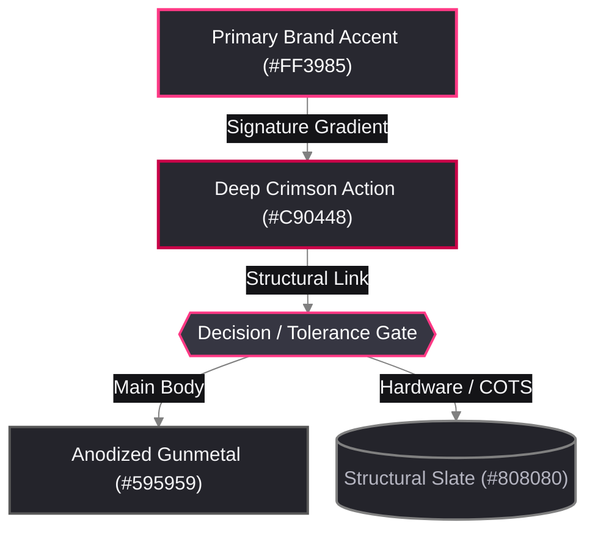

# Alchemical-3D Ecosystem Links, Brand Assets & Affiliate Reference

Use this reference to ensure 100% consistency across all Alchemical-3D repositories for brand colors, badges, project URLs, community links, and vendor affiliate parameters.

---

## 1. Brand Identity & Color Palette

- **Organization Name**: `Alchemical-3D` (hyphenated in technical/repo prose and ecosystem badges; `Alchemical 3D` in formal brand logo titles).
- **Primary Motto**: *"Transmuting ideas into reality, layer by layer."*
- **Maker Tools Motto**: *"Curated gear and materials for pushing the boundaries of 3D printing."*
- **Logo & Badge Assets (`Brand` repository)**:
  - Primary Banner SVG (Transparent BG):
    `https://raw.githubusercontent.com/Alchemical-3D/Brand/main/assets/svg/Alchemical-3D-Badge-Gradient-PRIMARY-Alchemical-3D-Logo-Gradient-PRIMARY-Transparent-Background.svg`
  - Primary Logo SVG (Transparent BG):
    `https://raw.githubusercontent.com/Alchemical-3D/Brand/main/assets/svg/Alchemical-3D-Logo-Gradient-PRIMARY-Transparent-Background.svg`
- **Brand Color Palette** (verified from master SVGs in `/home/orin/Projects/Alchemical3D/Brand/assets/svg/` and [`Alchemical3D_Color_Template.md`](../Templates/Color_Palettes/Alchemical3D_Color_Template.md)):
  - **Alchemical Pink (Primary Flat / Top Gradient)**: `#FF3985` (`RGB(255, 57, 133)`) — Primary logo bar & primary CAD accent printed parts (`[a]_*.stl`).
  - **Alchemical Crimson (Deep / Bottom Gradient)**: `#C90448` (`RGB(201, 4, 72)`) — Primary logo bottom gradient stop, high-emphasis callouts, and Alpha/critical badges.
  - **Brand Signature Gradient**: `linear-gradient(135deg, #FF3985 0%, #C90448 100%)`
  - **Structural Slate Grey**: `#808080` (`RGB(128, 128, 128)`) — Secondary middle bar (`0.50` opacity); COTS aluminum/steel hardware in CAD & diagrams.
  - **Anodized Gunmetal**: `#595959` (`RGB(89, 89, 89)`) — Secondary middle bar gradient end (`0.65` black opacity); primary printed structural body CAD color.
  - **Carbon Dim Grey**: `#696969` (`RGB(105, 105, 105)`) — Tertiary dot gradient end (`0.59` black opacity); secondary borders and connector lines.
  - **Obsidian Pure Black**: `#000000` (`RGB(0, 0, 0)`) — Wordmark typography (`ALCHEMICAL`), tertiary dot, and BoW mark.
  - **Image Card Interior Background (Locked Protocol)**: `#FFFFFF` (`RGB(255, 255, 255)`) with `2px` `#D0D0D0` (`RGB(208, 208, 208)`) card border.
  - **Extended Dark-Slate UI & Diagram Surfaces (`mkdocs.yml` Slate Scheme)**:
    - Deep Carbon (`bg0_h`): `#141417` (`RGB(20, 20, 23)`) — Edge label pills and recessed containers.
    - Dark Slate Canvas (`bg0`): `#1E1E24` (`RGB(30, 30, 36)`) — Primary dark-mode diagram and web canvas.
    - Elevated Slate (`bg1`): `#282830` (`RGB(40, 40, 48)`) — Standard Mermaid node fill.
    - Active Gunmetal (`bg2`): `#363642` (`RGB(54, 54, 66)`) — Decision gate hexagon (`{{...}}`) fill.
    - Crisp Alchemical White (`fg0`): `#F5F5F7` (`RGB(245, 245, 247)`) — Primary node text on dark slate surfaces.
    - Muted Metallic Silver (`fg1`): `#B4B4C0` (`RGB(180, 180, 192)`) — Secondary labels and subtle captions.
  - **CAD Render Color Convention**: Anodized Gunmetal (`#595959`) or dark charcoal (`~#2D3136`) for primary printed structural bodies, Alchemical Pink/Crimson (`#FF3985` / `#C90448`) for accent printed parts (`[a]_*.stl`: fan baffles, levers, rotational braces, logo inlays), and Structural Slate (`#808080`) / brass / aluminum metallic shaders for fasteners, heat-sets, and milled plates, rendered over a `#FFFFFF` card background.

---

## 2. Canonical Repository URLs

Always use the full canonical repository URLs below (never use legacy short paths like `/Alembic`, `/Pestle`, or `/Pneuma`):

| Project Name | Emoji | Canonical GitHub URL | Status |
| :--- | :---: | :--- | :--- |
| **Alembic Toolhead** | 🧪 | `https://github.com/Alchemical-3D/Alembic_Toolhead` | Active (Alpha) |
| **Pneuma Part Cooling** | 🌬️ / 💨 | `https://github.com/Alchemical-3D/Pneuma_Remote_Air` | Active (Alpha) |
| **A3DP Gantry Assembly** | ⚙️ | `https://github.com/Alchemical-3D/A3DP_Gantry_Assembly` | Active |
| **Pestle Rotational Bowden** | 🥣 | `https://github.com/Alchemical-3D/Pestle_Rotational_Bowden` | Active (Beta) |
| **Retort (Dehumidifier / Dryer)** | 💧 | `https://github.com/Alchemical-3D/Retort` *(Reserved remote; local docs in `alchemical-3d.github.io/docs/retort.md`)* | In Development |
| **Maker Tools & Filament Guide** | 🛠️ / 🧰 | `https://github.com/Alchemical-3D/Maker-Tools` | Active |
| **Brand Assets** | 🎨 | `https://github.com/Alchemical-3D/Brand` | Active |
| **Extras (Calibration Cubes)** | 🧊 | `https://github.com/Alchemical-3D/Extras` | Active |
| **Alchemical-3D Web Docs** | 🌐 | `https://github.com/Alchemical-3D/alchemical-3d.github.io` | Active |
| **Organization Profile** | 🏛️ | `https://github.com/Alchemical-3D/.github` | Active |

---

## 3. Community, Support & Contact Links

- **Alchemical-3D Discord (Canonical Invite)**: `https://discord.gg/aE49DW2xXe`
  *(Note: Replace any legacy `https://discord.gg/r97kK5B7B7` links when unifying repositories.)*
- **Ko-fi Support Page**: `https://ko-fi.com/alchemical3d`
- **Ko-fi Badge Image**: `https://ko-fi.com/img/githubbutton_sm.svg`
- **Printables Profile**: `https://www.printables.com/@Alchemical3D_390617`
- **Twitter / X**: `https://twitter.com/Alchemical3D`
- **Organization Email**: `we@alchemical3d.net`
- **Technical Writing / Partner Contact Email**: `orin@alchemical3d.net`
- **Standard Hardware License**: Creative Commons Attribution-NonCommercial-ShareAlike 4.0 International (`CC BY-NC-SA 4.0`).

---

## 4. Shields.io Badge Palette & GitHub-Safe Color Swatches

> [!IMPORTANT]
> **GitHub HTML Sanitizer Rule (`html-pipeline`)**
> Never use `<span style="background:#FF3985">` HTML swatches in GitHub repository `.md` files—GitHub strips all `style="..."` attributes. Use **Shields.io hex badges** or **backticked hex literals** (`` `#FF3985` ``, which GitHub natively renders with an interactive color dot).

### 4.1 Alchemical-3D Brand Scheme Hero Badges (Recommended for New & Unified Repos)
```markdown
[](#)
[](ALPHA_&_DIRECTION.md)
[](#)
[](#)
[](#)
[](#)
[](#)
[](#)
[](LICENSE.md)
```

### 4.2 BOM / Print Settings Filament Color Swatch Badges
```markdown


```

### 4.3 Classic Shields.io Badges (Legacy-Compatible)
```markdown
[](#)
[](ALPHA_&_DIRECTION.md)
[](#)
[](#)
[](#)
[](#)
[](#)
[](#)
[](LICENSE.md)
```

---

## 5. Affiliate Links & Partner Disclosures

### Vendor Affiliate Parameters
1. **KB-3D (`kb-3d.com`)**:
   - Storefront Partner Page: `https://kb-3d.com/store/affiliatepage/1007-kb3d-x-alchemical3d.html?affp=6182`
   - Product Links: Always append `?affp=6182` before any `#/` URL fragment (e.g., `https://kb-3d.com/store/...html?affp=6182#/option-value`).
2. **West3D (`west3d.com`)**:
   - Append `?dt_id=Alchemical3D&utm_source=affiliate` (or `&dt_id=Alchemical3D&utm_source=affiliate` if a query string already exists).
3. **Amazon (`amzn.to`)**:
   - Use the project's verified `https://amzn.to/...` shortlinks. **Never fabricate or guess a shortened `amzn.to` URL**—if a link is missing, leave an explicit `[TBD: affiliate_link_<item>]` placeholder and flag it for the user.

### Standard Affiliate Disclosure Callout (`BOM.md` / `Maker-Tools`)
```markdown
> [!NOTE]
> **Affiliate Links**
> This document contains affiliate links. Sourcing your parts through these links helps support the continued development of Alchemical-3D projects at no additional cost to you, and in some cases provides a discount!
```

---

## 6. Standard Reusable Blocks

### 6.1 Ko-fi Support Footer (Append to bottom of `README.md` and `Assembly_Guide.md`)
```markdown
***

> ☕ **Did you find this guide helpful?** 
> 
> My projects are open-source and free for the community. If you've enjoyed my designs and want to support my work, consider [leaving me a tip on Ko-fi](https://ko-fi.com/alchemical3d)! 
>
> [](https://ko-fi.com/alchemical3d)
```

### 6.2 AI Assistance Transparency Footer (Append to bottom of content documents)
```markdown
***
*Documentation prepared with AI editorial assistance • Engineered & maintained by Alchemical-3D.*
```

### 6.3 Partner / Technical Writing Services Block (`Resources_and_Acknowledgements.md`)
```markdown
> 🤝 **Partner with Alchemical-3D**
>
> Are you a vendor, creator, or sponsor looking for thorough hardware testing and clear technical documentation? I offer dedicated technical writing and guide-building services tailored for 3D printing hardware and kits. If you are interested in collaborating on a future product or manual, I would love to connect and try out your project!
>
> **Contact Me:** Email me at [orin@alchemical3d.net](mailto:orin@alchemical3d.net) or connect in the [Alchemical-3D Discord](https://discord.gg/aE49DW2xXe)!
```

### 6.4 Standard Hardware Safety & Torque Callouts (`Assembly_Guide.md`)
- **Milled Aluminum vs. 3D-Printed Plastic Torque**:
  - M3 into aluminum: `~1.0 to 1.5 Nm` (`~1.2 Nm` / `10.6 in-lbs` nominal).
  - M5 into aluminum: `~3.0 to 4.5 Nm`.
  - Fasteners into 3D-printed parts: Stop turning as soon as the plastic begins to compress.
- **Threadlocker Selection & Plastic Chemical Warning**:
  - M5 and larger bolts into metal: Medium-strength **Loctite 243 (Blue)**.
  - M3 / M4 and smaller bolts into metal: Low-strength **Loctite 222MS (Purple)**.
  - Never use high-strength red threadlocker. Never allow threadlocker to contact ABS, ASA, or PC printed parts (causes rapid chemical cracking).

---

## 7. Alchemical-3D Brand Mermaid Flowchart Template (GitHub Light & Dark Safe)

When adding architecture, pneumatic routing, wiring, or assembly flowcharts to public Alchemical-3D GitHub repositories, always use the **Alchemical-3D Brand Mermaid Scheme** (never the local machine Gruvbox Dark palette):


