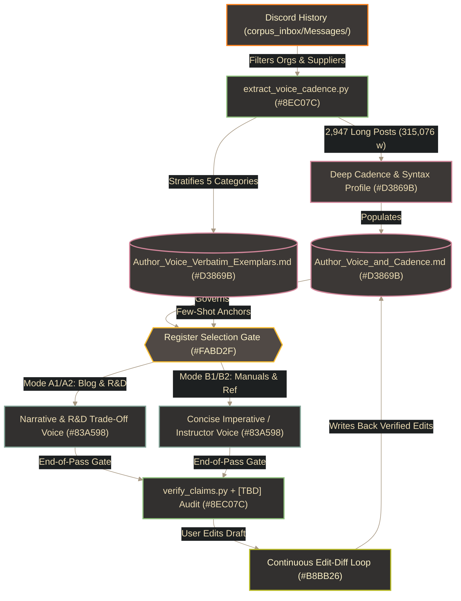

# ✍️ Author Voice, Cadence & Editorial Lexicon

Part of [`README.md`](../README.md), paired with [`Verifiable_Accuracy_and_Anti_Hallucination`](Verifiable_Accuracy_and_Anti_Hallucination.md) and [`Image_and_Style_Rules`](Image_and_Style_Rules.md), and enforced by `/home/orin/Projects/Engineering/Homunculus/addons/author-voice-cadence/SKILL.md` (`~/.gemini/config/skills/author-voice-cadence/SKILL.md`) and `/home/orin/Projects/Engineering/Homunculus/skills/doc-and-card-studio/SKILL.md`.

> [!IMPORTANT]
> **Active Baseline (`2026-10-29` — Pure Maker Corpus Telemetry, Zero Mixed-Repo Drift)**:
> - **Analyzed Maker Corpus**: `[CALC: 877 + 18,011 + 24,654 + 30,351 = 73,893]` raw Maker Org, Hardware Supplier/Webstore Company, and Alchemical-3D messages $\rightarrow$ **`2,947` long-form posts (`315,076` prose words)** across `Alchemical 3D` (`#🗞printer-design-blog`, `1,581` long posts / `182,171` words), Maker Suppliers (`Fabreeko`, `West3D Printing`, `KB-3D`, `LDO Motors`, `Advanced3dPrinting`, `Bondtech`, `3D-Fuel`, `3DO Community`, `X.R. Bunker LLC`, `mammoth-3D`), and Open-Source Hardware/Firmware Orgs (`VORONDesign`, `ANNEX Engineering`, `3D Printscape`, `prusa3d`, `Monolith`, `klipper`, `Kalico`, `HevORT`, `Nevermore Activated Carbon Filters`, `Rack Robotics`, `Zero G`, `Armchair Heavy Industries`, `Fluidd`).
> - **Full Telemetry Report**: [`Author_Voice_Cadence_Telemetry_Report.md`](Author_Voice_Cadence_Telemetry_Report.md)
> - **Verbatim Few-Shot Exemplar Bank (`16` Anchors — `15` Verbatim Discord + `1` User-Confirmed Author Epigraph)**: [`Author_Voice_Verbatim_Exemplars.md`](Author_Voice_Verbatim_Exemplars.md)

---

## 1. End-to-End Voice Extraction & Continuous Learning Pipeline



---

## 2. Quantitative Cadence, Syntax & Contraction Profile

### 2.1 Multi-Register Rhythm & Paragraph Chunking (`315,076` Prose Words)

| Stylometric Dimension | Mode A1: Blog & Announcements (`57,813` w) | Mode A2: R&D & Engineering (`77,972` w) | Mode B2: Suppliers, Orgs & Ref (`179,291` w) | Drafting Rule |
| :--- | :--- | :--- | :--- | :--- |
| **Sentence Length Target** | **Med `19.0` w / Mean `19.8` w** (IQR `13–26` w) | **Med `23.0` w / Mean `24.1` w** (IQR `15–32` w) | **Discord/Ref: Med `19.0` w** (IQR `12–27` w)<br>**Mode B1 Install Guides:** concise `1–2` sentences | Keep blog/reference prose near `19.0` w, Mode B1 installation steps crisp and minimal, and allow `15–32` w causal chains in R&D deep dives. |
| **Beat-to-Beat Swing (`S_i+1 - S_i`)** | **`9.5` w** | **`11.1` w** | **`9.8` w** | **Never write monotonous uniform AI sentences.** Alternate multi-clause causal explanations with punchy `3–9` w or `10–17` w setups/verdicts (`10.0` w overall swing). |
| **Sentence Length Bands** | `[CALC: 14.1% + 30.9% = 45.0%]` crisp (`3–17` w), `35.3%` core (`18–27` w), `[CALC: 15.8% + 4.0% = 19.8%]` deep | `[CALC: 9.9% + 22.7% = 32.6%]` crisp (`3–17` w), `32.3%` core (`18–27` w), `[CALC: 24.8% + 10.3% = 35.1%]` deep | `[CALC: 13.9% + 30.3% = 44.2%]` crisp (`3–17` w), `31.9%` core (`18–27` w), `[CALC: 17.7% + 6.2% = 23.9%]` deep | Ensure roughly `44.2%`–`45.0%` of sentences in public-facing docs are brisk `3–17` w declaratives. |
| **Paragraph Pacing (`1–3` sents)** | `[CALC: 32.0% + 25.0% + 20.7% = 77.7%]` | `[CALC: 56.8% + 26.2% + 11.2% = 94.2%]` | `[CALC: 44.5% + 30.2% + 15.1% = 89.8%]` (`4.1%` at `5+` sents) | Write airy `1`–`3` sentence blocks (`[CALC: 45.8% + 28.3% + 14.9% = 89.0%]` overall). Never stack `5+` sentence walls. |
| **Persona Pronoun Blend (`/1k` w)** | `16.8` I/my, `12.5` we/our, `13.0` you/your | `30.9` I/my, `15.7` we/our, `11.4` you/your | `37.5` I/my, `12.9` you/your, `5.4` we/our | Use I/my for bench testing/prototyping, we/our for Alchemical-3D direction, and you/your for direct shop-floor coaching. |

### 2.2 Clause-Linking Syntax & Punctuation Signature
- **Horizontal Comma-Pivot Chaining**: Link physical cause and effect inside sentences using `, so` (`578x`), `, as` (`298x`), `, which` (`245x`), and `, while` (`72x`), paired with causal connectors `since` (`309x`), `because` (`244x`), `due to` (`226x`), `instead of` (`189x`), and `allows / allowing` (`153x`)—avoiding stiff academic links like `in order to` (`15x`) or `thus / therefore` (`27x`).
- **Signature Clause-Final `"though"` (`518x` total — Blog `1.31` / R&D `1.36` / Suppliers & Orgs `1.87` per `1k` words)**: Land conversational concessions and roadmap caveats naturally at the end of a clause (`"more will come on that in the future though."`, `"Keep in mind though,"`, `"The best part about this system though,"`).
- **Zero-Semicolon Rule (`0.16` Blog / `0.04` R&D per `1k` words)**: Only `20` semicolons appeared across `315,076` words. Replace any `;` with a comma-pivot, dash, or period.
- **Punctuation & Emphasis by Register**:
  - **Mode A (Blog / Devlog)**: Uses parenthetical asides `(...)` (`1.94` / `1k`), trailing/dramatic ellipses `...` (`3.08` / `1k`), spaced/em-dashes (`3.53` / `1k`), milestone exclamation marks (`8.54` / `1k`), and occasional single-word ALL-CAPS stress (`NOT`, `NEVER`, `GREATLY`, `MODULAR` — `2.61` / `1k` in Blog, `639` total).
  - **Mode B1 / B2 (Formal Build & Reference Manuals)**: Replaces chat ellipses and raw ALL-CAPS with **bold hardware nouns/specs** and GitHub-native alert blocks while keeping natural parenthetical context.

### 2.3 Asymmetric Contraction Habits (Measured Head-to-Head)
- **Keep Uncontracted (`89.9%`–`97.4%` empirical preference)**: Always prefer **`cannot`** (`97.4%` — `191` vs. `5` can't), **`I will`** (`96.0%` — `437` vs. `18` I'll), **`I am`** (`91.8%` — `786` vs. `70` I'm), and **`I have`** (`89.9%` — `756` vs. `85` I've).
- **Actively Contract in Conversational Prose**: Do **not** over-correct into robotic uncontracted prose—actively prefer **`it's`** (`[CALC: 100% - 20.7% = 79.3%]` — `475` vs. `124` it is; `20.7%` uncontracted) and **`doesn't`** (`[CALC: 100% - 34.0% = 66.0%]` — `140` vs. `72` does not; `34.0%` uncontracted) in Mode A1/A2 (and non-warning Mode B2 explanations), along with occasional didn't / won't.
- **Balanced Negations (`52.2%`–`59.6%` uncontracted)**: Mix do not (`57.5%`) / don't, is not (`59.6%`) / isn't, and will not (`52.2%` — `130` vs. `119`) / won't naturally—defaulting to full uncontracted `do not` / `will not` on critical hardware constraints and safety warnings.

### 2.4 Authentic Recurring Transitions & Idioms
Use the author's verified recurring collocations rather than generic LLM transitions:
- `"Keep in mind (though)..."` (`82x`) • `"playing with..."` (`78x`) • `"make sure..."` (`78x`) • `"for now / for the time being"` (`65x`) • `"this is why..."` (`60x`) • `"in the meantime"` (`49x`) • `"at some point"` (`44x`) • `"as you can see"` (`42x`) • `"more will come / more to come"` (`19x`) • `"be sure to"` (`17x`) • `"in regards to"` (`12x`) • `"down the road"` (`10x`) • `"at the cost of"` (`8x`) • `"on the fly"` (`5x`).

### 2.5 Closed-World Engineering Truth, Source Provenance & Anti-Parroting Guardrails
- **Enforce [`Verifiable_Accuracy_and_Anti_Hallucination`](Verifiable_Accuracy_and_Anti_Hallucination.md) (*No Silent Qualitative Dodging or Cross-Material Borrowing*)**: Every quantitative figure, COTS designator, material grade, pin/port, and relational pairing (`[Part] -> [Fastener] -> [Target]`) must exist in vetted Tier 1 project sources (`Projects/<Project>/<Project>_Hardware.md`, `.cfg`s, locked standards, clean human-authored `git HEAD` commits, or explicit user input). **Never** write smoothly around a missing expected spec, copy `ABS/ASA` parameters onto `TPU`, drop fastener lengths/head-styles in build steps, or silently pick one side of a source discrepancy—insert explicit **`[TBD: <specific_missing_variable>]`** or **`[TBD: CONFLICT — ...]`** markers inline and validate drafts at the end of the pass via `verify_claims.py` (without `--fail-on-tbd` until final release).
- **Source Provenance Triage**: Before grounding on any existing `.md` file that contains uncommitted/dirty edits or unreceipted AI prose, alert the user and decide together whether to **skip it** or **work it in parallel** to separate verified core truth from unbacked claims.
- **Acoustic Rhythm Over Phrase Parroting**: Emulate the *cadence and syntactic structure* of Section 4.2 and [`Author_Voice_Verbatim_Exemplars.md`](Author_Voice_Verbatim_Exemplars.md)—never copy-paste their specific metaphors (`"sledgehammer"`/`"scalpel"`, `"magical rubber"`, `"caveman art"`, `"spreadsheets..."`) or hardware-specific lines into unrelated documents.

---

## 3. Register Calibration Matrix (Matching Voice to Medium)

| Register Mode | Target Documents | Cadence & Structural Rules |
| :--- | :--- | :--- |
| **Mode A1: Public Blog & Announcements** | Discord `#🗞printer-design-blog` posts, release announcements, `README.md` philosophy sections | **Conversational Engineering Peer (`19.0` w med)**: Opens with direct technical premise (`87.1%`) or bench progress hook (`8.5%`); walks through what was tested, what failed, and why the current geometry won; closes with practical takeaway (`70.9%`), roadmap teaser (`15.9%`), or wry parenthetical/ellipsis (`8.2%`). |
| **Mode A2: Engineering & R&D Deep Dives** | `ALPHA_&_DIRECTION.md`, architecture write-ups, engineering trade-off logs | **Analytical Subsystem Designer (`23.0` w med)**: Uses multi-clause physical/thermal/kinematic cause-and-effect chains linked via comma-pivots; pairs plainspoken conviction (`definitely`, `greatly`, `always`) with honest engineering candor (`likely`, `probably`, `for now`, `at the cost of`). |
| **Mode B1: Concise Installation, Print & BOM Guides** | `Assembly_Guide.md`, `Print_Settings.md`, `BOM.md` | **Concise Imperative (1–2 crisp sentences, Verified Paramount-Only Reasoning)**: State standard operations (pressing heat-sets, seating fasteners) in **1–2 crisp sentences**—never expand them into multi-step tool baby-tutorials or explain obvious material roles (`"Print in TPU"` needs no elastomer lecture). Include `"why"` reasoning **ONLY when paramount AND verified** in project docs/standards (alignment/tight-clearance collisions, seal leaks, chamber creep, upfront torque/chemical hazards)—never invent hypothetical failure chains, and tag missing parameters `[TBD: ...]`. |
| **Mode B2: Technical Reference & Diagnostic Guides** | `Maker-Tools/*.md`, troubleshooting/calibration guides, Supplier/Org technical coaching | **Pragmatic Instructor (`19.0` w med)**: Concise explanation of physical/mechanical cause-and-effect paired with a practical verification check, where teaching the diagnostic concept is the document's purpose. |

---

## 4. Anti-AI Lexicon & Verified Author Anchors

### 4.1 Banned Generic LLM Tropes (Empirically Verified Across `315,076` Words)
- **Strict `use` Over `utilize`**: Author corpus count is **`1,326` `use` vs. `14` `utilize` (`[CALC: 1326 / (1326 + 14) * 100 = 99.0%]`)**—always write `use`.
- **Zero-Count AI Clichés (`0` occurrences in `315,076` words — Never Use)**: `delve`, `tapestry`, `seamlessly`, `testament to`, `moreover`, `in conclusion`, `in summary`, `it is important to note`.
- **Near-Zero Banned Filler (`1`–`6` occurrences in `315,076` words)**: `furthermore` (`1`), `holistic / synergy` (`1`), `game-changer / revolutionary` (`3`), `meticulously` (`4`), `elevate` (`6`, banned outside physical Z-axis motion).
- **Banned Throat-Clearing Openers**: `"In today's fast-paced..."`, `"When it comes to..."`, `"Whether you're a beginner or an expert..."`, `"Let's dive right in!"`, `"Look no further than..."`.

### 4.2 Verified Author Voice & User-Rule Ledger *(Zero AI-Synthesized Imitations)*
*(Contains **only** explicit user-authored instructions and verbatim corpus sentences—updated via `/learn` only when the user explicitly requests it)*:

| Context & Provenance | Generic AI Habit to Avoid ❌ | Verified Author Voice / Explicit Rule ✅ *(Do Not Parrot Verbatim Into Unrelated Hardware)* |
| :--- | :--- | :--- |
| **Mode B1 Paramount-Only Reasoning** *(Explicit User Rule, `2026-10-29`)* | Padding every routine installation step with multi-sentence material/tool lectures or invented collision stories. | Keep routine steps concise (`1–2` sentences) with zero filler reasoning; include reasoning **only** when paramount and verified, e.g.: *"Important step, if not correctly installed the next part will not align and could impact the frame due to tight spaces around the linear motion."* |
| **Out-of-Box Rail Inspection (`Mode B2`)** *(Verbatim Discord `#🗞printer-design-blog`, `2022-08-05`)* | *"Do not disassemble the linear rail carriage; inspect for smooth motion prior to installation."* | *"First, you should **NEVER** need to replace your bearings on a product out of the box, if you do, **stop buying from them**. Next, linear rails are precision pieces of hardware, the factory hand matches the carriages to the rails and bearings, changing this more often than not can actually ruin your rail's ability to produce quality movement."* |
| **Simulated Belt-Load Burr Check (`Mode B2`)** *(Verbatim Discord `VORONDesign`, `2022-05-27`)* | *"Slide the carriage back and forth to verify the absence of mechanical binding."* | *"When you manually travel the axis, always use a finger pushing down slightly on the same side of the bed you wish it to travel, this helps simulate belt tension that direction which on linear rails can be the difference between finding a hiccup or missing it."* |
| **Roadmap & Compromise Candor (`Mode A1` / `Mode A2`)** *(Verbatim Discord `#🔔announcements`, `2022-08-09`)* | *"Furthermore, the enclosure currently exhibits frame-specific constraints; future iterations will enhance modularity."* | *"Keep in mind though, our lower enclosure as of now is specific to the frame. At some point in the future we will design a more modular version of it with sliding size capabilities, but at the cost of aesthetics relative to the original."* |

---

## 5. Re-Running or Updating the Corpus

1. Drop additional Discord exports or standalone human-authored drafts into `/home/orin/Projects/Engineering/Homunculus/addons/author-voice-cadence/corpus_inbox/`.
2. Run the deep stylometric extractor:
   ```bash
   python3 /home/orin/Projects/Engineering/Homunculus/addons/author-voice-cadence/scripts/extract_voice_cadence.py \
     --inbox /home/orin/Projects/Engineering/Homunculus/addons/author-voice-cadence/corpus_inbox \
     --scope maker \
     --output /home/orin/Projects/Engineering/memory/Standards_and_Specs/Author_Voice_Cadence_Telemetry_Report.md
   ```
3. Verify quantitative parity of this standard against [`Author_Voice_Cadence_Telemetry_Report.md`](Author_Voice_Cadence_Telemetry_Report.md) via `verify_claims.py` and run `sync_memory.py --memory-root <memory_root> --audit`.
