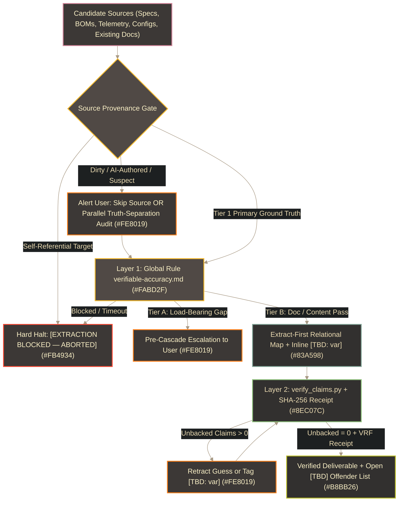

# 🛡️ Verifiable Engineering Accuracy & Anti-Hallucination Standard

Part of the [`README.md`](../README.md), enforced globally by `/home/orin/Projects/Engineering/Homunculus/rules/verifiable-accuracy.md` (`~/.gemini/config/rules/verifiable-accuracy.md`) and deterministically verified by `/home/orin/Projects/Engineering/Homunculus/skills/claim-verification/SKILL.md` (`scripts/verify_claims.py`).

> [!IMPORTANT]
> **Domain-Agnostic Charter (`Accuracy > Efficiency`)**:
> This framework operates independently of `Author_Voice_and_Cadence` and `Image_and_Style_Rules` so identical factual guarantees apply across **structured cabling & BOM workbooks** (`NetCom_Engineering_Assistant`), **electronics & power prototyping**, **mechanical CAD & 3D printing** (`Alembic_Toolhead`, `Pneuma_Remote_Air`, `A3DP_Gantry_Assembly`, `Pestle_Rotational_Bowden`), **software**, and **GitHub / Discord content**.

---

## 1. Two-Layer Defense-in-Depth Pipeline

---

## 2. Core Invariants

1. **Priority Law (`Accuracy > Efficiency`)**: Accuracy of values, units, identifiers, coordinates, and relationships always supersedes speed or brevity. Major verification cost outliers or source conflicts are surfaced to the user for joint decision.
2. **Source Provenance, Repo-Path Scoping & Sibling-Render Anti-Circularity Gate**: Never validate a file against itself or its own sibling `.svg`/`.html` derivative renders sharing `(dirname, stem)` (`_is_sibling_derivative_of_target`), and never silently treat dirty/uncommitted working-tree edits, unreceipted AI-authored prose, placeholder stubs, or files containing open `[TBD]` markers as primary ground truth (`_detect_entity` scopes living repo files by parent directory path before falling back to `"*"`, blocking `CROSS_ENTITY_BORROWING`; `--dump-whitelist` inspects indexed source tokens in `< 50ms` prior to drafting). When suspect sources are detected (`verify_claims.py` flags `DIRTY_GIT_WORKTREE`, `AI_AUTHORED_UNRECEIPTED`, `CONTAINS_OPEN_TBD`, `PLACEHOLDER_STUB_SOURCE`), **alert the user immediately** and decide together whether to **(a) skip the source** (grounding strictly on CAD/workbook/code telemetry, `.cfg`s, standards, and clean `git HEAD` commits) or **(b) work it in parallel** to separate verified core truth from unbacked claims.
3. **Closed-World Parametric Lock, Anti-Cross-Borrowing, Dimensional `[CALC: ...]` Arithmetic & Safety Polarity**: Zero domain-default guessing (`95A`, `100% infill`, `250°C`, unmeasured weights/lengths), zero deduced secondary dimensions (`ID` from `OD`), zero subtype/package narrowing, and zero cross-entity parameter borrowing (never copy `ABS/ASA` slicer/rating values onto `TPU` or unindexed sub-assemblies). Explicit arithmetic from verified source literals uses `[CALC: 120W / 24V = 5.0A]`, which `verify_claims.py` validates for source-backed operands, exact AST math, and dimensional unit preservation (rejecting dimensional alchemy). Directional safety and polarity assertions (such as active-high vs active-low, normally-open vs normally-closed) must strictly match source pin/switch schematics without inverted logic.
4. **Explicit `[TBD: ...]` & `[TBD: CONFLICT — ...]` Anti-Goodhart Rule**: Never write smoothly around a missing expected variable or drop expected sub-specifications (e.g., bare `"using M3 screws"` caught as `UNDERSPECIFIED_FASTENER_DODGE`, or stripping `SHCS`/`BHCS` head styles) just to reach `Open [TBD] = 0`. Tag missing specs inline with `[TBD: <specific_missing_variable>]` and inter-source discrepancies with `[TBD: CONFLICT — <A> vs <B>]`; run `verify_claims.py` without `--fail-on-tbd` during drafting, reserving `--fail-on-tbd` strictly for final release sign-off.
5. **Explicit Relational & Topology Binding**: Verify every relational pairing (Entity $\rightarrow$ Fastener/Connector/Pin/Key $\rightarrow$ Target) against explicit source records rather than naming proximity, and never invent hypothetical collision/failure callouts.
6. **Two-Tier Gate Timing**:
   - **Tier A (`Load-Bearing Engineering`)**: Halt *early* (pre-cascade) when missing/conflicting inputs affect sizing, calculations, fit, electrical/thermal safety, takeoff rollups, or code logic.
   - **Tier B (`Documentation & Content Authoring`)**: Draft continuously using inline `[TBD: ...]` tags, then run `verify_claims.py` at the *end of the pass* to batch-validate and surface a single consolidated `[TBD]` offender list.
7. **Hard Fail-Closed Extraction (`[EXTRACTION BLOCKED — ABORTED]`) & Inert Examples**: Halt immediately if any file read, parser, or telemetry script fails/times out; never copy placeholder values from `.md` skills/templates into live deliverables.
8. **Memory Dossier Quarantine, `#L` Line Bounds, `<Project>_Lessons_Learned.md` Exclusion & v2.1 Claim-to-Anchor Token Binding**: When Obsidian `Projects/<Project>/<Project>.md` dossiers are passed in `--sources` to `verify_claims.py`, all inline `[TBD: ...]` spans, unverified placeholder tags, `## 🔍 Provenance Status & Open [TBD] / [CONFLICT] Ledger` sections, and synthetic directory rollup badges are stripped prior to source indexing, and `Projects/<Project>/<Project>_Lessons_Learned.md` files are automatically excluded (`excluded_lessons_learned_sources`) so unresolved or rejected historical figures never whitelist downstream prose. Line citations (`#Lstart-Lend`) are deterministically checked against actual source file line counts (`StartLine <= EndLine`). Furthermore, `verify_claims.py` validates `=== Subagent Evidence Packet ===` blocks to ensure every verified fact bullet binds to an exact verbatim anchor hunk proving the claim (`ANCHOR_CLAIM_UNBOUND`), while untethered bullets trigger `MISSING_EVIDENCE_ANCHOR`. Whole-file spec absences use `Source: <path> (ABSENT)` and `Anchor: [ABSENT_IN_SOURCE]`.
9. **Subagent Transcript Attestation (`--transcript`)**: When subagent execution transcripts (`transcript.jsonl` or `transcript_full.jsonl`) are passed to `verify_claims.py`, the verifier checks tool execution history to catch unpaged silent file truncations (`UNATTESTED_TRUNCATED_READ`), non-zero oracle exits (`FAILED_ORACLE_COMMAND`), and unreceipted verification tokens (`UNATTESTED_RECEIPT_TOKEN`), preventing unverified or incomplete subagent reads from certifying deliverables.
