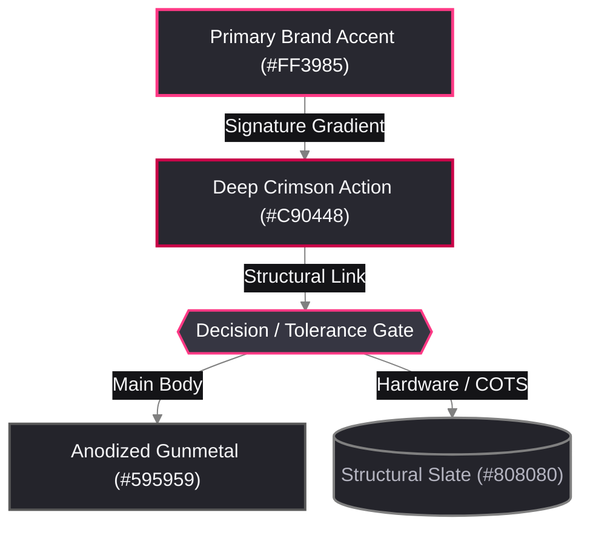

# 🎨 Alchemical-3D Brand Color Template (Dark Slate)

Part of the [`README.md`](../../README.md). Extracted directly from official vector assets in `Brand` (`/home/orin/Projects/Alchemical3D/Brand/assets/svg/`), `Alchemical_Web_Docs` (`mkdocs.yml`), and `Image_and_Style_Rules`. Companion light/print palette: `Alchemical3D_Light_Color_Template`. Also serves as the contrast-verified **KDE Plasma 6** (`AlchemicalDark.colors`), **KDE Konsole** (`Alchemical_Dark.colorscheme`), and **KDE Kate** (`Alchemical_Dark.theme`) dark workstation theme.

---

## 0. Machine-Readable Semantic Token Schema (`visual-studio`)

*(Auto-discovered by `/home/orin/Projects/Engineering/Homunculus/skills/visual-studio/scripts/render_diagram.py` via `--palette alchemical_dark`.)*

```json palette_tokens
{
  "palette_id": "alchemical_dark",
  "palette_name": "Alchemical-3D Brand Dark Slate",
  "mode": "dark",
  "font_stack": "'Inter', 'Segoe UI', Ubuntu, Arial, sans-serif",
  "mono_stack": "'JetBrains Mono', 'Fira Code', Consolas, monospace",
  "canvas_bg": "#1E1E24",
  "container_bg": "#24242C",
  "container_bg_alt": "#18181D",
  "card_bg_primary": "#282830",
  "card_bg_secondary": "#363642",
  "card_bg_recessed": "#141417",
  "banner_grad_start": "#141417",
  "banner_grad_mid": "#282830",
  "banner_grad_end": "#C90448",
  "banner_text": "#FFFFFF",
  "banner_subtext": "#FF3985",
  "primary_accent": "#FF3985",
  "secondary_accent": "#C90448",
  "tertiary_accent": "#808080",
  "structural_border": "#595959",
  "text_bright": "#FFFFFF",
  "text_primary": "#F5F5F7",
  "text_muted": "#B4B4C0",
  "text_on_accent": "#FFFFFF",
  "status_pass": "#2ECC71",
  "status_pass_bg": "#192B22",
  "status_warn": "#FFB800",
  "status_warn_bg": "#2B2414",
  "status_alert": "#FF3985",
  "status_alert_bg": "#2D1622",
  "pill_bg": "#141417",
  "pill_border": "#FF3985",
  "pill_text": "#F5F5F7"
}
```

---

## 1. Core Brand Identity Swatches (Official SVG Palette)

| Swatch | Token / Role | Hex | RGB | Source / Usage |
| :---: | :--- | :---: | :---: | :--- |
| <span style="display:inline-block;width:56px;height:22px;background:#FF3985;border:1px solid #808080;border-radius:4px;vertical-align:middle;"></span> | **Alchemical Pink (Primary)** | `#FF3985` | `255, 57, 133` | Primary logo bar (Flat) & top gradient stop (`!Alchemical-3D-Badge-Gradient-PRIMARY.svg`); primary CAD accent parts (`[a]_*.stl`). |
| <span style="display:inline-block;width:56px;height:22px;background:#C90448;border:1px solid #808080;border-radius:4px;vertical-align:middle;"></span> | **Alchemical Crimson (Deep)** | `#C90448` | `201, 4, 72` | Primary logo bottom gradient stop; high-emphasis callouts, critical nodes, and active states. |
| <span style="display:inline-block;width:56px;height:22px;background:linear-gradient(135deg,#FF3985 0%,#C90448 100%);border:1px solid #808080;border-radius:4px;vertical-align:middle;"></span> | **Brand Signature Gradient** | `#FF3985 → #C90448` | `Linear 135°` | Official primary mark gradient (`paint0_linear_129_37`). |
| <span style="display:inline-block;width:56px;height:22px;background:#808080;border:1px solid #595959;border-radius:4px;vertical-align:middle;"></span> | **Structural Slate Grey** | `#808080` | `128, 128, 128` | Secondary middle bar (`Alchemical-3D-Badge-Flat.svg` & gradient start `0.50` opacity); COTS aluminum/steel hardware. |
| <span style="display:inline-block;width:56px;height:22px;background:#595959;border:1px solid #808080;border-radius:4px;vertical-align:middle;"></span> | **Anodized Gunmetal** | `#595959` | `89, 89, 89` | Secondary middle bar gradient end (`0.65` black opacity); main printed structural body CAD color. |
| <span style="display:inline-block;width:56px;height:22px;background:#696969;border:1px solid #808080;border-radius:4px;vertical-align:middle;"></span> | **Carbon Dim Grey** | `#696969` | `105, 105, 105` | Tertiary dot gradient end (`0.59` black opacity); secondary borders and connector lines. |
| <span style="display:inline-block;width:56px;height:22px;background:#000000;border:1px solid #808080;border-radius:4px;vertical-align:middle;"></span> | **Obsidian Pure Black** | `#000000` | `0, 0, 0` | Wordmark typography (`ALCHEMICAL`), tertiary dot (Flat & gradient start), and BoW mark. |
| <span style="display:inline-block;width:56px;height:22px;background:#FFFFFF;border:1px solid #808080;border-radius:4px;vertical-align:middle;"></span> | **Pure Showcase White** | `#FFFFFF` | `255, 255, 255` | Locked `format_image.py` showcase card interior (`Image_and_Style_Rules`) & WoB mark. |

---

## 2. Extended Dark-Slate UI & Diagram Surfaces (`mkdocs.yml` Slate Scheme)

| Swatch | Surface Role | Hex | RGB | Usage |
| :---: | :--- | :---: | :---: | :--- |
| <span style="display:inline-block;width:56px;height:22px;background:#141417;border:1px solid #595959;border-radius:4px;vertical-align:middle;"></span> | **Deep Carbon (`bg0_h`)** | `#141417` | `20, 20, 23` | Edge label pills, code block backdrops, and deep recessed containers. |
| <span style="display:inline-block;width:56px;height:22px;background:#1E1E24;border:1px solid #595959;border-radius:4px;vertical-align:middle;"></span> | **Dark Slate Canvas (`bg0`)** | `#1E1E24` | `30, 30, 36` | Primary dark-mode diagram and web page background (`scheme: slate`). |
| <span style="display:inline-block;width:56px;height:22px;background:#282830;border:1px solid #595959;border-radius:4px;vertical-align:middle;"></span> | **Elevated Slate (`bg1`)** | `#282830` | `40, 40, 48` | Standard Mermaid node fill and card surface. |
| <span style="display:inline-block;width:56px;height:22px;background:#363642;border:1px solid #808080;border-radius:4px;vertical-align:middle;"></span> | **Active Gunmetal (`bg2`)** | `#363642` | `54, 54, 66` | Decision gate hexagon fill & active hover surface. |
| <span style="display:inline-block;width:56px;height:22px;background:#F5F5F7;border:1px solid #808080;border-radius:4px;vertical-align:middle;"></span> | **Crisp Alchemical White (`fg0`)** | `#F5F5F7` | `245, 245, 247` | Primary node text and headings on dark slate surfaces. |
| <span style="display:inline-block;width:56px;height:22px;background:#B4B4C0;border:1px solid #595959;border-radius:4px;vertical-align:middle;"></span> | **Muted Metallic Silver (`fg1`)** | `#B4B4C0` | `180, 180, 192` | Secondary labels, captions, and subtle borders. |

---

## 3. Semantic & Terminal Accent Swatches (Normal, Bright & Faint ANSI)

> [!IMPORTANT]
> **Zero-Disappearing-Text Konsole Contrast Guardrail**
> Raw `#000000`, `#1E1E24`, `#595959`, and deep `#C90448` are never assigned to Konsole ANSI foreground text slots (`Color0`–`Color7`). Instead, `Color0` is anchored at Structural Slate (`#808080`), `Color0Faint` at Carbon Dim Grey (`#696969`), and `Color0Intense` (`ANSI 8` / `brblack` mute, comments, and `fish` autosuggestions) at Metallic Comment Silver (`#9E9EAE`).

|                                                                     Normal Swatch                                                                      |     Normal Hex (`RGB`)      |                                                               Bright (`Intense`) Swatch                                                                |     Bright Hex (`RGB`)      | Faint (`SGR 2`) Hex (`RGB`) | Semantic / Terminal Role                                                                                                                                               |
| :----------------------------------------------------------------------------------------------------------------------------------------------------: | :-------------------------: | :----------------------------------------------------------------------------------------------------------------------------------------------------: | :-------------------------: | :-------------------------: | :--------------------------------------------------------------------------------------------------------------------------------------------------------------------- |
| <span style="display:inline-block;width:44px;height:20px;background:#808080;border:1px solid #595959;border-radius:4px;vertical-align:middle;"></span> | `#808080` (`128, 128, 128`) | <span style="display:inline-block;width:44px;height:20px;background:#9E9EAE;border:1px solid #595959;border-radius:4px;vertical-align:middle;"></span> | `#9E9EAE` (`158, 158, 174`) | `#696969` (`105, 105, 105`) | **Slate / Mute (`ANSI 0 & 8`)**: Structural Slate, `brblack` comments/autosuggestions/Git branch, and dim grey.                                                        |
| <span style="display:inline-block;width:44px;height:20px;background:#D63855;border:1px solid #595959;border-radius:4px;vertical-align:middle;"></span> |  `#D63855` (`214, 56, 85`)  | <span style="display:inline-block;width:44px;height:20px;background:#E85470;border:1px solid #595959;border-radius:4px;vertical-align:middle;"></span> | `#E85470` (`232, 84, 112`)  |  `#AD2B43` (`173, 43, 67`)  | **Deep Crimson-Scarlet (`alert` / `ANSI 1 & 9`)**: Load-bearing errors, failed gates, and diff deletions.                                                                   |
| <span style="display:inline-block;width:44px;height:20px;background:#68A888;border:1px solid #595959;border-radius:4px;vertical-align:middle;"></span> | `#68A888` (`104, 168, 136`) | <span style="display:inline-block;width:44px;height:20px;background:#86C4A5;border:1px solid #595959;border-radius:4px;vertical-align:middle;"></span> | `#86C4A5` (`134, 196, 165`) | `#528A6E` (`82, 138, 110`)  | **Mineral Sage (`status_pass` / `ANSI 2 & 10`)**: Muted metallic green for `[PASS]` gates, quota bars, and diff additions.                                             |
| <span style="display:inline-block;width:44px;height:20px;background:#E0AC3E;border:1px solid #595959;border-radius:4px;vertical-align:middle;"></span> | `#E0AC3E` (`224, 172, 62`)  | <span style="display:inline-block;width:44px;height:20px;background:#F2C258;border:1px solid #595959;border-radius:4px;vertical-align:middle;"></span> | `#F2C258` (`242, 194, 88`)  | `#B88B2E` (`184, 139, 46`)  | **Rich Alchemical Gold (`status_warn` / `ANSI 3 & 11`)**: Rich gold for warnings, command duration, and decision gates.                                             |
| <span style="display:inline-block;width:44px;height:20px;background:#D13B67;border:1px solid #595959;border-radius:4px;vertical-align:middle;"></span> | `#D13B67` (`209, 59, 103`)  | <span style="display:inline-block;width:44px;height:20px;background:#E59E42;border:1px solid #595959;border-radius:4px;vertical-align:middle;"></span> | `#E59E42` (`229, 158, 66`)  | `#A82E52` (`168, 46, 82`)   | **Deep Alchemical Crimson (`ANSI 4`) & Warm Amber-Gold (`ANSI 12`)**: Deep crimson for links/headers (`Color4`) paired with warm amber-gold for `agy` inline code (`Color4Intense`).      |
| <span style="display:inline-block;width:44px;height:20px;background:#D97736;border:1px solid #595959;border-radius:4px;vertical-align:middle;"></span> | `#D97736` (`217, 119, 54`)  | <span style="display:inline-block;width:44px;height:20px;background:#ED9355;border:1px solid #595959;border-radius:4px;vertical-align:middle;"></span> | `#ED9355` (`237, 147, 85`)  | `#B05D27` (`176, 93, 39`)   | **Burnished Copper-Orange (`secondary_accent` / `ANSI 5 & 13`)**: Rich warm orange for prompt symbol (`❯`) and step/time badges.                                       |
| <span style="display:inline-block;width:44px;height:20px;background:#5A9688;border:1px solid #595959;border-radius:4px;vertical-align:middle;"></span> | `#5A9688` (`90, 150, 136`)  | <span style="display:inline-block;width:44px;height:20px;background:#74B5A6;border:1px solid #595959;border-radius:4px;vertical-align:middle;"></span> | `#74B5A6` (`116, 181, 166`) | `#46786C` (`70, 120, 108`)  | **Deep Sage-Patina (`info` / `ANSI 6 & 14`)**: Pairs seamlessly with `Color2` Mineral Sage (`#68A888`) across the `fastfetch` CachyOS splash logo and hardware labels. |
| <span style="display:inline-block;width:44px;height:20px;background:#B4B4C0;border:1px solid #595959;border-radius:4px;vertical-align:middle;"></span> | `#B4B4C0` (`180, 180, 192`) | <span style="display:inline-block;width:44px;height:20px;background:#F5F5F7;border:1px solid #595959;border-radius:4px;vertical-align:middle;"></span> | `#F5F5F7` (`245, 245, 247`) | `#9E9EAE` (`158, 158, 174`) | **Metallic Silver / White (`fg1` & `fg0` / `ANSI 7 & 15`)**: Standard & bright foreground text.                                                                        |

---

## 4. Live Preview & Copy-Paste Mermaid Template (Alchemical-3D Brand Theme)

*(Safe for both Obsidian and GitHub `README.md` / `Assembly_Guide.md` — explicit node/pill fills ensure legibility on both GitHub Light Mode and Dark Mode.)*



---

## 5. GitHub-Safe Badges & Color Swatches (No Inline CSS)

> [!IMPORTANT]
> **GitHub Sanitizer Rule (`html-pipeline`)**
> Never copy `<span style="background:...">` HTML swatches into GitHub repository `.md` files—GitHub strips all `style="..."` attributes. In GitHub Markdown, use **Shields.io hex badges** or **backticked hex codes** (`` `#FF3985` ``, which GitHub natively renders with an inline color swatch dot).

```markdown
<!-- Alchemical-3D Brand-Colored Shields.io Hero Badges -->
[](#)
[](ALPHA_&_DIRECTION.md)
[](#)
[](LICENSE.md)

<!-- GitHub-Safe BOM / Filament Color Swatch Badges -->


```

---

## 6. Reusable CSS Variables Snippet (Web / Docs / UI)

```css
:root {
  /* Alchemical-3D Core Brand Tokens */
  --alch-pink-primary: #FF3985;
  --alch-crimson-deep: #C90448;
  --alch-gradient-primary: linear-gradient(135deg, #FF3985 0%, #C90448 100%);
  --alch-grey-slate: #808080;
  --alch-grey-gunmetal: #595959;
  --alch-grey-carbon: #696969;
  --alch-black: #000000;
  --alch-white-card: #FFFFFF;

  /* Alchemical-3D Dark Slate Theme Surfaces */
  --alch-bg-deep: #141417;
  --alch-bg-canvas: #1E1E24;
  --alch-bg-surface: #282830;
  --alch-bg-elevated: #363642;
  --alch-fg-primary: #F5F5F7;
  --alch-fg-muted: #B4B4C0;
}
```

---

## 7. Ready-to-Use KDE Konsole Profile (`~/.local/share/konsole/Alchemical_Dark.colorscheme`)

Installed at `~/.local/share/konsole/Alchemical_Dark.colorscheme` and bound to `~/.local/share/konsole/Riced.profile` (`ColorScheme=Alchemical_Dark`):

```ini
[Background]
Color=29,29,29

[BackgroundFaint]
Color=24,24,24

[BackgroundIntense]
Color=40,40,40

[Color0]
Color=128,128,128

[Color0Faint]
Color=105,105,105

[Color0Intense]
Color=158,158,174

[Color1]
Color=214,56,85

[Color1Faint]
Color=173,43,67

[Color1Intense]
Color=232,84,112

[Color2]
Color=104,168,136

[Color2Faint]
Color=82,138,110

[Color2Intense]
Color=134,196,165

[Color3]
Color=224,172,62

[Color3Faint]
Color=184,139,46

[Color3Intense]
Color=242,194,88

[Color4]
Color=209,59,103

[Color4Faint]
Color=168,46,82

[Color4Intense]
Color=229,158,66

[Color5]
Color=217,119,54

[Color5Faint]
Color=176,93,39

[Color5Intense]
Color=237,147,85

[Color6]
Color=90,150,136

[Color6Faint]
Color=70,120,108

[Color6Intense]
Color=116,181,166

[Color7]
Color=180,180,192

[Color7Faint]
Color=158,158,174

[Color7Intense]
Color=245,245,247

[Foreground]
Color=245,245,247

[ForegroundFaint]
Color=180,180,192

[ForegroundIntense]
Color=255,255,255

[General]
Blur=false
ColorRandomization=false
Description=Alchemical-3D Dark Slate
Opacity=1
```

---

## 8. KDE Plasma 6 System-Wide Color Scheme (`~/.local/share/color-schemes/AlchemicalDark.colors`)

Installed at `~/.local/share/color-schemes/AlchemicalDark.colors` with a signature **Alchemical Pink (`#FF3985`) + Deep Crimson (`#C90448`) + Steel Blue (`#4DA3FF`)** architecture:
- **Interactive Focus & Active State (`DecorationFocus`, `ForegroundActive`, `[WM] activeBlend`)**: `#FF3985` (`255, 57, 133` — Alchemical Pink) over `#181818` / `#1D1D1D` / `#222222` / `#242424` / `#282828` pure neutral matte carbon surfaces (anchored on `#1D1D1D` / `29, 29, 29`).
- **Hover & Visited Links (`DecorationHover`, `ForegroundVisited`)**: `#C90448` (`201, 4, 72` — Alchemical Crimson) for `DecorationHover` (which KDE Breeze blends at `30%` alpha over `#1D1D1D` to produce `#50152B` / `80, 21, 43` translucent magenta hover pills), `#FF6EA7` (`255, 110, 167`) for `ForegroundVisited`, and `#4DA3FF` (`77, 163, 255` — Alchemical Steel Blue) for `ForegroundLink`.
- **Smoked Translucent Selection Highlight (`[Colors:Selection]`)**: Pre-blended `#701132` (`112, 17, 50` — `48%` Alchemical Crimson over `#1D1D1D`) for `BackgroundNormal` and `#56142C` (`86, 20, 44` — `33%` over `#1D1D1D`) for `BackgroundAlternate`, paired with `#FFFFFF` Pure White, `#FFD04D` Bright Gold, and `#63E2F5` Bright Aqua so selected items match the smoked translucency of hovered options.

```bash
# Apply Alchemical-3D Dark across KDE Plasma 6:
plasma-apply-colorscheme AlchemicalDark

# Switch back to Gruvbox Dark or Breeze Dark at any time:
plasma-apply-colorscheme GruvboxDark
plasma-apply-colorscheme BreezeDark
```

---

## 9. KDE Kate / KTextEditor Syntax Theme (`~/.local/share/org.kde.syntax-highlighting/themes/Alchemical_Dark.theme`)

Installed at `~/.local/share/org.kde.syntax-highlighting/themes/Alchemical_Dark.theme` (`"name": "Alchemical-3D Dark"`) and bound in `~/.config/katerc` (`[KTextEditor Renderer] Color Theme=Alchemical-3D Dark`, `[UiSettings] ColorScheme=AlchemicalDark`, `[filetree] editShade=38,68,56`, `viewShade=86,20,44`):
- **Editor Canvas & Selection**: `BackgroundColor` `#1d1d1d` (`29, 29, 29`), `CurrentLine` `#242424` (`36, 36, 36`), `IconBorder` `#181818` (`24, 24, 24`), and `TextSelection` `#701132` (`112, 17, 50` smoked translucent crimson-magenta — matching `AlchemicalDark.colors` so `KSyntaxHighlighting::Repository::themeForPalette` automatically pairs them).
- **Syntax Highlighting Hierarchy**:
  - **Keywords & Control Flow**: Deep Alchemical Crimson `#d13b67` (`Keyword` bold) paired with Burnished Copper-Orange `#d97736` (`ControlFlow` bold, `Preprocessor`).
  - **Functions, Built-Ins & Imports**: Warm Amber-Gold `#e59e42` (`Function`, `Attribute`, `CurrentLineNumber`) and Rich Alchemical Gold `#e0ac3e` (`BuiltIn`, `Import`, `Annotation`, `Warning`).
  - **Strings, Chars & Types**: Bright Mineral Sage `#86c4a5` (`String`, `Char`), Mineral Sage `#68a888` (`VerbatimString`, `SavedLines`), Bright Sage-Patina `#74b5a6` (`DataType`, `SpecialString`, `Information`), and Deep Sage-Patina `#5a9688` (`Extension`).
  - **Numbers, Constants & Variables**: Bright Copper-Orange `#ed9355` (`DecVal`, `Float`, `BaseN`, `SpecialChar`), Bright Gold `#f2c258` (`Constant` bold), Bright Titanium Silver `#d4d4de` (`Variable`), Metallic Silver `#b4b4c0` (`Operator`, `Others`), and Crisp Alchemical White `#f5f5f7` (`Normal`).
  - **Comments & Diagnostics**: Metallic Comment Silver `#9e9eae` (`Comment` italic), Structural Slate `#808080` (`Documentation` italic, `LineNumbers`), and Crimson-Scarlet `#e85470` / `#d63855` (`Error`, `SpellChecking`, `MarkError`).
