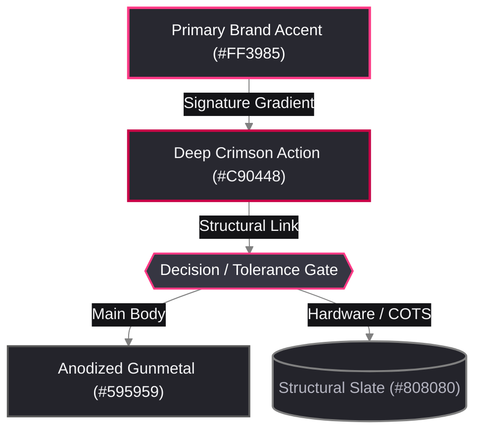

# 🎨 Alchemical-3D Brand Color Template (Dark Slate)

Part of the [`README.md`](../../README.md). Extracted directly from official vector assets in `Brand` (`/home/orin/Projects/Alchemical3D/Brand/assets/svg/`), `Alchemical_Web_Docs` (`mkdocs.yml`), and `Image_and_Style_Rules`. Companion light/print palette: `Alchemical3D_Light_Color_Template`.

---

## 0. Machine-Readable Semantic Token Schema (`visual-studio`)

*(Auto-discovered by `/home/orin/Projects/Engineering/Homunculus/skills/visual-studio/scripts/render_diagram.py` via `--palette alchemical_dark`.)*

```json palette_tokens
{
  "palette_id": "alchemical_dark",
  "palette_name": "Alchemical-3D Brand Dark Slate",
  "mode": "dark",
  "font_stack": "'Inter', 'Segoe UI', Ubuntu, Arial, sans-serif",
  "mono_stack": "'JetBrains Mono', 'Fira Code', Consolas, monospace",
  "canvas_bg": "#1E1E24",
  "container_bg": "#24242C",
  "container_bg_alt": "#18181D",
  "card_bg_primary": "#282830",
  "card_bg_secondary": "#363642",
  "card_bg_recessed": "#141417",
  "banner_grad_start": "#141417",
  "banner_grad_mid": "#282830",
  "banner_grad_end": "#C90448",
  "banner_text": "#FFFFFF",
  "banner_subtext": "#FF3985",
  "primary_accent": "#FF3985",
  "secondary_accent": "#C90448",
  "tertiary_accent": "#808080",
  "structural_border": "#595959",
  "text_bright": "#FFFFFF",
  "text_primary": "#F5F5F7",
  "text_muted": "#B4B4C0",
  "text_on_accent": "#FFFFFF",
  "status_pass": "#2ECC71",
  "status_pass_bg": "#192B22",
  "status_warn": "#FFB800",
  "status_warn_bg": "#2B2414",
  "status_alert": "#FF3985",
  "status_alert_bg": "#2D1622",
  "pill_bg": "#141417",
  "pill_border": "#FF3985",
  "pill_text": "#F5F5F7"
}
```

---

## 1. Core Brand Identity Swatches (Official SVG Palette)

| Swatch | Token / Role | Hex | RGB | Source / Usage |
| :---: | :--- | :---: | :---: | :--- |
| <span style="display:inline-block;width:56px;height:22px;background:#FF3985;border:1px solid #808080;border-radius:4px;vertical-align:middle;"></span> | **Alchemical Pink (Primary)** | `#FF3985` | `255, 57, 133` | Primary logo bar (Flat) & top gradient stop (`!Alchemical-3D-Badge-Gradient-PRIMARY.svg`); primary CAD accent parts (`[a]_*.stl`). |
| <span style="display:inline-block;width:56px;height:22px;background:#C90448;border:1px solid #808080;border-radius:4px;vertical-align:middle;"></span> | **Alchemical Crimson (Deep)** | `#C90448` | `201, 4, 72` | Primary logo bottom gradient stop; high-emphasis callouts, critical nodes, and active states. |
| <span style="display:inline-block;width:56px;height:22px;background:linear-gradient(135deg,#FF3985 0%,#C90448 100%);border:1px solid #808080;border-radius:4px;vertical-align:middle;"></span> | **Brand Signature Gradient** | `#FF3985 → #C90448` | `Linear 135°` | Official primary mark gradient (`paint0_linear_129_37`). |
| <span style="display:inline-block;width:56px;height:22px;background:#808080;border:1px solid #595959;border-radius:4px;vertical-align:middle;"></span> | **Structural Slate Grey** | `#808080` | `128, 128, 128` | Secondary middle bar (`Alchemical-3D-Badge-Flat.svg` & gradient start `0.50` opacity); COTS aluminum/steel hardware. |
| <span style="display:inline-block;width:56px;height:22px;background:#595959;border:1px solid #808080;border-radius:4px;vertical-align:middle;"></span> | **Anodized Gunmetal** | `#595959` | `89, 89, 89` | Secondary middle bar gradient end (`0.65` black opacity); main printed structural body CAD color. |
| <span style="display:inline-block;width:56px;height:22px;background:#696969;border:1px solid #808080;border-radius:4px;vertical-align:middle;"></span> | **Carbon Dim Grey** | `#696969` | `105, 105, 105` | Tertiary dot gradient end (`0.59` black opacity); secondary borders and connector lines. |
| <span style="display:inline-block;width:56px;height:22px;background:#000000;border:1px solid #808080;border-radius:4px;vertical-align:middle;"></span> | **Obsidian Pure Black** | `#000000` | `0, 0, 0` | Wordmark typography (`ALCHEMICAL`), tertiary dot (Flat & gradient start), and BoW mark. |
| <span style="display:inline-block;width:56px;height:22px;background:#FFFFFF;border:1px solid #808080;border-radius:4px;vertical-align:middle;"></span> | **Pure Showcase White** | `#FFFFFF` | `255, 255, 255` | Locked `format_image.py` showcase card interior (`Image_and_Style_Rules`) & WoB mark. |

---

## 2. Extended Dark-Slate UI & Diagram Surfaces (`mkdocs.yml` Slate Scheme)

| Swatch | Surface Role | Hex | RGB | Usage |
| :---: | :--- | :---: | :---: | :--- |
| <span style="display:inline-block;width:56px;height:22px;background:#141417;border:1px solid #595959;border-radius:4px;vertical-align:middle;"></span> | **Deep Carbon (`bg0_h`)** | `#141417` | `20, 20, 23` | Edge label pills, code block backdrops, and deep recessed containers. |
| <span style="display:inline-block;width:56px;height:22px;background:#1E1E24;border:1px solid #595959;border-radius:4px;vertical-align:middle;"></span> | **Dark Slate Canvas (`bg0`)** | `#1E1E24` | `30, 30, 36` | Primary dark-mode diagram and web page background (`scheme: slate`). |
| <span style="display:inline-block;width:56px;height:22px;background:#282830;border:1px solid #595959;border-radius:4px;vertical-align:middle;"></span> | **Elevated Slate (`bg1`)** | `#282830` | `40, 40, 48` | Standard Mermaid node fill and card surface. |
| <span style="display:inline-block;width:56px;height:22px;background:#363642;border:1px solid #808080;border-radius:4px;vertical-align:middle;"></span> | **Active Gunmetal (`bg2`)** | `#363642` | `54, 54, 66` | Decision gate hexagon fill & active hover surface. |
| <span style="display:inline-block;width:56px;height:22px;background:#F5F5F7;border:1px solid #808080;border-radius:4px;vertical-align:middle;"></span> | **Crisp Alchemical White (`fg0`)** | `#F5F5F7` | `245, 245, 247` | Primary node text and headings on dark slate surfaces. |
| <span style="display:inline-block;width:56px;height:22px;background:#B4B4C0;border:1px solid #595959;border-radius:4px;vertical-align:middle;"></span> | **Muted Metallic Silver (`fg1`)** | `#B4B4C0` | `180, 180, 192` | Secondary labels, captions, and subtle borders. |

---

## 3. Live Preview & Copy-Paste Mermaid Template (Alchemical-3D Brand Theme)

*(Safe for both Obsidian and GitHub `README.md` / `Assembly_Guide.md` — explicit node/pill fills ensure legibility on both GitHub Light Mode and Dark Mode.)*



---

## 4. GitHub-Safe Badges & Color Swatches (No Inline CSS)

> [!IMPORTANT]
> **GitHub Sanitizer Rule (`html-pipeline`)**
> Never copy `<span style="background:...">` HTML swatches into GitHub repository `.md` files—GitHub strips all `style="..."` attributes. In GitHub Markdown, use **Shields.io hex badges** or **backticked hex codes** (`` `#FF3985` ``, which GitHub natively renders with an inline color swatch dot).

```markdown
<!-- Alchemical-3D Brand-Colored Shields.io Hero Badges -->
[](#)
[](ALPHA_&_DIRECTION.md)
[](#)
[](LICENSE.md)

<!-- GitHub-Safe BOM / Filament Color Swatch Badges -->


```

---

## 5. Reusable CSS Variables Snippet (Web / Docs / UI)

```css
:root {
  /* Alchemical-3D Core Brand Tokens */
  --alch-pink-primary: #FF3985;
  --alch-crimson-deep: #C90448;
  --alch-gradient-primary: linear-gradient(135deg, #FF3985 0%, #C90448 100%);
  --alch-grey-slate: #808080;
  --alch-grey-gunmetal: #595959;
  --alch-grey-carbon: #696969;
  --alch-black: #000000;
  --alch-white-card: #FFFFFF;

  /* Alchemical-3D Dark Slate Theme Surfaces */
  --alch-bg-deep: #141417;
  --alch-bg-canvas: #1E1E24;
  --alch-bg-surface: #282830;
  --alch-bg-elevated: #363642;
  --alch-fg-primary: #F5F5F7;
  --alch-fg-muted: #B4B4C0;
}
```
