# 🎨 Alchemical-3D Brand Color Template (Light / Print / Showcase Mode)

Part of the [`README.md`](../../README.md). Companion to `Alchemical3D_Color_Template` (Dark Slate), engineered specifically for **white-interior GitHub showcase cards** (`Image_and_Style_Rules`), printable PDF assembly sheets, and high-contrast daytime technical diagrams.

---

## 0. Machine-Readable Semantic Token Schema (`visual-studio`)

*(Auto-discovered by `/home/orin/Projects/Engineering/Homunculus/skills/visual-studio/scripts/render_diagram.py` via `--palette alchemical_light`.)*

```json palette_tokens
{
  "palette_id": "alchemical_light",
  "palette_name": "Alchemical-3D Brand Light & Print",
  "mode": "light",
  "font_stack": "'Inter', 'Segoe UI', Ubuntu, Arial, sans-serif",
  "mono_stack": "'JetBrains Mono', 'Fira Code', Consolas, monospace",
  "canvas_bg": "#FFFFFF",
  "container_bg": "#F5F5F8",
  "container_bg_alt": "#EBEBF0",
  "card_bg_primary": "#FFFFFF",
  "card_bg_secondary": "#F8F8FA",
  "card_bg_recessed": "#EFEFF4",
  "banner_grad_start": "#1E1E24",
  "banner_grad_mid": "#282830",
  "banner_grad_end": "#C90448",
  "banner_text": "#FFFFFF",
  "banner_subtext": "#FF70A6",
  "primary_accent": "#FF3985",
  "secondary_accent": "#C90448",
  "tertiary_accent": "#595959",
  "structural_border": "#808080",
  "text_bright": "#141417",
  "text_primary": "#24242B",
  "text_muted": "#595959",
  "text_on_accent": "#FFFFFF",
  "status_pass": "#1E8449",
  "status_pass_bg": "#EAFAF1",
  "status_warn": "#B7791F",
  "status_warn_bg": "#FEF9E7",
  "status_alert": "#C90448",
  "status_alert_bg": "#FDEDEC",
  "pill_bg": "#FFFFFF",
  "pill_border": "#C90448",
  "pill_text": "#141417"
}
```

---

## 1. Light & Print Surface Swatches

| Swatch | Token / Role | Hex | RGB | Usage |
| :---: | :--- | :---: | :---: | :--- |
| <span style="display:inline-block;width:56px;height:22px;background:#FFFFFF;border:1px solid #808080;border-radius:4px;vertical-align:middle;"></span> | **Showcase White (`canvas_bg`)** | `#FFFFFF` | `255, 255, 255` | Primary canvas & card interior matching `format_image.py` (`#FFFFFF`). |
| <span style="display:inline-block;width:56px;height:22px;background:#F5F5F8;border:1px solid #808080;border-radius:4px;vertical-align:middle;"></span> | **Soft Platinum (`container_bg`)** | `#F5F5F8` | `245, 245, 248` | Swimlane band and subsystem group container fill. |
| <span style="display:inline-block;width:56px;height:22px;background:#EFEFF4;border:1px solid #808080;border-radius:4px;vertical-align:middle;"></span> | **Recessed Steel (`card_bg_recessed`)** | `#EFEFF4` | `239, 239, 244` | Code blocks, pinout tables, and spec callout fills. |
| <span style="display:inline-block;width:56px;height:22px;background:#FF3985;border:1px solid #808080;border-radius:4px;vertical-align:middle;"></span> | **Alchemical Pink (`primary_accent`)** | `#FF3985` | `255, 57, 133` | Primary brand accent headers, badges, and active airflow/signal paths. |
| <span style="display:inline-block;width:56px;height:22px;background:#C90448;border:1px solid #808080;border-radius:4px;vertical-align:middle;"></span> | **Deep Crimson (`secondary_accent`)** | `#C90448` | `201, 4, 72` | High-contrast crimson borders, pill outlines, and critical tolerances on white backgrounds. |
| <span style="display:inline-block;width:56px;height:22px;background:#595959;border:1px solid #808080;border-radius:4px;vertical-align:middle;"></span> | **Anodized Gunmetal (`tertiary_accent`)** | `#595959` | `89, 89, 89` | Structural body nodes, secondary headers, and muted labels. |
| <span style="display:inline-block;width:56px;height:22px;background:#141417;border:1px solid #808080;border-radius:4px;vertical-align:middle;"></span> | **Deep Carbon Ink (`text_bright`)** | `#141417` | `20, 20, 23` | High-contrast primary headings and technical labels on light surfaces. |

---

## 2. Live Preview & Copy-Paste Mermaid Template (Alchemical-3D Light Theme)

```mermaid
%%{init: {"theme": "base", "themeVariables": {"darkMode": false, "background": "#FFFFFF", "primaryColor": "#FFFFFF", "primaryTextColor": "#141417", "textColor": "#141417", "tertiaryTextColor": "#24242B", "primaryBorderColor": "#C90448", "lineColor": "#595959", "secondaryColor": "#F5F5F8", "tertiaryColor": "#EFEFF4", "edgeLabelBackground": "#FFFFFF"}, "flowchart": {"nodeSpacing": 24, "rankSpacing": 30, "curve": "basis", "padding": 12}}}%%
flowchart LR
    Source["Pneuma Air Supply (#FF3985)"] -->|"6mm OD PTFE"| Splitter{{"Y-Splitter Manifold (#C90448)"}}
    Splitter -->|"Dual 5mm OD"| Alembic["Alembic Toolhead (#595959)"]

    classDef lightPink fill:#FFFFFF,stroke:#FF3985,stroke-width:2.5px,color:#141417;
    classDef lightCrimson fill:#FDEDEC,stroke:#C90448,stroke-width:2.5px,color:#141417;
    classDef lightGunmetal fill:#F5F5F8,stroke:#595959,stroke-width:2px,color:#141417;

    class Source lightPink;
    class Splitter lightCrimson;
    class Alembic lightGunmetal;
```


