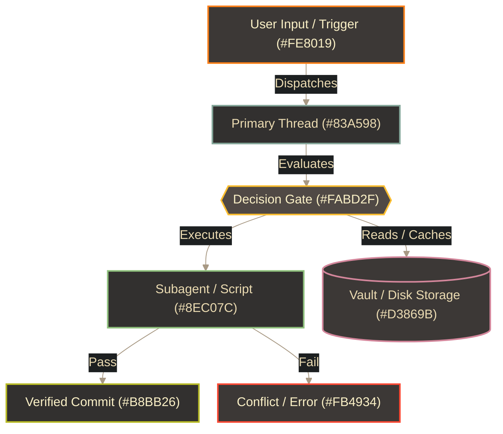

# 🎨 Gruvbox Dark Local Machine & Diagram Color Template

Part of the [`README.md`](../../README.md) and referenced by `Subagent_and_Memory_Architecture`. Standard palette for local Linux machine customization (**KDE Konsole**, terminal TUI tools, status bars), **Obsidian Mermaid Flowcharts**, and local architecture diagrams via `visual-studio`.

---

## 0. Machine-Readable Semantic Token Schema (`visual-studio`)

*(Auto-discovered by `/home/orin/Projects/Engineering/Homunculus/skills/visual-studio/scripts/render_diagram.py` via `--palette gruvbox_dark`.)*

```json palette_tokens
{
  "palette_id": "gruvbox_dark",
  "palette_name": "Gruvbox Dark (Local Engineering Standard)",
  "mode": "dark",
  "font_stack": "'Inter', 'Segoe UI', Ubuntu, Arial, sans-serif",
  "mono_stack": "'JetBrains Mono', 'Fira Code', Consolas, monospace",
  "canvas_bg": "#282828",
  "container_bg": "#32302F",
  "container_bg_alt": "#1D2021",
  "card_bg_primary": "#3C3836",
  "card_bg_secondary": "#504945",
  "card_bg_recessed": "#1D2021",
  "banner_grad_start": "#1D2021",
  "banner_grad_mid": "#3C3836",
  "banner_grad_end": "#D65D0E",
  "banner_text": "#FBF1C7",
  "banner_subtext": "#FABD2F",
  "primary_accent": "#FE8019",
  "secondary_accent": "#8EC07C",
  "tertiary_accent": "#83A598",
  "structural_border": "#A89984",
  "text_bright": "#FBF1C7",
  "text_primary": "#EBDBB2",
  "text_muted": "#D5C4A1",
  "text_on_accent": "#1D2021",
  "status_pass": "#B8BB26",
  "status_pass_bg": "#292B1E",
  "status_warn": "#FABD2F",
  "status_warn_bg": "#332B1E",
  "status_alert": "#FB4934",
  "status_alert_bg": "#361F1E",
  "pill_bg": "#1D2021",
  "pill_border": "#FABD2F",
  "pill_text": "#FBF1C7"
}
```

---

## 1. Background & Surface Swatches (Gruvbox Dark)

| Swatch | Gruvbox Token | Hex | RGB | Primary Role |
| :---: | :--- | :---: | :---: | :--- |
| <span style="display:inline-block;width:56px;height:22px;background:#1D2021;border:1px solid #665C54;border-radius:4px;vertical-align:middle;"></span> | **`bg0_h` (Hard Dark)** | `#1D2021` | `29, 32, 33` | High-contrast terminal background & Mermaid edge label pill background. |
| <span style="display:inline-block;width:56px;height:22px;background:#282828;border:1px solid #665C54;border-radius:4px;vertical-align:middle;"></span> | **`bg0` (Main Canvas)** | `#282828` | `40, 40, 40` | Standard Konsole background & Mermaid diagram canvas container. |
| <span style="display:inline-block;width:56px;height:22px;background:#32302F;border:1px solid #665C54;border-radius:4px;vertical-align:middle;"></span> | **`bg0_s` (Soft Dark)** | `#32302F` | `50, 48, 47` | Primary Thread, Subagent, and Commit node fill. |
| <span style="display:inline-block;width:56px;height:22px;background:#3C3836;border:1px solid #665C54;border-radius:4px;vertical-align:middle;"></span> | **`bg1` (Elevated Surface)** | `#3C3836` | `60, 56, 54` | Default Mermaid node fill, User Input fill, and Storage cylinder fill. |
| <span style="display:inline-block;width:56px;height:22px;background:#504945;border:1px solid #928374;border-radius:4px;vertical-align:middle;"></span> | **`bg2` (Active / Gate)** | `#504945` | `80, 73, 69` | Decision hexagon (`{{...}}`) fill, Hub node fill, and terminal selection background. |
| <span style="display:inline-block;width:56px;height:22px;background:#665C54;border:1px solid #928374;border-radius:4px;vertical-align:middle;"></span> | **`bg3` (Subtle Border)** | `#665C54` | `102, 92, 84` | Edge pill border and inactive UI dividers. |

---

## 2. Foreground & Typography Swatches

| Swatch | Gruvbox Token | Hex | RGB | Primary Role |
| :---: | :--- | :---: | :---: | :--- |
| <span style="display:inline-block;width:56px;height:22px;background:#FBF1C7;border:1px solid #665C54;border-radius:4px;vertical-align:middle;"></span> | **`fg0` (Bright Cream)** | `#FBF1C7` | `251, 241, 199` | High-emphasis node text (`input`, `gate`, `commit`) and edge label text. |
| <span style="display:inline-block;width:56px;height:22px;background:#EBDBB2;border:1px solid #665C54;border-radius:4px;vertical-align:middle;"></span> | **`fg1` (Standard Cream)** | `#EBDBB2` | `235, 219, 178` | Default Konsole foreground text and standard Mermaid node text. |
| <span style="display:inline-block;width:56px;height:22px;background:#D5C4A1;border:1px solid #665C54;border-radius:4px;vertical-align:middle;"></span> | **`fg2` (Muted Cream)** | `#D5C4A1` | `213, 196, 161` | Secondary labels and status bar text. |
| <span style="display:inline-block;width:56px;height:22px;background:#A89984;border:1px solid #665C54;border-radius:4px;vertical-align:middle;"></span> | **`fg4` (Warm Gray)** | `#A89984` | `168, 153, 132` | Mermaid connector lines, arrowheads, and muted icons. |
| <span style="display:inline-block;width:56px;height:22px;background:#928374;border:1px solid #665C54;border-radius:4px;vertical-align:middle;"></span> | **`gray` (Comment Gray)** | `#928374` | `146, 131, 116` | Code comments and dim terminal text (`ANSI Bright Black`). |

---

## 3. Semantic & Terminal Accent Swatches (Normal & Bright ANSI)

|                                                                     Normal Swatch                                                                      |     Normal Hex (`RGB`)      |                                                                     Bright Swatch                                                                      |     Bright Hex (`RGB`)      | Semantic / Mermaid / Terminal Role                                                                       |
| :----------------------------------------------------------------------------------------------------------------------------------------------------: | :-------------------------: | :----------------------------------------------------------------------------------------------------------------------------------------------------: | :-------------------------: | :------------------------------------------------------------------------------------------------------- |
| <span style="display:inline-block;width:44px;height:20px;background:#CC241D;border:1px solid #665C54;border-radius:4px;vertical-align:middle;"></span> |  `#CC241D` (`204, 36, 29`)  | <span style="display:inline-block;width:44px;height:20px;background:#FB4934;border:1px solid #665C54;border-radius:4px;vertical-align:middle;"></span> |  `#FB4934` (`251, 73, 52`)  | **Red (`alert` / `ANSI 1 & 9`)**: Load-bearing errors, `[CONFLICT]`, and failed gates.                   |
| <span style="display:inline-block;width:44px;height:20px;background:#98971A;border:1px solid #665C54;border-radius:4px;vertical-align:middle;"></span> | `#98971A` (`152, 151, 26`)  | <span style="display:inline-block;width:44px;height:20px;background:#B8BB26;border:1px solid #665C54;border-radius:4px;vertical-align:middle;"></span> | `#B8BB26` (`184, 187, 38`)  | **Green (`commit` / `ANSI 2 & 10`)**: Verified outputs, atomic commits, and `[PASS]` gates.              |
| <span style="display:inline-block;width:44px;height:20px;background:#D79921;border:1px solid #665C54;border-radius:4px;vertical-align:middle;"></span> | `#D79921` (`215, 153, 33`)  | <span style="display:inline-block;width:44px;height:20px;background:#FABD2F;border:1px solid #665C54;border-radius:4px;vertical-align:middle;"></span> | `#FABD2F` (`250, 189, 47`)  | **Yellow (`gate` / `ANSI 3 & 11`)**: Decision hexagons (`{{...}}`), hubs, and warnings.                  |
| <span style="display:inline-block;width:44px;height:20px;background:#458588;border:1px solid #665C54;border-radius:4px;vertical-align:middle;"></span> | `#458588` (`69, 133, 136`)  | <span style="display:inline-block;width:44px;height:20px;background:#83A598;border:1px solid #665C54;border-radius:4px;vertical-align:middle;"></span> | `#83A598` (`131, 165, 152`) | **Blue (`primary` / `ANSI 4 & 12`)**: Primary Thread (`Lead Co-Engineer`) and project nodes.             |
| <span style="display:inline-block;width:44px;height:20px;background:#B16286;border:1px solid #665C54;border-radius:4px;vertical-align:middle;"></span> | `#B16286` (`177, 98, 134`)  | <span style="display:inline-block;width:44px;height:20px;background:#D3869B;border:1px solid #665C54;border-radius:4px;vertical-align:middle;"></span> | `#D3869B` (`211, 134, 155`) | **Purple (`storage` / `ANSI 5 & 13`)**: Obsidian Vault databases, disk storage, and logs.                |
| <span style="display:inline-block;width:44px;height:20px;background:#689D6A;border:1px solid #665C54;border-radius:4px;vertical-align:middle;"></span> | `#689D6A` (`104, 157, 106`) | <span style="display:inline-block;width:44px;height:20px;background:#8EC07C;border:1px solid #665C54;border-radius:4px;vertical-align:middle;"></span> | `#8EC07C` (`142, 192, 124`) | **Aqua (`subagent` / `ANSI 6 & 14`)**: Subagents (`vault-scout`, `hardware-inspector`) & Python scripts. |
| <span style="display:inline-block;width:44px;height:20px;background:#D65D0E;border:1px solid #665C54;border-radius:4px;vertical-align:middle;"></span> |  `#D65D0E` (`214, 93, 14`)  | <span style="display:inline-block;width:44px;height:20px;background:#FE8019;border:1px solid #665C54;border-radius:4px;vertical-align:middle;"></span> | `#FE8019` (`254, 128, 25`)  | **Orange (`input` / Accent)**: Human input, hardware triggers, and standards specs.                      |

---

## 4. Live Preview & Copy-Paste Mermaid Template (Gruvbox Dark)



---

## 5. Ready-to-Use KDE Konsole Profile (`~/.local/share/konsole/Gruvbox_Dark.colorscheme`)

Save this block to `~/.local/share/konsole/Gruvbox_Dark.colorscheme` to apply the exact same Gruvbox Dark palette to **KDE Konsole**:

```ini
[Background]
Color=40,40,40

[BackgroundFaint]
Color=29,32,33

[BackgroundIntense]
Color=60,56,54

[Color0]
Color=40,40,40

[Color0Faint]
Color=29,32,33

[Color0Intense]
Color=146,131,116

[Color1]
Color=204,36,29

[Color1Faint]
Color=157,0,6

[Color1Intense]
Color=251,73,52

[Color2]
Color=152,151,26

[Color2Faint]
Color=121,116,14

[Color2Intense]
Color=184,187,38

[Color3]
Color=215,153,33

[Color3Faint]
Color=181,118,20

[Color3Intense]
Color=250,189,47

[Color4]
Color=69,133,136

[Color4Faint]
Color=7,102,120

[Color4Intense]
Color=131,165,152

[Color5]
Color=177,98,134

[Color5Faint]
Color=143,63,113

[Color5Intense]
Color=211,134,155

[Color6]
Color=104,157,106

[Color6Faint]
Color=66,123,88

[Color6Intense]
Color=142,192,124

[Color7]
Color=168,153,132

[Color7Faint]
Color=146,131,116

[Color7Intense]
Color=235,219,178

[Foreground]
Color=235,219,178

[ForegroundFaint]
Color=168,153,132

[ForegroundIntense]
Color=251,241,199

[General]
Blur=false
ColorRandomization=false
Description=Gruvbox Dark (Local Machine Standard)
Opacity=1
```

---

## 6. KDE Plasma 6 System-Wide Color Scheme (`~/.local/share/color-schemes/GruvboxDark.colors`)

Installed at `~/.local/share/color-schemes/GruvboxDark.colors` with a dual-accent **Orange (`#FE8019`) + Aqua (`#8EC07C` / `#689D6A` / `#427B58`)** architecture:
- **Interactive Focus & Active State (`DecorationFocus`, `ForegroundActive`, `[WM] activeBlend`)**: `#FE8019` (`254, 128, 25` — Gruvbox Orange).
- **Hover, Links & Selection (`DecorationHover`, `ForegroundLink`, `[Colors:Selection]`)**: `#8EC07C` (`142, 192, 124` — Bright Aqua) for hover outlines/links and `#427B58` / `#689D6A` (Deep/Normal Aqua) for selection backgrounds so `#FBF1C7` Bright Cream text maintains high contrast.

```bash
# Apply Gruvbox Dark (with built-in Orange #FE8019 Focus + Aqua #8EC07C Hover/Selection):
plasma-apply-colorscheme GruvboxDark

# Revert to Breeze Dark at any time:
plasma-apply-colorscheme BreezeDark
```
