# 🎨 NetCom Corporate & Structured Cabling Color Template

> [!IMPORTANT]
> **Strict Entity Separation**: **NetCom (`netcom1989.com`)** is an independent enterprise entity and has **no relationship** with **Alchemical-3D**. This palette is indexed in [`README.md`](../../README.md) solely for workstation diagram rendering (`visual-studio`) supporting `NetCom_Engineering_Assistant`.

Extracted from `netcom1989.com` corporate branding and standardized for `NetCom_Engineering_Assistant` (**NEA**) architecture flowcharts, workbook data-flow diagrams, and structured cabling engineering deliverables.

---

## 0. Machine-Readable Semantic Token Schema (`visual-studio`)

*(Auto-discovered by `/home/orin/Projects/Engineering/Homunculus/skills/visual-studio/scripts/render_diagram.py` via `--palette netcom_corporate`.)*

```json palette_tokens
{
  "palette_id": "netcom_corporate",
  "palette_name": "NetCom Corporate (Structured Cabling & NEA)",
  "mode": "light",
  "font_stack": "Calibri, 'Segoe UI', Aptos, Arial, sans-serif",
  "mono_stack": "Consolas, 'JetBrains Mono', monospace",
  "canvas_bg": "#F4F7FA",
  "container_bg": "#EAF0F6",
  "container_bg_alt": "#E6F4F9",
  "card_bg_primary": "#FFFFFF",
  "card_bg_secondary": "#F5F8FB",
  "card_bg_recessed": "#EBF3F9",
  "banner_grad_start": "#114573",
  "banner_grad_mid": "#165366",
  "banner_grad_end": "#03A6D9",
  "banner_text": "#FFFFFF",
  "banner_subtext": "#D9F2FA",
  "primary_accent": "#114573",
  "secondary_accent": "#03A6D9",
  "tertiary_accent": "#165366",
  "structural_border": "#8FA6BC",
  "text_bright": "#114573",
  "text_primary": "#231F20",
  "text_muted": "#4A5568",
  "text_on_accent": "#FFFFFF",
  "status_pass": "#5DA423",
  "status_pass_bg": "#EDF7ED",
  "status_warn": "#D98200",
  "status_warn_bg": "#FFF8E6",
  "status_alert": "#C60F13",
  "status_alert_bg": "#FDECEC",
  "pill_bg": "#FFFFFF",
  "pill_border": "#165366",
  "pill_text": "#114573"
}
```

---

## 1. Corporate Brand & Engineering Swatches (`netcom1989.com`)

| Swatch | Token / Role | Hex | RGB | Primary Usage |
| :---: | :--- | :---: | :---: | :--- |
| <span style="display:inline-block;width:56px;height:22px;background:#114573;border:1px solid #8FA6BC;border-radius:4px;vertical-align:middle;"></span> | **NetCom Primary Navy** | `#114573` | `17, 69, 115` | Primary headers, structural bands, main titles, and core data tables (`Cable Schedule`). |
| <span style="display:inline-block;width:56px;height:22px;background:#03A6D9;border:1px solid #8FA6BC;border-radius:4px;vertical-align:middle;"></span> | **NetCom Bright Cyan** | `#03A6D9` | `3, 166, 217` | Active data flows, AI/Copilot orchestration layers, and highlight accents. |
| <span style="display:inline-block;width:56px;height:22px;background:#165366;border:1px solid #8FA6BC;border-radius:4px;vertical-align:middle;"></span> | **NetCom Deep Teal** | `#165366` | `22, 83, 102` | Secondary headers, lookup matrices (`Rule Matrix`, `Parts Catalog`), and connector pills. |
| <span style="display:inline-block;width:56px;height:22px;background:#231F20;border:1px solid #8FA6BC;border-radius:4px;vertical-align:middle;"></span> | **NetCom Charcoal** | `#231F20` | `35, 31, 32` | Standard body text, field names, and specifications. |
| <span style="display:inline-block;width:56px;height:22px;background:#EAF0F6;border:1px solid #8FA6BC;border-radius:4px;vertical-align:middle;"></span> | **NetCom Steel Slate** | `#EAF0F6` | `234, 240, 246` | Swimlane band fill and table container background. |
| <span style="display:inline-block;width:56px;height:22px;background:#5DA423;border:1px solid #8FA6BC;border-radius:4px;vertical-align:middle;"></span> | **Foundation Pass Green** | `#5DA423` | `93, 164, 35` | Verified outputs (`Project BOM`, `Room Summary`), passed gates, and compliant links. |
| <span style="display:inline-block;width:56px;height:22px;background:#FFAE00;border:1px solid #8FA6BC;border-radius:4px;vertical-align:middle;"></span> | **Foundation Warning Amber** | `#FFAE00` | `255, 174, 0` | Decision gates, manual overrides (`Override Part ID`), and distance warnings (`> 295 ft`). |
| <span style="display:inline-block;width:56px;height:22px;background:#C60F13;border:1px solid #8FA6BC;border-radius:4px;vertical-align:middle;"></span> | **Foundation Alert Red** | `#C60F13` | `198, 15, 19` | Compliance violations, missing requirements (`Exceptions & Notes`), and hard stops. |

---

## 2. Live Preview & Copy-Paste Mermaid Template (NetCom Corporate Theme)

```mermaid
%%{init: {"theme": "base", "themeVariables": {"darkMode": false, "background": "#F4F7FA", "primaryColor": "#FFFFFF", "primaryTextColor": "#231F20", "textColor": "#114573", "tertiaryTextColor": "#231F20", "primaryBorderColor": "#114573", "lineColor": "#165366", "secondaryColor": "#EAF0F6", "tertiaryColor": "#F5F8FB", "edgeLabelBackground": "#FFFFFF"}, "flowchart": {"nodeSpacing": 24, "rankSpacing": 30, "curve": "basis", "padding": 12}}}%%
flowchart LR
    Ingest["Layer 1: Ingestion (#114573)"] -->|"Normalized Rows"| Schedule["Layer 2: Cable Schedule (#03A6D9)"]
    Schedule -->|"XLOOKUP Rules"| Matrix["Layer 3: Rule Matrix (#165366)"]
    Matrix -->|"SUMIFS Rollup"| BOM["Layer 4: Project BOM (#5DA423)"]

    classDef netNavy fill:#FFFFFF,stroke:#114573,stroke-width:2.5px,color:#114573;
    classDef netCyan fill:#E6F4F9,stroke:#03A6D9,stroke-width:2.5px,color:#114573;
    classDef netTeal fill:#F5F8FB,stroke:#165366,stroke-width:2px,color:#231F20;
    classDef netGreen fill:#EDF7ED,stroke:#5DA423,stroke-width:2.5px,color:#1E4620;

    class Ingest netNavy;
    class Schedule netCyan;
    class Matrix netTeal;
    class BOM netGreen;
```


